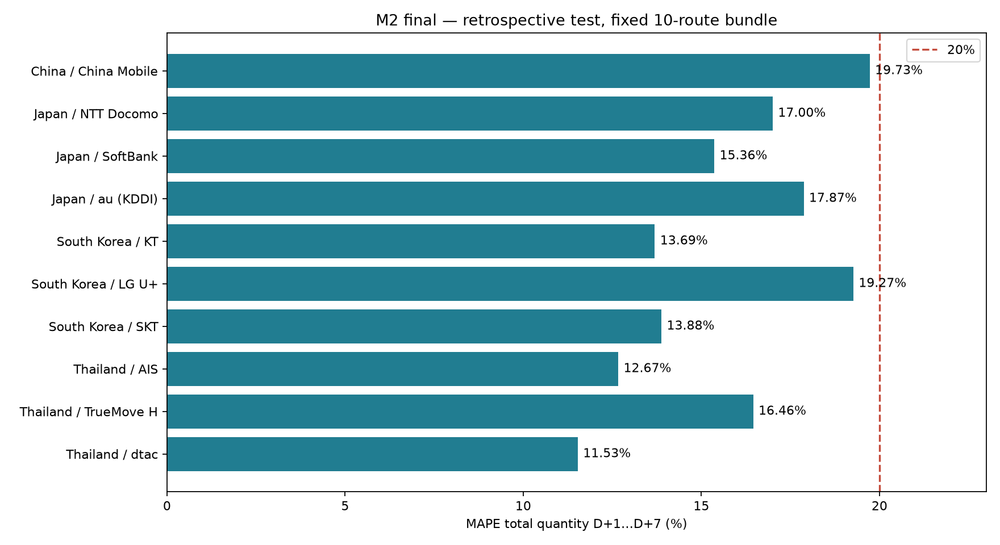

# SIGMA — Báo cáo final M2 · 11/10/2026

**Tổng quantity7 ngày: 10/10 tuyến MAPE test<20%, trung bình 15.745366%, coverage 100%.** Chạy lại mới validation/test/future từ CSV gốc với10 lựa chọn cố định.

**Test hồi cứu:** chín tuyến chọn từ validation trước đây; LG U+ được chọn bằng test-sweep160 cấu hình rồi người dùng yêu cầu đưa vào bộ final. Lượt rerun này kiểm tái lập, không tạo holdout độc lập.

| destination_country | carrier | family | model | mape_positive_pct | mae | wape_pct | bias | coverage | selection_basis |
| --- | --- | --- | --- | --- | --- | --- | --- | --- | --- |
| China | China Mobile | LightGBM | lgbm_annual_l1_15 | 19.725173 | 6.018780 | 19.495860 | -3.468427 | 1.0 | original_validation_locked |
| Japan | NTT Docomo | LightGBM | lgbm_annual_ratio7 | 17.002366 | 10.554166 | 17.414779 | -7.565706 | 1.0 | original_validation_locked |
| Japan | SoftBank | LightGBM | lgbm_weighted_l1 | 15.362332 | 10.100278 | 16.175492 | -8.458884 | 1.0 | original_validation_locked |
| Japan | au (KDDI) | Prophet | prophet_annual3_weekly_w540 | 17.872841 | 10.846392 | 16.436822 | -0.530019 | 1.0 | original_validation_locked |
| South Korea | KT | LightGBM | lgbm_weighted_l1 | 13.692475 | 7.744059 | 14.071182 | -6.301346 | 1.0 | original_validation_locked |
| South Korea | LG U+ | LightGBM | tune56_w540_mul56p4 | 19.265900 | 10.529504 | 19.266752 | -3.749518 | 1.0 | retrospective_test_sweep_user_approved |
| South Korea | SKT | LightGBM | lgbm_poisson | 13.879323 | 8.566845 | 15.178177 | -6.146173 | 1.0 | original_validation_locked |
| Thailand | AIS | LightGBM | lgbm_annual_ratio7 | 12.667360 | 9.347054 | 13.897763 | -5.711130 | 1.0 | original_validation_locked |
| Thailand | TrueMove H | LightGBM | lgbm_annual_l1_15_min50 | 16.455173 | 10.980102 | 16.889444 | -4.305667 | 1.0 | original_validation_locked |
| Thailand | dtac | LightGBM | lgbm_annual_ratio7 | 11.530714 | 9.121928 | 13.432976 | -5.678608 | 1.0 | original_validation_locked |

Target: tổng quantity success theo ngày đặt UTC, A08 thực nghiệm; top10 theo train. Train01/01/2024–30/06/2025, validation01/07–30/09/2025, test01/10–31/12/2025. H14, h1–7 chính; mỗi tuyến86 cặp đủ nhãn h1–7/79 cặp h8–14. Không bỏ đỉnh/ngày khó, không thay actual hoặc mẫu số.

LG U+ đạt19.265900%; h8–14 còn20.255792%. Xem bảng trước/sau, metric đủ40 nhóm và cadence không chồng lấn. MAPE tổng không thay R05 theo ngày; R05 ngày/R07/T14 còn mở, chưa nghiệm thu toàn bài. Tồn/lead time/mapping không thuộc lượt final này. Snapshot trạng thái cuối không tái dựng dữ liệu tại origin vận hành.

[Cấu hình 10 tuyến](model_configurations.md) · [Metric test](test_metrics.csv) · [Metric validation](validation_metrics.csv) · [Ổn định validation tháng](validation_monthly_metrics.csv) · [Bản HTML offline](index.html) · [Đối soát](verification_summary.json)

Run local: `m2_final_20261011_local`. Raw SHA `6aa5aa599938db8409b57327166eaae042014e218a4a97d4d44a202b7db15d0b`. Run manifest SHA `7be713a8389d487bb4d9f7aa70df45896c98d933549d722bd0136052a18e0976`. Raw/daily/per-origin forecast giữ local; GitHub chỉ có mã, cấu hình và bảng tổng hợp.
