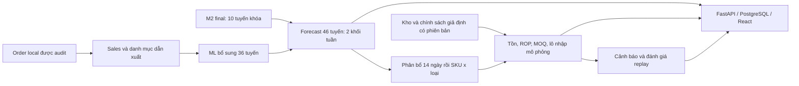

# SIGMA M3 — thiết kế tồn kho, nhập hàng và dashboard

**Cập nhật phạm vi demo03/11/2026:** Tổng30 đã gỡ khỏi giao diện/API/CLI ứng dụng theo yêu cầu người dùng; không thêm cờ bật/tắt và không chờ bundle/receipt ngoài. Tài liệu/bằng chứng M05/R05 bên dưới là nghiên cứu và lịch sử tích hợp, không còn mô tả tính năng demo hiện hành. H14/L7/R1 phục vụ vận hành giữ nguyên; không tự nghiệm thu R05/R07/T14.

**CHG-085 publish giai đoạn 7–8 — 03/11/2026:** Người dùng giao đẩy toàn bộ phần vừa hoàn tất lên GitHub: cho phép commit/push thường 20 tệp code/tests/docs của CHG-085 giai đoạn 7–8 lên final-report. Quyền này thay các điểm dừng chưa publish7–8 phía dưới; không mở công việc mới hoặc tự đóng R07/T14. Phạm vi là 18 Markdown và 2 tệp FE; giữ COMMIT_BLOCK_PLAN.md untracked/nguyên nội dung. Không stage raw/run/DB/env/dist/output hoặc thay metadata lịch sử Git. App0008/3run và các DB bản sao giữ nguyên; lượt publish không tạo run, khai báo lifecycle hoặc chạy model/worker mới. 89 React, TypeScript/Vite build và pipcheck được kiểm lại cho lượt publish; hash mã FE khớp bản đã kiểm browser. Bằng chứng 7 run cũ/12 DB-run, 4 run mới trên bản sao nguồn thật, 1 synthetic hai kho và bảo toàn 4 DB/1.412 tệp thuộc giai đoạn8; không nhận là vừa chạy lại trong lượt publish. Cổng: local → commit tên theo thay đổi → push thường → SHA remote khớp → hai workflow CI success. [Bàn giao](../docs/development.md#handoff-chg085-publish78).

**CHG-085 giai đoạn 8 — 03/11/2026, hoàn tất local:** đã đọc và verify 7 run cũ, đối chiếu API/CSV cho 12 cặp DB–run; chạy 4 run mới trên bản sao dùng nguồn/forecast có sẵn và 1 run synthetic cho hai kho. Worker, verifier độc lập, API/CSV và browser 1440/390px đạt. Ca bổ sung chặn 19 đơn vị nguồn trong mô phỏng; ca synthetic có 280 = 150 được phép bán + 130 bị chặn. Sửa nhãn quyền mua/bán trong bảng projection; 89 React và build đạt. App ở 0008 với 3 run ban đầu; 4 DB bảo vệ và 1.412 tệp giữ hash. Không refit/tuning hoặc viết lại bằng chứng CHG-084; R07/T14 giữ mở. Thay đổi giai đoạn 7–8 chưa commit/push. [Bàn giao/giới hạn](../docs/development.md#handoff-chg085-phase8). Các checkpoint bên dưới là lịch sử.

**CHG-085 giai đoạn 7 — 03/11/2026, hoàn tất tích hợp/cutover local:** backup 31.536.707 byte đã restore trên DB rehearsal riêng; nâng/hạ/nâng với lịch sử cũ không rỗng và từ chối downgrade khi có stop cùng ngày đạt. DBapp đã nâng `0008_trade_lifecycle`, giữ hash toàn bộ cột cũ của 14 bảng nghiệp vụ/3 run; 1.053 tệp và hai DB bản sao CHG-084 giữ nguyên. 478 Python BE/M2, 88 React, build/pipcheck, API/CSV 920 và browser 1440/390px đạt. API/worker cùng bản mã 99395aa và FE build mới chạy cổng 8000; thử ghi chỉ trên DBtest/bản rehearsal, worker chỉ synthetic DBtest, không tạo run nguồn thật hoặc khai báo stop/notice trên app. Giai đoạn 8 chưa được giao, R07/T14 giữ mở. [Bàn giao/cách chạy/rollback](../docs/development.md#handoff-chg085-phase7), [trạng thái thực](docs/07-product-supply-lifecycle.md#phase7-implemented). Các mốc app0007 phía dưới là lịch sử.

**CHG-085 tích hợp/publish — 02/11/2026:** Người dùng giao “Đẩy hết mấy cái vừa làm lên github đi”: cho phép commit/push thường toàn bộ code/tests/docs CHG-085 giai đoạn4–6 lên final-report. Quyền này thay điểm dừng chưa publish của các checkpoint4–6 bên dưới; không mở giai đoạn7–8. Kiểm publish hiện tại: 478Python BE/M2 chạy lại đạt; 88React của bản FE giữ nguyên hash đã đạt, build TypeScript/Vite và pipcheck chạy lại đạt. Browser1440/390px và hash DB/tệp bảo vệ đã kiểm ở6; không dùng số này làm nghiệm thu R07/T14. DBapp0007 giữ, chưa cutover7 hoặc chạy nguồn thật. [Bàn giao](../docs/development.md#handoff-chg085-publish).

**CHG-085 giai đoạn 6 — 02/11/2026, hoàn tất local FE:** modal ngừng nhập nội bộ cùng ngày, trang thông báo nhà mạng/phạm vi nhiều kho, preview và hai quyền riêng; vận hành hiển thị lượng bán/tồn bị chặn/Q/cap từ frozen. Baseline74, suite cuối88React (gồm22ca liên quan), 37ca hợp đồng BE, build/pipcheck và browser1440/390px synthetic đạt. DBapp vẫn0007; không cutover/nguồn thật/bước8 cũ. Bước4–6cònlocal, chưa commit/push; dừng trước7, R07/T14 giữ mở. [FE thực có](docs/07-product-supply-lifecycle.md#phase6-implemented), [bàn giao](../docs/development.md#handoff-chg085-phase6). Schema0007 khóa ghi mới; trên DBtest0008, UI tự gửi marker cho inventory run, không đưa profile cho source/forecast. App vẫn chưa cutover.

**CHG-085 giai đoạn 5 — 02/11/2026, hoàn tất local:** đã mở API kết quả/CSV trade_v2 từ ledger, projection và snapshot frozen; lọc hai quyền/trạng thái trước count/page/aggregate, counters riêng và metric có scope/exclusions. Baseline11/targeted62/suite478 Python BE/M2 và pip check đạt. DB ứng dụng vẫn 0007, hai bản sao/bằng chứng cũ giữ nguyên; không FE/cutover/nguồn thật. Chưa commit/push bước 4–5; dừng trước 6. R07/T14 giữ mở. [Read model thực](docs/07-product-supply-lifecycle.md#phase5-implemented), [bàn giao](../docs/development.md#handoff-chg085-phase5). Marker trade_v2 vẫn opt-in staging; app chưa nâng DB/mở provider live.

**CHG-085 giai đoạn 4 — 02/11/2026, hoàn tất local:** worker/projection và verifier độc lập đã thực thi trade_v2; 40 ca trade mới, 152 ca targeted và toàn suite 459 Python BE/M2 đạt, pip check đạt. Tồn tổng được giữ, sale bị chặn ghi riêng, Q áp cap nguyên lô/ETA/coverage và metric loại cả item-window bị chặn. DB ứng dụng/bản sao cũ chỉ đọc, không cutover hoặc chạy nguồn thật. Bước 5–8 chưa làm; chưa commit/push bước 4 trong lượt này. R07/T14 giữ mở. [Worker/verifier thực](docs/07-product-supply-lifecycle.md#phase4-implemented), [bàn giao](../docs/development.md#handoff-chg085-phase4). Marker kỹ thuật vẫn opt-in; API kết quả trade_v2 giữ 409 chờ read model bước 5.

**CHG-085 giai đoạn3 — 02/11/2026:** API quản lý/preview/version/fingerprint và snapshottrade_v2 đã có trên DBtest;419Python BE/M2/pipcheck đạt. DBapp vẫn0007, không mở provider live. Markertrade_v2 chuyển tiếp có guard worker/verifier; chưa tính bán bị chặn hoặc cap Q ở4. Người dùng giao publish code2–3tích hợp, SHAremote/CI rồi dừng trước4. [Bàn giao](../docs/development.md#handoff-chg085-phase3), [API/snapshot thực](docs/07-product-supply-lifecycle.md#phase3-implemented). Bước8 cũ vẫn tạm dừng.

**CHG-085 giai đoạn2 — 02/11/2026:** schema0008 và nghiệp vụ hai nguồn đã có mã, chỉ kiểm sigma_m3_test; app0007 và hai bản sao cũ giữ nguyên. Chưa mở providerAPI/snapshot/worker/FE; nội bộ cùng ngày hiện chỉ domain min0, caller API cũ giữnotice7 đến bước tương thích tiếp theo. [Bàn giao](../docs/development.md#handoff-chg085-phase2), [lộ trình](../docs/planning/PRODUCT_SUPPLY_LIFECYCLE_PLAN.md#steps). Chưa commit/push giai đoạn2; không nối3 hoặc tiếp tục bước8 cũ.

**CHG-085 — 02/11/2026, chỉ tài liệu:** [thiết kế vòng đời mới](docs/07-product-supply-lifecycle.md), [FE/wireframe](docs/04-frontend-spec.md#lifecycle-chg085), [8giai đoạn](../docs/planning/PRODUCT_SUPPLY_LIFECYCLE_PLAN.md#steps). Tách ngừng nhập nội bộ cùng ngày khỏi thông báo nhà mạng chặn nhập/bán nhiều kho, tồn bị chặn/actual/metric riêng; chưa triển khai. Người dùng giao kiểm rồi publish riêng MD bước1/SHAremote/CI và dừng. [Bước8 CHG-084 đã làm một phần, đang tạm dừng](../docs/planning/PRODUCT_SUPPLY_LIFECYCLE_PLAN.md#step8-run-validation); không chạy lại hoặc sửa bằng chứng, không coi nó chứng minh nghiệp vụ nhà mạng. Những mốc phía dưới giữ lịch sử; R07/T14 chưa nghiệm thu.

**CHG-084 tích hợp/cutover — 02/11/2026:** DBapp đã ở0007_supply_lifecycle sau backup/restore thử, form cung cấp được bật. 368Python/74React/build/pipcheck, API/CSV920 và browser1440/390px đạt;13bảng cũ/3run/1.052file giữ hash, history mới0. Chưa có stop live hoặc run thật mới; run cũ thiếu profile bán tồn cần tạo kế hoạch mới, không tính lại snapshot cũ. [Bàn giao](../docs/development.md#handoff-chg084-step7). Hiện7/8bước xong local, chỉ bước8 còn chờ; R07/T14 giữ mở. Các mốc chưa nâng DB dưới đây là lịch sử.

**CHG-084 mở rộng8bước — 02/11/2026:** đã thêm kế hoạch kiểm run cũ và một run mới có một mặt hàng ngừng nhập giữa kỳ vào [bước8](../docs/planning/PRODUCT_SUPPLY_LIFECYCLE_PLAN.md#step8-run-validation), [kiểm kỹ thuật](docs/07-product-supply-lifecycle.md#step8-run-validation). Bước1–6 đã hoàn tất; bước7cutover và bước8diễn tập chưa làm, không tự chạy từ yêu cầu bổ sung Markdown này. Run thử có nhãn giả định và DB bản sao riêng, không sửa run/cấu hình live cũ hoặc nâng R07/T14.

**CHG-084 bước6 — 02/11/2026:** FE quản lý cung cấp và bán tồn đã có: form/lịch sử/dừng/hủy/mở lại theo UTC, nhãn/bộ lọc, biểu đồ/CSV; giữ riêng cấu hình live và trạng thái frozen. 73React/build/browser desktop390px trên DBtest đạt. DBapp vẫn0006, form báo chưa bật; chỉ cutover sau backup/restore thử ở bước7 được giao riêng. [Bàn giao](../docs/development.md#handoff-chg084-step6). Các checkpoint trước bên dưới là lịch sử; R07/T14 giữ mở.

**CHG-084 bước5 — 02/11/2026:** có GET runs/{key}/sell-through và exports/sell_through cùng metadata cung cấp trên tồn/nhập/cảnh báo/tổng quan; đọc từ snapshot/projection lưu. Không tự tính lại run cũ, thiếu profile/dữ liệu trả409 tạo kế hoạch mới. Chỉ kiểm DBtest; DBapp chưa nâng, UI bước6 chưa làm. [Bàn giao](../docs/development.md#handoff-chg084-step5).

**CHG-084 bước4 — 02/11/2026:** worker/simulation đã hỗ trợ supply event frozen và bán tồn, guard bước3 được gỡ; verifier kiểm độc lập. Chỉ kiểm DBtest; DBapp vẫn chưa nâng/mở chức năng cung cấp. Read model/CSV/FE chưa tích hợp ở bước4, không coi các nhãn hiện tại của web là luồng bán tồn đã hoàn tất. [Bàn giao](../docs/development.md#handoff-chg084-step4).

**CHG-084 bước3 — 02/11/2026:** API lịch sử cung cấp và freeze snapshot đã có, được kiểm trên DBtest; chưa nâng DBapp hoặc có FE mới. Run có sự kiện cung cấp bị worker chặn bằng stage_not_implemented tới bước4; không dùng nó như kế hoạch đã tính ngừng nhập. Schema0006 vẫn đọc sản phẩm cũ không ngày; tính năng mới yêu cầu schema0007 và trả503 khi chưa nâng. [Bàn giao](../docs/development.md#handoff-chg084-step3).

**CHG-084 bước2 — 02/11/2026:** đã thêm DB/model và resolver thuần, chỉ kiểm/migrate DBtest. Chưa có API/snapshot/worker/FE cho ngừng nhập, chưa nâng DBứng dụng; không chạy lệnh upgrade head trên DBapp ở giai đoạn này. [Bàn giao](../docs/development.md#handoff-chg084-step2), [lộ trình](../docs/planning/PRODUCT_SUPPLY_LIFECYCLE_PLAN.md#steps).

**CHG-084 — 02/11/2026, bước1 chỉ Markdown:** [lộ trình ngừng nhập/bán tồn](../docs/planning/PRODUCT_SUPPLY_LIFECYCLE_PLAN.md) và [đặc tả07 DB/API/FE/worker](docs/07-product-supply-lifecycle.md) là thiết kế được duyệt, chưa triển khai bảng/migration/profile/API/UI mới. Kiểm/push MD riêng bước1 rồi dừng chờ duyệt bước2; giữ schema0006_fixed_days và trạng thái R07/T14. [Bàn giao](../docs/development.md#handoff-chg084). Các checkpoint ứng dụng bên dưới là lịch sử, không là bằng chứng tính năng CHG-084 đã chạy.

**Tính policy bước11 CHG-068 — 25/10/2026:** inventory/service có2mode SS và2mode ROP, simulation chọn lịch sử causal theo decision origin, independent verifier tự đối soát từng dòng. Mode đã lưu từ bước10 nay chạy được, không guard tạm; API/schema13bảng/FE/default legacy giữ, cấu trúc web của CHG-072 giữ. [Công thức và ví dụ](docs/01-functional-spec.md#configurable-calculation-step11), [kiểm và bàn giao](../docs/development.md#handoff-chg068-step11). Bước12–15 chưa bắt đầu; các trạng thái trước bước11 bên dưới là checkpoint lịch sử.

**Hiện hành CHG-072 — 25/10/2026:** frontend ở web/frontend, configs/research code/env ở web/backend; M3 chỉ giữ Markdown và protocol nghiên cứu. Backend serve/build/launcher/CI đã đổi đường; tên env/DB, FE/nghiệp vụ/API/13bảng/snapshot giữ nguyên. [Cây thực](docs/05-source-architecture.md#web-layout-chg072), [bàn giao](../docs/development.md#handoff-chg072). Bước11–15 chưa bắt đầu; các mốc đường M3/frontend/configs/research/env dưới đây là lịch sử trước chuyển vị trí, các lệnh chạy đã cập nhật.

**Backend bước10 CHG-068 — 25/10/2026:** lưu5tham số policy/override, migration0002_policy với default tương thích; snapshot/run cũ nguyên, bản đọc chỉ thêm default trong bộ nhớ.144Python BE/M2 và migration DB test/app local đã kiểm; FE giữ bước9. [Schema/cách migrate](docs/02-data-model.md#policy-persistence-step10), [bàn giao/giới hạn](../docs/development.md#handoff-chg068-step10). Công thức fixed/volatility thuộc bước11; trước đó worker chặn mode này bằng stage_not_implemented.

**Frontend sau bước9 CHG-068 — 25/10/2026:** FE vẫn M3/frontend; App ghép6pages với AppLayout/Sidebar/Header/ContextFilters, state/effect ở useAppContext. useConfiguration giữ ghi cấu hình; form policy/scenario và3drawer tách component. index.css giữ byte của styles.css, import tại main. Không dependency/nghiệp vụ mới. [Cây thực](docs/04-frontend-spec.md#step9-actual), [kiểm và bàn giao](../docs/development.md#handoff-chg068-step9). Backend/dữ liệu không đổi; bước10–15 chưa bắt đầu.

**Hiện hành CHG-068 bước7 — 25/10/2026:** đã tách inventory/purchasing/alerts, hoàn tất8module backend và bỏ source api/services cũ. models.py chỉ đăng ký13model; entry point/launcher/API/DDL/phép tính giữ nguyên. [Cây source](docs/05-source-architecture.md#step7-actual), [kiểm và bàn giao](../docs/development.md#handoff-chg068-step7). Bước8–15 chưa bắt đầu; các trạng thái bên dưới là checkpoint lịch sử.

**Hiện hành CHG-068 bước6 — 25/10/2026:** đã tách forecasting/runs/reporting tại web/backend/src/modules; worker/CLI/launcher dùng cùng dịch vụ và giữ giao diện chạy. API/13bảng/phép tính giữ nguyên. [Cây source](docs/05-source-architecture.md#step6-actual), [kiểm và bàn giao](../docs/development.md#handoff-chg068-step6). Bước7–15 chưa bắt đầu; các trạng thái bên dưới là checkpoint lịch sử.

**CHG-071 — backend/worker:** source trực tiếp trong web/backend/src, launcher tại web/backend/scripts, import core/api/modules/services và các module main/worker/cli. Không còn wrapper sigma_m3; M2 src và M3 frontend/configs/research giữ nguyên. Dùng [README root](../README.md) và [cây hiện hành](docs/05-source-architecture.md#flat-backend-chg071); các cấu trúc trước đó dưới đây là checkpoint lịch sử.

**CHG-070 — vị trí code:** backend đã chuyển sang `../web/backend/` tính từ M3, gồm sigma_m3 API/CLI/worker, migration và tests. FE/configs/scripts/research vẫn ở M3; dùng [README root](../README.md) để cài và chạy. [Cây thực và đích](docs/05-source-architecture.md#web-layout-chg070). Các mốc E89–E103 bên dưới là bằng chứng lịch sử, không phải kiểm mới trong lượt chuyển thư mục.

**FE dự kiến CHG-069:** cập nhật theo ảnh tham khảo người dùng, dùng pages/layouts/components và config/hooks/services/types/utils, bỏ tầng feature/shared và thư mục chưa cần. [Cây đích, ánh xạ và kiểm hành vi](docs/04-frontend-spec.md#frontend-target-chg069). Đây là đặc tả bước8–9; code FE chưa đổi và bước6–15 chưa bắt đầu.

**CHG-068 bước5 — 24/10/2026:** người dùng yêu cầu làm riêng bước5 sau checkpoint `992b8f5`. Đã tách core/catalog/configuration và rút main391→45dòng; giữ26route/OpenAPI đầy đủ, DDL13bảng và giao dịch/version/snapshot. Local107Python/26React/build/pipcheck/CLI/import/Alembic/smoke đạt,845protectedhash nguyên. Commit mã `db6c1d5` đã push, SHAremote khớp và cả2workflowCI completed/success. Bước5 hoàn tất; bước6–15 chưa bắt đầu. [Cấu trúc hiện hành](docs/05-source-architecture.md#step5-actual). Các đoạn điểm dừng bước4 và E99 bên dưới là lịch sử; CLI/factory/start scripts vẫn cùng giao diện.

**CHG-068 bước4 — điểm dừng theo người dùng:** toàn bộ runtime/build/dependency Streamlit M3/M2 đã gỡ; dùng React/HTTP/FastAPI/PostgreSQL local theo [README hiện hành](../README.md). BE/FE chưa refactor theo module/feature, mode SS/ROP/cảnh báo ngưỡng mới chưa làm; tiếp tục từ bước5 khi được yêu cầu. Các mốc Streamlit E94–E99 bên dưới là lịch sử.

**CHG-068 — 24/10/2026, kế hoạch đã được người dùng duyệt:** nhánh `m3-implementation` từ `codex/m3-implementation` tại `b1357cd`; cập nhật tài liệu trước, bỏ toàn bộ Streamlit, tổ chức BE theo module/FE theo pages, layouts và component dùng chung (CHG-069), sau đó thêm policy/cảnh báo cấu hình. Mỗi bước kiểm local → commit → push → SHA remote khớp → CI đạt trước bước sau. Code chưa thay đổi ở bước 1; các mốc E99 trở về trước bên dưới là bằng chứng lịch sử, không phải kiểm lại trong lượt này. Giữ M05 tổng30, H14/L7/R1, snapshot và dữ liệu local; R07/T14 chưa nghiệm thu.

Cấu trúc đích và15bước nằm trong PLAN; chưa triển khai chỉ vì đã viết MD. Phản hồi ba câu hỏi cho phép chọn cách tính SS/ROP và cảnh báo theo ngưỡng; 34,39% là số lịch sử, không là mức đạt mới. Phạm vi là local, không xóa hay chuyển hosting ứng dụng public đang tồn tại.

[Kế hoạch CHG-068 và cổng từng bước](../docs/planning/PLAN.md#chg-068).

**CHG-067/E99 — 21/10/2026, hoàn thiện bản nộp:** bổ sung phục hồi khi tải lỗi/mất kết nối, giới hạn chờ RPC, màn hình lỗi có lối thử lại, làm mới trong phiên, hướng dẫn nghiệp vụ, điều hướng Back/Escape và hỗ trợ bàn phím. Tạo phương án online chỉ chọn93ngày có đủ closing920item và forecast H14 (30/09–31/12/2025).120Python+31React đạt; dữ liệu/metric/run khóa giữ nguyên. [Hướng dẫn nộp và kiểm sản phẩm](SUBMISSION.md). Đã push deploy `10dd4e19af9fa26d1aeb05124a05bbd5fdcf78ce`; kiểm browser/CI mới ghi riêng E99. Không nâng nghiệm thu R07/T14 hoặc bổ sung auth/PO/DB bền vững.


**CHG-066/E98 — React công khai trên Streamlit:** đã cập nhật [SIGMA](https://sigma-demand-inventory.streamlit.app/) sang giao diện quản lý React sáu màn hình; Python xử lý qua component hai chiều. Repo triển khai riêng tư `Sigma-M3-App/main`, commit `77b0b3d9406ba2131f678466b86f6615af6636e4`, release `m3-react-public-20261020-v2`.117Python và23React đạt; build local/Streamlit, đối soát aggregate/privacy và tạo phương án trong phiên đã kiểm. [Phạm vi và cách chạy](../docs/review-log.md#removed-docs-chg070). Cấu hình/phương án mới riêng phiên; import/fit/replay giao dịch/DB dùng chung vẫn local. R05/M05/R07/T14 không đổi. Các mốc E94–E97 bên dưới giữ lịch sử.


**E97 — giao diện và quy trình điều hành kho:** [Bàn làm việc nhập hàng](IMPLEMENTATION.md#purchasing-e97) có ba danh sách theo ngày, tìm kiếm/sắp xếp, chi tiết lô, CSV và liên kết đúng SKU giữa tồn/nhập/cảnh báo.111Python+19React/build đạt; đã kiểm API/browser thật. Giữ phạm vi mô phỏng M3, không nhận là đã triển khai ERP hoặc cập nhật Streamlit.


**E95 — React quản lý M3:** đã làm lại giao diện sáu màn hình, thao tác quản lý tồn/nhập/cảnh báo và tạo phương án qua API thật; các bảng đánh giá chuyển vào phần mở rộng. [Hướng dẫn cho nhóm, kiểm thử và giới hạn](IMPLEMENTATION.md#react-management-e95).109Python+17React/build đạt. Đây là bản React/FastAPI/PostgreSQL local; bản Streamlit E94 bên dưới tiếp tục độc lập.


**E94 — đã triển khai Streamlit công khai theo yêu cầu mới:** [Mở SIGMA](https://sigma-demand-inventory.streamlit.app/) · [phạm vi online và source](../docs/review-log.md#removed-docs-chg070). Cùng kết quả M3 mới L7/R1/H14 và tổng30; 11 bảng tổng hợp+1mảng forecast, khoảng6,6MB, không raw/ID đơn/khách/DB/env. What-if dùng cùng hàm policy/project và chỉ giữ trong phiên; các tác vụ worker/huấn luyện/DB vẫn local. Các mô tả “chưa deploy” bên dưới là mốc lịch sử trước E94.

**E93/M05 — 20/10/2026, áp dụng hiện tại:** R05 chấm tổng 30 ngày thay từng ngày theo mentor được người dùng thuật lại. [Kết quả và tích hợp tổng 30](MONTHLY.md): 10/10≤20%, mean11,621356%, coverage100%, 63 cửa sổ/tuyến, test hồi cứu. API/React có tab riêng và CSV; luồng tồn H14 giữ nguyên. Các mô tả R05 ngày/E92 bên dưới là lịch sử trước M05.

**E92 — 20/10/2026:** [Bảng đối chiếu tiêu chí](ACCEPTANCE.md) ghi rõ các cổng đã kiểm và chưa nghiệm thu. Nghiên cứu panel validation giảm còn45,971604%, vẫn0/10≤20%; app/serving giữ nguyên.89Python đạt;9FE/CI E91 đã xác nhận. [Protocol nghiên cứu](docs/research.md).

**E91 bổ sung:** có chẩn đoán cơ hội báo sớm trong Cảnh báo và [nghiên cứu dự báo ngày validation](docs/research.md).86Python+9FE/build đạt; không thay model chính hoặc đóng R05/R07/T14. [Kết quả/giới hạn](IMPLEMENTATION.md).

**Ngày:** 19/10/2026 (Asia/Saigon). **Trạng thái hiện hành E90:** đã triển khai ứng dụng local46tuyến: forecast, allocation, replay tồn/cảnh báo, API và React. [Cách chạy/bằng chứng/giới hạn](IMPLEMENTATION.md). R05/R07/T14 còn mở; không gọi toàn bộ chỉ tiêu đã đạt. Phần thiết kế bên dưới giữ nguyên phạm vi đích. **Mốc mục tiêu:** 07/11/2026. **Truy vết:** CHG-048/E76; R04–R09; T08–T14.

## 1. Kết quả cần xây

M3 chuyển dự báo bán thành safety stock, điểm đặt hàng lại và lượng cần nhập; cảnh báo nguy cơ cạn, theo dõi dự báo cùng sai số khi có actual. Ứng dụng local dùng FastAPI, React/TypeScript và PostgreSQL. Một worker Python thực hiện công việc dài; API và CLI gọi cùng nghiệp vụ.

Phạm vi gồm **46 tuyến → 46 kho mô phỏng**, danh mục hiện tại **920 mặt hàng** theo tuyến × `sku` × `product_type`. Theo CHG-079, nhà cung cấp chính là carrier của mặt hàng, dùng chung qua các tuyến có cùng carrier. ROP tối thiểu, MOQ và safety days cấu hình riêng theo supplier × mặt hàng; **nhập kho sau 7 ngày lịch UTC**. Các con số ngưỡng minh họa không phải điều kiện hợp đồng thật.



## 2. Đọc theo thứ tự

| Tài liệu | Mục đích |
|---|---|
| [01 — Chức năng và nghiệp vụ](docs/01-functional-spec.md) | Quy tắc chuẩn cho tính toán, forecast và cảnh báo. |
| [02 — Dữ liệu](docs/02-data-model.md) | ERD, đúng 13 bảng, khóa và từ điển cột. |
| [03 — BE/API](docs/03-backend-api.md) | HTTP, worker, lỗi và giao dịch. |
| [04 — FE](docs/04-frontend-spec.md) | Sáu màn hình, thao tác và trạng thái. |
| [05 — Mã nguồn](docs/05-source-architecture.md) | Cây mã dự kiến, adapter M2 và vận hành local. |
| [06 — Kiểm thử và bàn giao](docs/06-testing-delivery.md) | Ca tính tay, nghiệm thu và lịch triển khai. |

Nguồn nền: [requirements](../docs/requirements.md), [PLAN](../docs/planning/PLAN.md), [TASK](../docs/planning/TASK.md), [data-contract](../docs/data-contract.md), [review-log](../docs/review-log.md), [mẫu bàn giao](../docs/development.md#handoff).

## 3. Hiện trạng và mức bằng chứng

| Loại | Đã xác định | Giới hạn |
|---|---|---|
| Kiểm trực tiếp local | HEAD nền `261c631`; code M2 final và 6 spec ML có thật; daily aggregate 33.626 dòng/46 tuyến; catalog nguồn có 920 khóa item; forecast final tương lai 20 dòng/10 tuyến. | Kiểm đếm/schema, không phải lần fit hoặc đánh giá M3 mới. |
| M2 được bảo toàn | 10 lựa chọn final: 5 spec LightGBM gốc, một biến thể LG U+ riêng và một Prophet. | Test đã dùng hồi cứu; LG U+ test-selected. Kết quả tuần không thay R05 ngày. |
| Mentor do người dùng thuật lại ngày 19/10 | Điều kiện nhập linh hoạt từng supplier × SKU × loại; lead time nhập kho7; một kho giả định mỗi tuyến. | Không nhận đã đọc hợp đồng hay xác minh kho ngoài thực tế. |
| Ảnh M3 đính kèm đã xem | Đến07/11: chính sách tồn, cảnh báo trước ≥7 ngày, dashboard dự báo/sai số. | Không suy thêm ngưỡng precision/recall hoặc bảo đảm mọi sự kiện đều báo sớm. |
| Lựa chọn người dùng trong phiên | BE/FE riêng, PostgreSQL trong lựa chọn MySQL/PGSQL, 46 tuyến, mở rộng ML, ROP lấy mức cao hơn, một supplier/item. | Quyết định thiết kế, chưa là kết quả triển khai. |

Order là nguồn duy nhất được cung cấp, xử lý như snapshot hồi cứu. Giữ lịch sử U07 mô tả nguồn giả định; không suy ra lịch sử trạng thái tại origin thật. M01–M03 cũ vẫn giữ nhãn thuật lại; A08–A17 không được đồng loạt nâng xác nhận. M3 áp dụng lựa chọn mới vào profile có phiên bản, ghi rõ phần thay A11/A12/A13; kết quả tồn cũ cần kiểm lại khi dùng cho M3 mới.

## 4. Ranh giới và đường triển khai

Không thiết kế customer, payment, invoice, giao khách, tài khoản/phân quyền nhiều người, chuyển kho, tối ưu vị trí, giá mua hoặc kết nối đặt hàng thật. Hành động nhập chỉ là mô phỏng. Cùng thành phố không gộp các kho của hai tuyến. Japan / NTT Docomo → Tokyo là giả định minh họa, chưa có bằng chứng tối ưu vị trí.

Thứ tự: T08–T09 bổ sung forecast36 → T10 catalog/chính sách/tồn → T11 API/FE → T12 kiểm tích hợp → T13–T14 demo/nghiệm thu. Lịch tại [06](docs/06-testing-delivery.md#8-lịch-triển-khai-dự-kiến). Viết xong tài liệu chỉ hoàn tất đặc tả CHG-048, không đóng R05/R07/T14.

Bộ `M3-design-plan` ban đầu chỉ có Markdown. Implementation E89 ở nhánh `codex/m3-implementation` mới có các phần ghi rõ dưới đây; các endpoint/CLI/source còn lại trong đặc tả chưa tự trở thành đã chạy. Không kèm raw, artifact riêng tư, DB hoặc ảnh clipboard vào Git.


<a id="implementation-e89"></a>
## 5. Lịch sử mốc nền implementation E89 — đã kiểm thực chạy

**Mục5 chỉ mô tả checkpoint879365e tại E89. Hướng dẫn và trạng thái hiện hành dùng [IMPLEMENTATION](IMPLEMENTATION.md); các câu “chưa triển khai” bên dưới đã được thay trong phạm vi E90.**

Checkout riêng giữ nguyên nhánh tổng30 đang chạy: `outputs/workspaces/m3-implementation` bên trong workspace gốc. Nền nhánh là `20a3c45` (`M3-design-plan`), không hợp nhất implementation tổng30/Streamlit cũ vào profile mới. Chưa push/deploy implementation mới.

| Thành phần | Đã có | Chưa có / giới hạn |
|---|---|---|
| Môi trường | Python3.12.14 riêng,83pin M2 nguyên và15dependency backend bổ sung được khóa; pipcheck đạt. | Chưa cài/khóa FE. |
| Database | PostgreSQL18.6 local127.0.0.1:55432, role app không superuser; Alembic0001_m3 đúng13bảng nghiệp vụ + bảng version. | Không là database doanh nghiệp hoặc service toàn máy. |
| API | Health; danh sách kho/item/supplier/policy; tạo policy có khóa/version; enqueue/status/summary run. | Chưa đủ endpoints kết quả/export/snapshot catalog và chưa React. |
| Worker/CLI | PostgreSQL single-worker lock, claimqueue, restart→failed/interrupted; source_import và seed-simulation chạy thật. | Chỉ source_import được worker thực thi; kind khác báo failed/stage_not_implemented, không giả complete. Heartbeat hiện ở mốc đầu/cuối, chưa chu kỳ30s cho job dài. |
| Nghiệp vụ | Hàm L7/R1/H14,strictROP/MOQ/pending/fulfillment, nhận receipt một lần, projection và metric replay, phân bổ causal; kiểm ca tính tay và DB concurrency. | Chưa tạo ledger/policy_replay/alert_replay thực đầy đủ hoặc fit ML36. |
| Nguồn thật local | Import100.000dòng →118.296quantity/46kho/920item/672.520dailyrows; seed920policy và5scenario từ lịch sử tới30/09/2025. | Tồn/nhập/supplier/policy là giả định; không là xác nhận hợp đồng. Idempotency hiện bảo đảm cùng requestkey; dedup sourcehash giữa các key khác chưa có. |

Lượt nguồn `96e77f53-fa7c-46be-987f-50e308920dba` complete; độc lập tính lại quantity/catalog/920policy, hash raw và manifest đạt. Cùng requestkey không tạo thêm run/daily; seed lần2 tái dùng920policy, không ghi đè. Bằng chứng private: `outputs/m3-foundation-verification.json`, `outputs/m3-foundation-tests.xml` (35đạt), `outputs/m2-regression-tests.xml` (32đạt). Lượt này không refit M2, không đánh giá mô hình mới. Warning Starlette về httpx TestClient đã ghi nhận; kiểm vẫn đạt, không đổi pin M2 để tắt warning.

### Cài và chạy phần đã có

Cần Python3.12 và PostgreSQL18 local; tạo database app và database riêng `sigma_m3_test`, role không superuser. Tạo `.venv-m3` bằng Python3.12 đã cài, rồi từ root checkout:

```powershell
.\.venv-m3\Scripts\python.exe -m pip install -r web/backend/requirements.txt
.\.venv-m3\Scripts\python.exe -m pip install --no-deps -e web/backend
# Copy web/backend/configs/.env.example thành web/backend/.env, điền kết nối local và source root.
. ./web/backend/scripts/load_env.ps1
.\.venv-m3\Scripts\python.exe -m alembic -c web/backend/alembic.ini upgrade head
.\.venv-m3\Scripts\python.exe -m pip check
.\.venv-m3\Scripts\python.exe -B -m pytest web/backend/tests
. ./web/backend/scripts/start_api.ps1
```

API hiện chạy tại `http://127.0.0.1:8000/api/v1/health`; OpenAPI tại `http://127.0.0.1:8000/docs`. Đây là tài liệu API/backend nền, chưa là giao diện sản phẩm6màn hình. PostgreSQL bootstrap portable trên máy này nằm trong outputs ignored, không cần cài service; credentials chỉ có trong M3/.env ignored, không gửi qua HTTP/Git.

CLI thật đã kiểm:

```powershell
. ./web/backend/scripts/load_env.ps1
.\.venv-m3\Scripts\python.exe -m cli import-orders --as-of-date 2025-12-31 --request-key SOURCE_KEY_MOI --wait
.\.venv-m3\Scripts\python.exe -m cli status --run-id <UUID_VUA_TAO>
.\.venv-m3\Scripts\python.exe -m cli seed-simulation --source-run <UUID_NGUON_COMPLETE> --as-of-date 2025-09-30
```

Không chạy `forecast/simulate/verify` trong cây CLI đích ở05 vì chưa implement. Tiếp theo theo PLAN: T08–T09 adapter/parityfinal10 +validation/lock/test36 +allocation46; T10 tích hợp ledger/replay; T11APIkết quả/FE; T12E2E/fullrun. Mốc nền không đóng R05/R07/T14.
