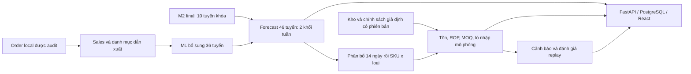

# SIGMA M3 — thiết kế tồn kho, nhập hàng và dashboard

**Ngày:** 19/10/2026 (Asia/Saigon). **Trạng thái:** đặc tả để triển khai; chưa có BE, FE, database hoặc run M3 mới. **Mốc mục tiêu:** 07/11/2026. **Truy vết:** CHG-048/E76; R04–R09; T08–T14.

## 1. Kết quả cần xây

M3 chuyển dự báo bán thành safety stock, điểm đặt hàng lại và lượng cần nhập; cảnh báo nguy cơ cạn, theo dõi dự báo cùng sai số khi có actual. Ứng dụng local dùng FastAPI, React/TypeScript và PostgreSQL. Một worker Python thực hiện công việc dài; API và CLI gọi cùng nghiệp vụ.

Phạm vi gồm **46 tuyến → 46 kho mô phỏng**, danh mục hiện tại **920 mặt hàng** theo tuyến × `sku` × `product_type`. Mỗi mặt hàng có một nhà cung cấp tại một thời điểm. ROP tối thiểu, MOQ và safety days cấu hình riêng theo supplier × mặt hàng; **nhập kho sau 7 ngày lịch UTC**. Các con số ngưỡng minh họa không phải điều kiện hợp đồng thật.

## 2. Đọc theo thứ tự

| Tài liệu | Mục đích |
|---|---|
| [01 — Chức năng và nghiệp vụ](docs/01-functional-spec.md) | Quy tắc chuẩn cho tính toán, forecast và cảnh báo. |
| [02 — Dữ liệu](docs/02-data-model.md) | ERD, đúng 13 bảng, khóa và từ điển cột. |
| [03 — BE/API](docs/03-backend-api.md) | HTTP, worker, lỗi và giao dịch. |
| [04 — FE](docs/04-frontend-spec.md) | Sáu màn hình, thao tác và trạng thái. |
| [05 — Mã nguồn](docs/05-source-architecture.md) | Cây mã dự kiến, adapter M2 và vận hành local. |
| [06 — Kiểm thử và bàn giao](docs/06-testing-delivery.md) | Ca tính tay, nghiệm thu và lịch triển khai. |

Nguồn nền: [requirements](../docs/requirements.md), [PLAN](../docs/planning/PLAN.md), [TASK](../docs/planning/TASK.md), [data-contract](../docs/data-contract.md), [review-log](../docs/review-log.md), [mẫu bàn giao](../docs/development.md#handoff).

## 3. Hiện trạng và mức bằng chứng

| Loại | Đã xác định | Giới hạn |
|---|---|---|
| Kiểm trực tiếp local | HEAD nền `261c631`; code M2 final và 6 spec ML có thật; daily aggregate 33.626 dòng/46 tuyến; catalog nguồn có 920 khóa item; forecast final tương lai 20 dòng/10 tuyến. | Kiểm đếm/schema, không phải lần fit hoặc đánh giá M3 mới. |
| M2 được bảo toàn | 10 lựa chọn final: 5 spec LightGBM gốc, một biến thể LG U+ riêng và một Prophet. | Test đã dùng hồi cứu; LG U+ test-selected. Kết quả tuần không thay R05 ngày. |
| Mentor do người dùng thuật lại ngày 19/10 | Điều kiện nhập linh hoạt từng supplier × SKU × loại; lead time nhập kho7; một kho giả định mỗi tuyến. | Không nhận đã đọc hợp đồng hay xác minh kho ngoài thực tế. |
| Ảnh M3 đính kèm đã xem | Đến07/11: chính sách tồn, cảnh báo trước ≥7 ngày, dashboard dự báo/sai số. | Không suy thêm ngưỡng precision/recall hoặc bảo đảm mọi sự kiện đều báo sớm. |
| Lựa chọn người dùng trong phiên | BE/FE riêng, PostgreSQL trong lựa chọn MySQL/PGSQL, 46 tuyến, mở rộng ML, ROP lấy mức cao hơn, một supplier/item. | Quyết định thiết kế, chưa là kết quả triển khai. |

Order là nguồn duy nhất được cung cấp, xử lý như snapshot hồi cứu. Giữ lịch sử U07 mô tả nguồn giả định; không suy ra lịch sử trạng thái tại origin thật. M01–M03 cũ vẫn giữ nhãn thuật lại; A08–A17 không được đồng loạt nâng xác nhận. M3 áp dụng lựa chọn mới vào profile có phiên bản, ghi rõ phần thay A11/A12/A13; kết quả tồn cũ cần kiểm lại khi dùng cho M3 mới.

## 4. Ranh giới và đường triển khai

Không thiết kế customer, payment, invoice, giao khách, tài khoản/phân quyền nhiều người, chuyển kho, tối ưu vị trí, giá mua hoặc kết nối đặt hàng thật. Hành động nhập chỉ là mô phỏng. Cùng thành phố không gộp các kho của hai tuyến. Japan / NTT Docomo → Tokyo là giả định minh họa, chưa có bằng chứng tối ưu vị trí.

Thứ tự: T08–T09 bổ sung forecast36 → T10 catalog/chính sách/tồn → T11 API/FE → T12 kiểm tích hợp → T13–T14 demo/nghiệm thu. Lịch tại [06](docs/06-testing-delivery.md#8-lịch-triển-khai-dự-kiến). Viết xong tài liệu chỉ hoàn tất đặc tả CHG-048, không đóng R05/R07/T14.

Các cây source, endpoint, CLI, bảng và test trong bộ này đều **dự kiến phải xây**. Không chạy lệnh M3 trước khi có implementation. Lượt tài liệu chỉ commit Markdown trên `M3-design-plan`, không kèm raw, artifact riêng tư, DB hoặc ảnh clipboard.
