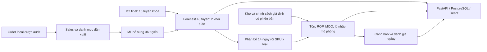

# SIGMA M3 — thiết kế tồn kho, nhập hàng và dashboard

**FE dự kiến CHG-069:** cập nhật theo ảnh tham khảo người dùng, dùng pages/layouts/components và config/hooks/services/types/utils, bỏ tầng feature/shared và thư mục chưa cần. [Cây đích, ánh xạ và kiểm hành vi](docs/04-frontend-spec.md#frontend-target-chg069). Đây là đặc tả bước8–9; code FE chưa đổi và bước6–15 chưa bắt đầu.

**CHG-068 bước5 — 24/10/2026:** người dùng yêu cầu làm riêng bước5 sau checkpoint `992b8f5`. Đã tách core/catalog/configuration và rút main391→45dòng; giữ26route/OpenAPI đầy đủ, DDL13bảng và giao dịch/version/snapshot. Local107Python/26React/build/pipcheck/CLI/import/Alembic/smoke đạt,845protectedhash nguyên. Commit mã `db6c1d5` đã push, SHAremote khớp và cả2workflowCI completed/success. Bước5 hoàn tất; bước6–15 chưa bắt đầu. [Cấu trúc hiện hành](docs/05-source-architecture.md#step5-actual). Các đoạn điểm dừng bước4 và E99 bên dưới là lịch sử; CLI/factory/start scripts vẫn cùng giao diện.

**CHG-068 bước4 — điểm dừng theo người dùng:** toàn bộ runtime/build/dependency Streamlit M3/M2 đã gỡ; dùng React/HTTP/FastAPI/PostgreSQL local theo [README hiện hành](../README.md). BE/FE chưa refactor theo module/feature, mode SS/ROP/cảnh báo ngưỡng mới chưa làm; tiếp tục từ bước5 khi được yêu cầu. Các mốc Streamlit E94–E99 bên dưới là lịch sử.

**CHG-068 — 24/10/2026, kế hoạch đã được người dùng duyệt:** nhánh `m3-implementation` từ `codex/m3-implementation` tại `b1357cd`; cập nhật tài liệu trước, bỏ toàn bộ Streamlit, tổ chức BE theo module/FE theo pages, layouts và component dùng chung (CHG-069), sau đó thêm policy/cảnh báo cấu hình. Mỗi bước kiểm local → commit → push → SHA remote khớp → CI đạt trước bước sau. Code chưa thay đổi ở bước 1; các mốc E99 trở về trước bên dưới là bằng chứng lịch sử, không phải kiểm lại trong lượt này. Giữ M05 tổng30, H14/L7/R1, snapshot và dữ liệu local; R07/T14 chưa nghiệm thu.

Cấu trúc đích và15bước nằm trong PLAN; chưa triển khai chỉ vì đã viết MD. Phản hồi ba câu hỏi cho phép chọn cách tính SS/ROP và cảnh báo theo ngưỡng; 34,39% là số lịch sử, không là mức đạt mới. Phạm vi là local, không xóa hay chuyển hosting ứng dụng public đang tồn tại.

[Kế hoạch CHG-068 và cổng từng bước](../docs/planning/PLAN.md#chg-068).

**CHG-067/E99 — 21/10/2026, hoàn thiện bản nộp:** bổ sung phục hồi khi tải lỗi/mất kết nối, giới hạn chờ RPC, màn hình lỗi có lối thử lại, làm mới trong phiên, hướng dẫn nghiệp vụ, điều hướng Back/Escape và hỗ trợ bàn phím. Tạo phương án online chỉ chọn93ngày có đủ closing920item và forecast H14 (30/09–31/12/2025).120Python+31React đạt; dữ liệu/metric/run khóa giữ nguyên. [Hướng dẫn nộp và kiểm sản phẩm](SUBMISSION.md). Đã push deploy `10dd4e19af9fa26d1aeb05124a05bbd5fdcf78ce`; kiểm browser/CI mới ghi riêng E99. Không nâng nghiệm thu R07/T14 hoặc bổ sung auth/PO/DB bền vững.


**CHG-066/E98 — React công khai trên Streamlit:** đã cập nhật [SIGMA](https://sigma-demand-inventory.streamlit.app/) sang giao diện quản lý React sáu màn hình; Python xử lý qua component hai chiều. Repo triển khai riêng tư `Sigma-M3-App/main`, commit `77b0b3d9406ba2131f678466b86f6615af6636e4`, release `m3-react-public-20261020-v2`.117Python và23React đạt; build local/Streamlit, đối soát aggregate/privacy và tạo phương án trong phiên đã kiểm. [Phạm vi và cách chạy](../docs/history/m3-streamlit.md). Cấu hình/phương án mới riêng phiên; import/fit/replay giao dịch/DB dùng chung vẫn local. R05/M05/R07/T14 không đổi. Các mốc E94–E97 bên dưới giữ lịch sử.


**E97 — giao diện và quy trình điều hành kho:** [Bàn làm việc nhập hàng](IMPLEMENTATION.md#purchasing-e97) có ba danh sách theo ngày, tìm kiếm/sắp xếp, chi tiết lô, CSV và liên kết đúng SKU giữa tồn/nhập/cảnh báo.111Python+19React/build đạt; đã kiểm API/browser thật. Giữ phạm vi mô phỏng M3, không nhận là đã triển khai ERP hoặc cập nhật Streamlit.


**E95 — React quản lý M3:** đã làm lại giao diện sáu màn hình, thao tác quản lý tồn/nhập/cảnh báo và tạo phương án qua API thật; các bảng đánh giá chuyển vào phần mở rộng. [Hướng dẫn cho nhóm, kiểm thử và giới hạn](IMPLEMENTATION.md#react-management-e95).109Python+17React/build đạt. Đây là bản React/FastAPI/PostgreSQL local; bản Streamlit E94 bên dưới tiếp tục độc lập.


**E94 — đã triển khai Streamlit công khai theo yêu cầu mới:** [Mở SIGMA](https://sigma-demand-inventory.streamlit.app/) · [phạm vi online và source](../docs/history/m3-streamlit.md). Cùng kết quả M3 mới L7/R1/H14 và tổng30; 11 bảng tổng hợp+1mảng forecast, khoảng6,6MB, không raw/ID đơn/khách/DB/env. What-if dùng cùng hàm policy/project và chỉ giữ trong phiên; các tác vụ worker/huấn luyện/DB vẫn local. Các mô tả “chưa deploy” bên dưới là mốc lịch sử trước E94.

**E93/M05 — 20/10/2026, áp dụng hiện tại:** R05 chấm tổng 30 ngày thay từng ngày theo mentor được người dùng thuật lại. [Kết quả và tích hợp tổng 30](MONTHLY.md): 10/10≤20%, mean11,621356%, coverage100%, 63 cửa sổ/tuyến, test hồi cứu. API/React có tab riêng và CSV; luồng tồn H14 giữ nguyên. Các mô tả R05 ngày/E92 bên dưới là lịch sử trước M05.

**E92 — 20/10/2026:** [Bảng đối chiếu tiêu chí](ACCEPTANCE.md) ghi rõ các cổng đã kiểm và chưa nghiệm thu. Nghiên cứu panel validation giảm còn45,971604%, vẫn0/10≤20%; app/serving giữ nguyên.89Python đạt;9FE/CI E91 đã xác nhận. [Protocol nghiên cứu](research/README.md).

**E91 bổ sung:** có chẩn đoán cơ hội báo sớm trong Cảnh báo và [nghiên cứu dự báo ngày validation](research/README.md).86Python+9FE/build đạt; không thay model chính hoặc đóng R05/R07/T14. [Kết quả/giới hạn](IMPLEMENTATION.md).

**Ngày:** 19/10/2026 (Asia/Saigon). **Trạng thái hiện hành E90:** đã triển khai ứng dụng local46tuyến: forecast, allocation, replay tồn/cảnh báo, API và React. [Cách chạy/bằng chứng/giới hạn](IMPLEMENTATION.md). R05/R07/T14 còn mở; không gọi toàn bộ chỉ tiêu đã đạt. Phần thiết kế bên dưới giữ nguyên phạm vi đích. **Mốc mục tiêu:** 07/11/2026. **Truy vết:** CHG-048/E76; R04–R09; T08–T14.

## 1. Kết quả cần xây

M3 chuyển dự báo bán thành safety stock, điểm đặt hàng lại và lượng cần nhập; cảnh báo nguy cơ cạn, theo dõi dự báo cùng sai số khi có actual. Ứng dụng local dùng FastAPI, React/TypeScript và PostgreSQL. Một worker Python thực hiện công việc dài; API và CLI gọi cùng nghiệp vụ.

Phạm vi gồm **46 tuyến → 46 kho mô phỏng**, danh mục hiện tại **920 mặt hàng** theo tuyến × `sku` × `product_type`. Mỗi mặt hàng có một nhà cung cấp tại một thời điểm. ROP tối thiểu, MOQ và safety days cấu hình riêng theo supplier × mặt hàng; **nhập kho sau 7 ngày lịch UTC**. Các con số ngưỡng minh họa không phải điều kiện hợp đồng thật.



## 2. Đọc theo thứ tự

| Tài liệu | Mục đích |
|---|---|
| [01 — Chức năng và nghiệp vụ](docs/01-functional-spec.md) | Quy tắc chuẩn cho tính toán, forecast và cảnh báo. |
| [02 — Dữ liệu](docs/02-data-model.md) | ERD, đúng 13 bảng, khóa và từ điển cột. |
| [03 — BE/API](docs/03-backend-api.md) | HTTP, worker, lỗi và giao dịch. |
| [04 — FE](docs/04-frontend-spec.md) | Sáu màn hình, thao tác và trạng thái. |
| [05 — Mã nguồn](docs/05-source-architecture.md) | Cây mã dự kiến, adapter M2 và vận hành local. |
| [06 — Kiểm thử và bàn giao](docs/06-testing-delivery.md) | Ca tính tay, nghiệm thu và lịch triển khai. |

Nguồn nền: [requirements](../docs/requirements.md), [PLAN](../docs/planning/PLAN.md), [TASK](../docs/planning/TASK.md), [data-contract](../docs/data-contract.md), [review-log](../docs/review-log.md), [mẫu bàn giao](../docs/development.md#handoff).

## 3. Hiện trạng và mức bằng chứng

| Loại | Đã xác định | Giới hạn |
|---|---|---|
| Kiểm trực tiếp local | HEAD nền `261c631`; code M2 final và 6 spec ML có thật; daily aggregate 33.626 dòng/46 tuyến; catalog nguồn có 920 khóa item; forecast final tương lai 20 dòng/10 tuyến. | Kiểm đếm/schema, không phải lần fit hoặc đánh giá M3 mới. |
| M2 được bảo toàn | 10 lựa chọn final: 5 spec LightGBM gốc, một biến thể LG U+ riêng và một Prophet. | Test đã dùng hồi cứu; LG U+ test-selected. Kết quả tuần không thay R05 ngày. |
| Mentor do người dùng thuật lại ngày 19/10 | Điều kiện nhập linh hoạt từng supplier × SKU × loại; lead time nhập kho7; một kho giả định mỗi tuyến. | Không nhận đã đọc hợp đồng hay xác minh kho ngoài thực tế. |
| Ảnh M3 đính kèm đã xem | Đến07/11: chính sách tồn, cảnh báo trước ≥7 ngày, dashboard dự báo/sai số. | Không suy thêm ngưỡng precision/recall hoặc bảo đảm mọi sự kiện đều báo sớm. |
| Lựa chọn người dùng trong phiên | BE/FE riêng, PostgreSQL trong lựa chọn MySQL/PGSQL, 46 tuyến, mở rộng ML, ROP lấy mức cao hơn, một supplier/item. | Quyết định thiết kế, chưa là kết quả triển khai. |

Order là nguồn duy nhất được cung cấp, xử lý như snapshot hồi cứu. Giữ lịch sử U07 mô tả nguồn giả định; không suy ra lịch sử trạng thái tại origin thật. M01–M03 cũ vẫn giữ nhãn thuật lại; A08–A17 không được đồng loạt nâng xác nhận. M3 áp dụng lựa chọn mới vào profile có phiên bản, ghi rõ phần thay A11/A12/A13; kết quả tồn cũ cần kiểm lại khi dùng cho M3 mới.

## 4. Ranh giới và đường triển khai

Không thiết kế customer, payment, invoice, giao khách, tài khoản/phân quyền nhiều người, chuyển kho, tối ưu vị trí, giá mua hoặc kết nối đặt hàng thật. Hành động nhập chỉ là mô phỏng. Cùng thành phố không gộp các kho của hai tuyến. Japan / NTT Docomo → Tokyo là giả định minh họa, chưa có bằng chứng tối ưu vị trí.

Thứ tự: T08–T09 bổ sung forecast36 → T10 catalog/chính sách/tồn → T11 API/FE → T12 kiểm tích hợp → T13–T14 demo/nghiệm thu. Lịch tại [06](docs/06-testing-delivery.md#8-lịch-triển-khai-dự-kiến). Viết xong tài liệu chỉ hoàn tất đặc tả CHG-048, không đóng R05/R07/T14.

Bộ `M3-design-plan` ban đầu chỉ có Markdown. Implementation E89 ở nhánh `codex/m3-implementation` mới có các phần ghi rõ dưới đây; các endpoint/CLI/source còn lại trong đặc tả chưa tự trở thành đã chạy. Không kèm raw, artifact riêng tư, DB hoặc ảnh clipboard vào Git.


<a id="implementation-e89"></a>
## 5. Lịch sử mốc nền implementation E89 — đã kiểm thực chạy

**Mục5 chỉ mô tả checkpoint879365e tại E89. Hướng dẫn và trạng thái hiện hành dùng [IMPLEMENTATION](IMPLEMENTATION.md); các câu “chưa triển khai” bên dưới đã được thay trong phạm vi E90.**

Checkout riêng giữ nguyên nhánh tổng30 đang chạy: `outputs/workspaces/m3-implementation` bên trong workspace gốc. Nền nhánh là `20a3c45` (`M3-design-plan`), không hợp nhất implementation tổng30/Streamlit cũ vào profile mới. Chưa push/deploy implementation mới.

| Thành phần | Đã có | Chưa có / giới hạn |
|---|---|---|
| Môi trường | Python3.12.14 riêng,83pin M2 nguyên và15dependency backend bổ sung được khóa; pipcheck đạt. | Chưa cài/khóa FE. |
| Database | PostgreSQL18.6 local127.0.0.1:55432, role app không superuser; Alembic0001_m3 đúng13bảng nghiệp vụ + bảng version. | Không là database doanh nghiệp hoặc service toàn máy. |
| API | Health; danh sách kho/item/supplier/policy; tạo policy có khóa/version; enqueue/status/summary run. | Chưa đủ endpoints kết quả/export/snapshot catalog và chưa React. |
| Worker/CLI | PostgreSQL single-worker lock, claimqueue, restart→failed/interrupted; source_import và seed-simulation chạy thật. | Chỉ source_import được worker thực thi; kind khác báo failed/stage_not_implemented, không giả complete. Heartbeat hiện ở mốc đầu/cuối, chưa chu kỳ30s cho job dài. |
| Nghiệp vụ | Hàm L7/R1/H14,strictROP/MOQ/pending/fulfillment, nhận receipt một lần, projection và metric replay, phân bổ causal; kiểm ca tính tay và DB concurrency. | Chưa tạo ledger/policy_replay/alert_replay thực đầy đủ hoặc fit ML36. |
| Nguồn thật local | Import100.000dòng →118.296quantity/46kho/920item/672.520dailyrows; seed920policy và5scenario từ lịch sử tới30/09/2025. | Tồn/nhập/supplier/policy là giả định; không là xác nhận hợp đồng. Idempotency hiện bảo đảm cùng requestkey; dedup sourcehash giữa các key khác chưa có. |

Lượt nguồn `96e77f53-fa7c-46be-987f-50e308920dba` complete; độc lập tính lại quantity/catalog/920policy, hash raw và manifest đạt. Cùng requestkey không tạo thêm run/daily; seed lần2 tái dùng920policy, không ghi đè. Bằng chứng private: `outputs/m3-foundation-verification.json`, `outputs/m3-foundation-tests.xml` (35đạt), `outputs/m2-regression-tests.xml` (32đạt). Lượt này không refit M2, không đánh giá mô hình mới. Warning Starlette về httpx TestClient đã ghi nhận; kiểm vẫn đạt, không đổi pin M2 để tắt warning.

### Cài và chạy phần đã có

Cần Python3.12 và PostgreSQL18 local; tạo database app và database riêng `sigma_m3_test`, role không superuser. Tạo `.venv-m3` bằng Python3.12 đã cài, rồi từ root checkout:

```powershell
.\.venv-m3\Scripts\python.exe -m pip install -r M3/backend/requirements.txt
.\.venv-m3\Scripts\python.exe -m pip install --no-deps -e M3/backend
# Copy M3/configs/.env.example thành M3/.env, điền kết nối local và source root.
. ./M3/scripts/load_env.ps1
.\.venv-m3\Scripts\python.exe -m alembic -c M3/backend/alembic.ini upgrade head
.\.venv-m3\Scripts\python.exe -m pip check
.\.venv-m3\Scripts\python.exe -B -m pytest M3/backend/tests
. ./M3/scripts/start_api.ps1
```

API hiện chạy tại `http://127.0.0.1:8000/api/v1/health`; OpenAPI tại `http://127.0.0.1:8000/docs`. Đây là tài liệu API/backend nền, chưa là giao diện sản phẩm6màn hình. PostgreSQL bootstrap portable trên máy này nằm trong outputs ignored, không cần cài service; credentials chỉ có trong M3/.env ignored, không gửi qua HTTP/Git.

CLI thật đã kiểm:

```powershell
. ./M3/scripts/load_env.ps1
.\.venv-m3\Scripts\python.exe -m sigma_m3.cli import-orders --as-of-date 2025-12-31 --request-key SOURCE_KEY_MOI --wait
.\.venv-m3\Scripts\python.exe -m sigma_m3.cli status --run-id <UUID_VUA_TAO>
.\.venv-m3\Scripts\python.exe -m sigma_m3.cli seed-simulation --source-run <UUID_NGUON_COMPLETE> --as-of-date 2025-09-30
```

Không chạy `forecast/simulate/verify` trong cây CLI đích ở05 vì chưa implement. Tiếp theo theo PLAN: T08–T09 adapter/parityfinal10 +validation/lock/test36 +allocation46; T10 tích hợp ledger/replay; T11APIkết quả/FE; T12E2E/fullrun. Mốc nền không đóng R05/R07/T14.
