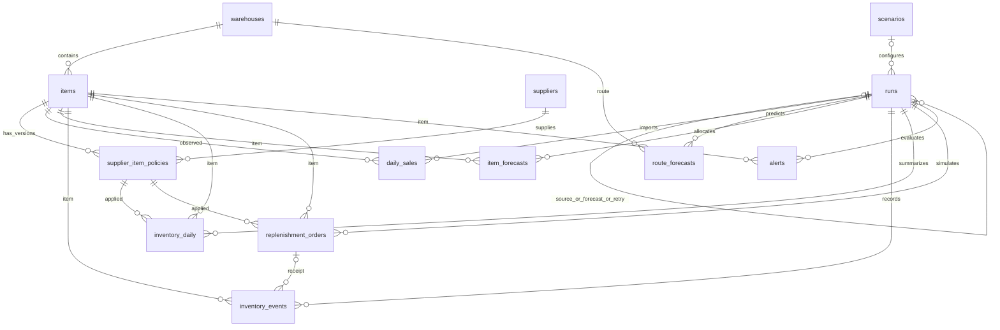

# M3 — mô hình dữ liệu PostgreSQL

**Trạng thái:** schema dự kiến, chưa có migration/DB. Quy tắc tính tại [01](01-functional-spec.md); API tại [03](03-backend-api.md). Đúng **13 bảng nghiệp vụ**; bảng version nội bộ của Alembic không phải bảng nghiệp vụ bổ sung.

## 1. Quy ước chung

ID danh mục dùng `bigint generated always as identity`; `runs.id` dùng UUID. Ngày nghiệp vụ là `date` UTC; thời điểm kỹ thuật dùng `timestamptz`. Quantity tồn/bán/nhập dùng bigint không âm; forecast dùng double precision hữu hạn ≥0 để giữ parity M2. Safety days dùng numeric(8,3). PK/FK bắt buộc NOT NULL trừ trường ghi rõ `?`; không dùng chuỗi rỗng thay null. `created_at`/`updated_at` là timestamptz, version là integer≥1. Mọi bảng có PK `id` trừ daily_sales dùng PK ghép.

Các kết quả có `run_id`; chỉ đọc công khai khi run complete, không invalidated. Source/target/config/assumption/code version được đóng băng trong runs, không lặp toàn bộ JSON ở mỗi dòng. Khóa cảnh replay dùng `window_origin` NOT NULL: policy replay cố định ngày khởi tạo; alert replay là origin từng đợt. Như vậy UNIQUE không bị lỗ hổng NULL. Ngày ra quyết định riêng `as_of_date` hoặc `date`.

Catalog toàn nguồn có 920 item; `first_seen_date` chặn dùng item tương lai tại origin quá khứ. Thêm catalog không cho sửa khóa route/item đã được run dùng. City/name có thể chỉnh cho run mới; run cũ đọc catalog snapshot trong config_snapshot.

## 2. ERD

## 3. Danh mục và chính sách — 4 bảng

| Bảng | Cột chính và kiểu | Ràng buộc, chỉ mục, mục đích |
|---|---|---|
| `warehouses` | id; code text; destination_country text; carrier text; city text; is_assumed bool=true; assumption_source text; version int; created_at | UNIQUE(code), UNIQUE(destination_country,carrier). Một route một kho; city bắt buộc nhưng không được coi tối ưu. |
| `items` | id; warehouse_id FK; sku text; product_type text; first_seen_date date; created_at | UNIQUE(warehouse_id,sku,product_type); CHECK product_type IN ('eSIM','physical_SIM'). Index warehouse_id. Không giả định sku duy nhất toàn hệ thống. |
| `suppliers` | id; code text; display_name text; is_assumed bool=true; assumption_source text; created_at | UNIQUE(code). Một supplier có nhiều policy; v1 không lưu thông tin liên hệ, tài khoản ngân hàng hay hợp đồng đính kèm. |
| `supplier_item_policies` | id; item_id FK; supplier_id FK; version int; effective_from date; effective_to date?; configured_rop_floor bigint; moq bigint; safety_days numeric(8,3); is_assumed bool=true; assumption_source text; created_at | UNIQUE(item_id,version), UNIQUE(item_id,effective_from), UNIQUE(id,item_id); CHECK floor≥0, moq≥1, safety≥0, end>start nếu có. Index(item_id,effective_from,effective_to). Một policy hiệu lực/item/ngày, kể cả đổi supplier. |

Không lưu lead_time_days tùy chỉnh ở policy: profile M3 khóa L7/R1 trong run config; API từ chối giá trị khác. Không có fallback policy chung. Chặn chồng khoảng bằng transaction khóa dòng items tương ứng, kiểm `[from,to)` trước insert/đóng khoảng; UNIQUE chặn trùng đầu khoảng. Không dùng CHECK tham chiếu dòng khác. Chỉ một đường mutation policy trong API/CLI để giữ kiểm này, tài khoản DB ứng dụng không được dùng tùy tiện ngoài dịch vụ.

Policy đã dùng không sửa floor/MOQ/safety/supplier/effective_from. Được đóng effective_to để thêm version kế tiếp nếu không làm thay lựa chọn trong bất kỳ khoảng run đã tham chiếu; nếu cần backdate ảnh hưởng lịch sử, tạo scenario override snapshot riêng cho run mới, không sửa policy cũ. Trong một transaction khóa item → kiểm khoảng và tham chiếu → đóng khoảng cũ → tạo version mới. Ràng buộc DB theo [PostgreSQL constraints](https://www.postgresql.org/docs/current/ddl-constraints.html).

## 4. Kịch bản và run — 2 bảng

| Bảng | Cột chính và kiểu | Ràng buộc, vai trò |
|---|---|---|
| `scenarios` | id; code text; version int; name text; description text; settings jsonb; assumption_version text; created_at | UNIQUE(code,version). Mỗi sửa tạo bản mới. settings chứa cover_days, safety_multiplier, policy_overrides, receipts_initial và cờ receipts_declared; không chứa ID order/customer. |
| `runs` | id UUID; kind text; status text; source_import_run_id FK runs?; forecast_run_id FK runs?; retry_of_run_id FK runs?; scenario_id FK?; as_of_date date; period_start date?; period_end date?; observation_end date; target_version text; config_version text; assumption_version text; source_sha256 char(64)?; code_revision text; code_sha256 char(64); config_snapshot jsonb; config_sha256 char(64); request_key text; request_sha256 char(64); selection_sha256 char(64)?; result_summary jsonb; artifact_manifest jsonb; error_code text?; started_at?; finished_at?; heartbeat_at?; created_at | UNIQUE(request_key). kind IN ('source_import','forecast','policy_replay','alert_replay','stock_projection'); status IN ('queued','running','complete','failed','invalidated'). Index(status,created_at). Parent bắt buộc complete, cùng source/target; kiểm DAG không chu trình. |

config_snapshot lưu đầy đủ các policy/version/giá trị được chọn, warehouse-city map, danh mục tới cutoff, thuật toán seed/tồn đầu, tập model/spec/selection, split/refit/H/L/R/seed và nguồn parent/hash. source_import dùng source_sha256; run con kế thừa chính xác. config_snapshot không chứa đường dẫn tùy ý do HTTP gửi hoặc thông tin bí mật. artifact_manifest là tên tương đối/hash của file private bên dưới run folder.

result_summary lưu metric tổng hợp/counters/coverage và fit-selection summary; không cần bảng metric riêng. Mỗi metric có granularity, horizon_block, cadence, numerator/denominator, excluded_count và null_reason nếu không xác định. Selection36 khóa sau validation, trước test; ghi cả selection artifact hash và thời điểm khóa vào manifest. Forecast/import không cần scenario; các kind tồn bắt buộc scenario/forecast parent. stock_projection là ảnh chụp tại một cutoff, không có actual tương lai để giả làm replay.

## 5. Sales và forecast — 3 bảng

| Bảng | Cột chính và kiểu | Khóa và quy tắc |
|---|---|---|
| `daily_sales` | source_import_run_id FK; item_id FK; date; sales_qty bigint?; order_count bigint?; actual_available bool | PK(source_import_run_id,item_id,date). Khi available=true thì qty/count≥0 và NOT NULL; false thì cả hai null. Index(source_import_run_id,date,item_id). Giá trị order_count chỉ dùng aggregate từ audit đúng khóa, không suy quantity từ count. |
| `route_forecasts` | id; run_id FK; warehouse_id FK; as_of_date date; block smallint; window_start date; target_date date; forecast_qty double; actual_qty double?; actual_available bool; family text; model_id text; selection_basis text; parent_bundle_sha256 text? | UNIQUE(run_id,warehouse_id,as_of_date,block). block1/2; start=D+1 hoặcD+8; target_date là ngày kết thúc D+7/D+14. actual chỉ khi đủ 7 ngày nhãn. Index(run_id,as_of_date,warehouse_id). |
| `item_forecasts` | id; run_id FK; item_id FK; as_of_date date; target_date date; horizon_day smallint; forecast_qty double; actual_qty bigint?; actual_available bool; item_share double; weekday_weight double; share_window_days smallint; allocation_basis text | UNIQUE(run_id,item_id,as_of_date,target_date). horizon1…14, target_date=as_of+h; share_window30/90; weights0…1. Index(run_id,as_of_date,item_id), index(run_id,target_date). |

daily_sales thuộc snapshot import bất biến. Dense grid ngày được dựng trong phạm vi nguồn tuyên bố đầy đủ; không có giao dịch là 0, thiếu nguồn lànull. Lấy route sales bằng SUM item sales, nhưng nếu có bất kỳ item thiếu nguồn thì route actual thiếu, không lấy SUM bỏ NULL thành tổng đầy đủ. Dùng cùng audited frame để lấy route order_count theo ID unique; không cộng count của các nhóm nếu có thể trùng ID. Snapshot hiện tại audit loại duplicate theo ID trước aggregate.

route_forecasts chứa đúng tổng7 ngày, không chứa forecast ngày. Forecast ngày route cho FE lấy SUM(item_forecasts) khi phân bổ complete; UI ghi allocated_daily. Chỉ complete forecast run khi92 tổng ở origin tương lai (46×2), hoặc đủ cặp dự kiến ở replay, và item vectors bảo toàn. Số item forecast tại origin phụ thuộc first_seen_date, không hardcode920 tại origin cũ. Missing allocation làm run failed, forecast tuyến đã tính giữ private để chẩn đoán, không trình như complete.

## 6. Tồn, lô nhập và cảnh báo — 4 bảng

| Bảng | Cột chính và kiểu | Khóa và quy tắc |
|---|---|---|
| `inventory_events` | id; run_id FK; window_origin date; item_id FK; event_at timestamptz; event_sequence bigint; event_kind text; source_sequence bigint?; replenishment_order_id FK?; quantity bigint; fulfilled_qty bigint; shortage_qty bigint; balance_after bigint; is_simulated bool=true | UNIQUE(run_id,window_origin,item_id,event_sequence). kind initial_stock/receipt/sale. Sale: quantity=fulfilled+shortage; receipt/initial: fulfilled=shortage=0. Không lưu ID nguồn. Unique receipt theo replenishment_order_id khi kind=receipt. |
| `inventory_daily` | id; run_id FK; window_origin date; item_id FK; date; policy_id FK?; forecast_as_of_date date; opening_qty bigint; receipts_qty bigint; sales_qty bigint; fulfilled_qty bigint; shortage_qty bigint; closing_qty bigint; ss bigint?; rop_forecast bigint?; rop bigint?; target_stock bigint?; pending_qty bigint; inventory_position bigint; needs_replenishment bool?; recommended_qty bigint?; config_status text; is_simulated bool=true | UNIQUE(run_id,window_origin,item_id,date). CHECK closing=opening+receipts−fulfilled, sales=fulfilled+shortage; số lượng≥0. Composite FK(policy_id,item_id) sang policy. Index(run_id,date,item_id). ss/rop/Q null khi thiếu config/vector, không giả0; run đó không complete. |
| `replenishment_orders` | id; run_id FK; window_origin date; item_id FK; policy_id FK; order_key text; ordered_on date; eta date; ordered_qty bigint; received_qty bigint; status text; is_initial bool; is_simulated bool=true | UNIQUE(run_id,window_origin,order_key); composite FK(policy_id,item_id). qty>0; received0 hoặcordered; status ordered/received; eta=ordered_on+7. Một order/item/decision day cho lô chính sách, key='policy:'+item+date; lô seed có key riêng. Index(run_id,eta,status). |
| `alerts` | id; run_id FK; window_origin date; item_id FK; as_of_date date; alert_type text; state text; predicted_depletion_date date?; actual_depletion_date date?; lead_days smallint?; is_evaluable bool; evaluation_class text?; exclusion_reason text?; explanation jsonb; is_simulated bool=true | UNIQUE(run_id,window_origin,item_id,as_of_date,alert_type). type below_rop/depletion. State low_stock/pending_covers/urgent/early/already_depleted/not_within_horizon. evaluation_class TP/FP/FN/TN chỉ alert_replay. Index(run_id,state,as_of_date). |

inventory_events ghi receipt và sale theo thứ tự, initial_stock trước ngày đầu replay; initial không tính như receipt trong cân bằng daily. Với alert_replay, không tái forecast sau origin trong cửa sổ: forecast_as_of_date=window_origin; policy chỉ áp dụng tại origin để giải thích, không đặt mới. Với policy_replay, forecast_as_of_date=date cho quyết định cuối ngày, nhưng sales ngày đó đã xử lý bằng actual; quyết định chỉ áp dụng tương lai. Với stock_projection, date=as_of_date thể hiện snapshot cuối ngày, không trừ lại sales origin; diễn biến tương lai nằm ở projection alert và không giả thành actual ledger. Dòng snapshot có opening=closing=tồn seed cuối cutoff và receipts/sales/fulfilled/shortage=0, được ghi rõ là khởi tạo mô phỏng; không diễn giải sales=0 này là actual bán ngày cutoff.

Mỗi đợt alert replay lưu một dòng depletion/item kể cả không dự kiến cạn để chấm TN/FN và coverage; FE mặc định ẩn not_within_horizon. below_rop chỉ phát khi dưới ngưỡng. Actual depletion lấy từ ledger mô phỏng của chính đợt; policy/stock_projection không gắn confusion class. Event đầu tiên/item/đợt được xác định bằng key run/window/item, ngày thực là thuộc tính, không là phần key.

## 7. Snapshot, ràng buộc và dung sai

Không xóa dây chuyền parent, policy, item hoặc run đã có kết quả; FK RESTRICT. Một run failed có thể có phần dữ liệu trung gian, readers từ chối đọc như kết quả hợp lệ. Retry tạo run mới và retry_of, không sửa lại run đã đóng. Viết theo batch trong run running; bước cuối transaction kiểm counters/hash/invariants rồi chuyển complete. Lần request trùng trả lại cùng run, không tạo thêm lô.

Run con kiểm source_import/forecast parent cùng target/source hash/cutoff phù hợp. Filter city và supplier cho run cũ dùng snapshot của run, tránh catalog hiện tại thay nhãn quá khứ. Không dùng config mới diễn giải ledger cũ. Export chỉ các view tổng hợp được cho phép, không có raw/event source identifiers.

Forecast phải hữu hạn; app kiểm isfinite, DB CHECK `forecast_qty >= 0 AND forecast_qty < 'Infinity'::float8` chặn âm/NaN/Infinity. Float kiểm tổng trong 1e-8; quantity nguyên khớp tuyệt đối. Metric null được giữ nguyên, không COALESCE0. Không tạo index riêng mọi cột, chỉ index theo route/item/run/date/filter thực dùng.

## 8. Ví dụ giả và vì sao không thêm bảng

Ví dụ hoàn toàn giả: warehouse DEMO-W1, route DemoLand/DemoCarrier, item DEMO-ESIM-01/eSIM, supplier DEMO-S1, policyv1 floor100/MOQ50/safety2 hiệu lực30/09/2025. Forecast10/ngày, tồn80 → SS20/ROP100/S110/IP80/Q50. Order31/10 → ETA07/11. Không sao chép order/customer ID hoặc dòng riêng tư để làm seed public.

Không cần customer/payment/invoice/delivery/user; không phục vụ phép tính hoặc demo M3. Không cần bảng route riêng vì warehouse đã chứa khóa tuyến1–1. product_type là enum; supplier_item_policies chứa mapping và điều kiện nên không thêm supplier_items. Metric nằm trong run summary; recommendation trong inventory_daily. Một replenishment row là một lô/mặt hàng, chưa cần header/detail. Initial stock là event và config seed, không thêm snapshot table. File private có manifest trong runs, không thêm artifact table.
