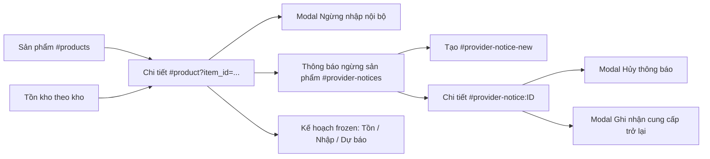

# M3 — đặc tả frontend

**05/11/2026 — CHG-110, form ngừng cung cấp gọn:** Từ Lịch cung cấp, form nhà mạng chỉ chọn/điền sẵn nhà mạng, SKU, loại, ngày biết/ngày hiệu lực và lý do; bỏ toàn bộ checkbox thị trường/kho, nút chọn tất cả kho, Nguồn khai báo/giả định và Liên kết tham chiếu. Không tải danh sách kho cho form. API tự áp toàn sản phẩm cùng SKU/type/nhà mạng trên mọi thị trường/kho hiện có; preview trả số lượng/member thực để kiểm trước lưu. Phần xem tác động từ kế hoạch đã lưu giữ tùy chọn. Detail/history bỏ hiển thị nguồn/link; bảng member vẫn thể hiện phạm vi đã lưu để đọc đúng thông báo cũ. Form hủy/mở lại không có nguồn/link và ghi rõ phạm vi cũ được giữ. Ngừng nhập nội bộ tại kho, quản lý lịch sử, preview/version/dirty guard và run frozen giữ nguyên. [Nghiệp vụ](07-product-supply-lifecycle.md#provider-product-wide-chg110).

**04/11/2026 — kết quả nghiên cứu C00 trên demo:** Trang Kịch bản thêm khối Đánh giá C00 — hồi cứu toàn kỳ trước phần chọn/thiết lập. Đọc gói JSON tổng hợp đã chạy lại/kiểm chứng, không tạo Run giả hoặc gán vào run đang chọn:450/833=54,02%,Precision80,89%,Recall79,95%,dateMAE4,01ngày (666ca),kỳ29/10–31/12/2025. Công khai chính sách frozen,28ngày khởi tạo/tự bổ sung hàng, phạm vi cố định và tải JSON cùng nguồn quaHTTPS. EarlyWarningResult14ngày bên dưới giữ150/461. Không đổi API/worker/model; không đưa raw/ID riêng vào bản công khai. [Bàn giao](../../docs/development.md#handoff-c00-demo-evaluation).

**04/11/2026 — bốtrí Tóm tắt hiệnhành:** EarlyWarningResult nằm trong nội dungTóm tắt ngaydướinavigationtabs, trướcOverview. Stockcóreplaycùngscenario/parents hiệnmetricliênquan vớinhãnnguồnkỳ, khônggánlà%đoriêngngày stock. TabDựkiếnbán đãxóakhỏiScenarioResults; Forecastđộclậpvẫngiữdựphóngtheotồn.113React/build/HTTPSdesktop/mobileđạt. [Bàn giao](../../docs/development.md#handoff-scenario-summary-placement).

**04/11/2026 — kết quả cảnh báo và dedup:** Tóm tắt kết quả scenario hiệnEarlyWarningResult choalert_replaycomplete:early_rate/tửmẫu,Precision/Recall,exclusions vàphạmvitoànlượt; stock/policy thiếumetric cóthểmởreplaycùngscenario/parents,khôngtựgántỷlệ. ForecastComparison giữởtabComparison,showComparison=falseởDựkiếnbántrongscenario.113React/build/browserHTTPSdesktop/mobile đạt. [Bàn giao](../../docs/development.md#handoff-early-warning-result).

**04/11/2026 — ngày đánh giá so sánh14ngày:** Tab So sánh dự báo/thực tế trong ScenarioResults và khối ForecastComparison trên trang Dự báo cho chọnD riêng, có185mốc ở demo hiện tại. Hiển thị cửa sổUTC D+1…D+14,3thẻtổng,biểuđồ12tuyếnđầu,bảng/CSV; load đủpage mới cộngtổng, thiếuactual khôngzero-fill. Ngày tồn snapshotreadonlygiữ nguyên; thayD chỉ đọc, khôngenqueue hoặc lưuscenario.108React/build/browserHTTPSdesktop/mobile đạt. [Bàn giao](../../docs/development.md#handoff-forecast-comparison).

**CHG-094/095 — 04/11/2026, UI đã kiểm local:** 101React và TypeScript/Vite build đạt; browser1440/390 đi lưu kho→reload→lưu scenario riêng→chạy→queued/reload→complete/kết quả/CSV ngay trang. Liên kết product/product-supply thiếu run_id giữ item khi app tự chọn run; có2ca hồi quy mới. Alias/Back còn xem đúng kết quả, không tràn ngang toàn trang. Bản demo chưa cutover; [phạm vi/bằng chứng](../../docs/development.md#handoff-chg094-095-integration) thay các trạng thái chưa kiểm phía dưới.

**Tiến độ CHG-095, 04/11/2026:** Đã viết form Kho nhận hàng tại sản phẩm, mặc định/version và lỗi409/reload, phân trang options đầy đủ; các màn tồn/nhập/projection/CSV hiển thị kho nhận frozen và URL có `warehouse_scope=receiving`. Kịch bản hiện có tự lấy mặc định qua backend, không chọn lại kho. Chưa test/build/browser hoặc cập nhật demo; page Kịch bản CHG-094 chưa triển khai. [Bàn giao source/chưa nghiệm thu](../../docs/development.md#implementation-chg095-receiving-warehouse). Các mô tả chỉMD bên dưới là lịch sử thiết kế.

<a id="receiving-warehouse-chg095"></a>
## CHG-095 — Chọn kho mặc định tại sản phẩm, kịch bản tự dùng

**04/11/2026, bổ sung thiết kế/chỉ MD; chưa có UI mới.** Người dùng yêu cầu một trường chọn kho để nhập trong sản phẩm và bổ sung: **các kịch bản mặc định đưa sản phẩm về kho hàng mặc định**. Hiện mỗi item gắn một kho; lô nhập theo item, không dồn mọi sản phẩm vào một kho chung.

- Trang **Sản phẩm → Cấu hình** thêm trường **Kho nhận hàng mặc định** và thao tác **Lưu kho nhận**. Giá trị ban đầu là kho hiện tại nếu chưa cấu hình riêng, có nhãn kế thừa; không tự chọn kho đầu danh sách. Bộ chọn một kho, hiển thị địa danh và quốc gia; không thay SKU/loại/carrier/thị trường nguồn theo metadata kho nhận.
- Thông tin sản phẩm phân biệt **Kho danh mục / tuyến nguồn** và **Kho nhận hàng mặc định** khi khác nhau. Danh sách sản phẩm hiện kho nhận mặc định; trường này không phải bộ lọc “Kho sản phẩm” hiện có. Chọn xong phải lưu mới áp dụng; thành công hiện “Đã lưu kho nhận mặc định. Áp dụng cho lượt chạy mới.”
- Kho ngoài trang options đầu vẫn tải/chọn đúng; lỗi tải kho chặn lưu, không xóa giá trị đã lưu. 409 giữ bản nháp và cho tải lại version; đọc lại sản phẩm/reload phải thấy đúng lựa chọn. Lưu không tạo run hoặc chuyển lô/tồn đang có.
- **Trang Kịch bản CHG-094 không thêm ô chọn/override kho nhận.** Khi chạy, từng sản phẩm tự dùng mặc định đã lưu; phần kiểm tra thiết lập có dòng “Kho nhận theo mặc định từng sản phẩm”, bảng chi tiết hiển thị tên kho để đối chiếu. Lô đầu kỳ khai báo trong kịch bản cũng tự dùng kho mặc định được chốt của item, không cần chọn lại từng lô.
- Khi run đã được nhận, phần thiết lập đã chốt/tiến độ/kết quả hiện kho từ snapshot của run. Đổi mặc định sản phẩm không đổi kho của queued/running/complete hoặc lô cũ. Retry với cấu hình hiện tại có thể đổi kho ở run mới, phải ghi rõ trước thao tác.
- Kết quả tại trang Kịch bản, Tồn kho và Nhập hàng/CSV hiển thị kho nhận thực của mô phỏng; tên kho nguồn giữ riêng để giải thích forecast. Một lượng hàng không xuất hiện ở cả kho cũ và kho mới. Số lượng/tổng hợp/bộ lọc cùng vai trò kho nhận, không chỉ đổi chữ của cột cũ.

Desktop1440/mobile390, label/nút/lỗi tại trường và thao tác bàn phím theo chuẩn hiện có. [Quy tắc tồn và nguồn](01-functional-spec.md#receiving-warehouse-chg095), [API dự kiến](03-backend-api.md#receiving-warehouse-chg095), [ma trận kiểm](06-testing-delivery.md#receiving-warehouse-chg095). CHG-094/095 đã có source theo bàn giao hiện hành nhưng chưa kiểm/cutover; các yêu cầu và ma trận kiểm vẫn là cổng cần thực thi.

<a id="scenario-workspace-chg094"></a>
## CHG-094 — Trang riêng để thiết lập, chạy và xem kết quả kịch bản

**04/11/2026 — đã viết source, hoãn kiểm theo người dùng.** `Scenarios`, `ScenarioEditor`, `RunForm` và `ScenarioResults` thực hiện luồng chọn/tạo kịch bản → thiết lập → lưu → chạy → theo dõi → xem kết quả cùng trang; hai modal và trang Configuration cũ đã bỏ. Chưa test/build/browser/migration hoặc cập nhật demo, chưa nghiệm thu. [Bàn giao source](../../docs/development.md#implementation-chg094-scenarios). CHG-093 và kho mặc định CHG-095 tiếp tục áp dụng; các mô tả sáu màn hình, tab Kịch bản trong Cấu hình và modal tạo run phía dưới là lịch sử ở phần bị thay thế.

### Dọn các trang khác theo yêu cầu bổ sung

- Tổng quan giữ chỉ số, biểu đồ nhu cầu/tồn, mặt hàng cần chú ý và lịch hàng về; bỏ khối Thao tác nhanh/lịch sử chạy trùng. Khi có tác vụ chưa hoàn tất, liên kết mở đúng run tại Kịch bản; thao tác thử lại đặt ở đó.
- Chi tiết sản phẩm giữ cấu hình nhập và kho nhận; phần tồn của kế hoạch nằm trong mục thu gọn. Biểu đồ bán tồn dùng trang kết quả/Dự báo để tránh lặp trong trang cấu hình.
- Menu chỉ có một mục Kịch bản, header không lặp nút tạo khi đã ở trang đó. Help hướng dẫn luồng mới và bỏ tham chiếu Tổng30 đã gỡ. Không bỏ các trang Tồn kho/Nhập hàng/Cảnh báo/Dự báo hoặc dữ liệu lịch sử.

### Điểm vào và URL

- Menu **Kịch bản** thay mục **Thiết lập tính toán**, mở trang `#scenarios`. Danh sách lựa chọn, form thiết lập, form chạy và kết quả nằm trong cùng trang; không thêm một menu thiết lập trùng chức năng.
- Nút **Tạo phương án** ở header/Tổng quan mở trang này ở trạng thái tạo lượt chạy mới, giữ ngữ cảnh quay lại; không mở `RunDialog`. Liên kết **Đang xử lý**, **Xem lượt chạy** và lịch sử mở lại trang với đúng `run_id`, kể cả queued/running/failed.
- URL đích dùng query trước hash, ví dụ `?scenario_id=<id>&run_id=<id>#scenarios`. `scenario_id` là ID của đúng phiên bản đã lưu, không chỉ là mã nhóm kịch bản. `run_id` xác định tiến độ/kết quả đang xem. Filter kho/item/ngày giữ theo quy ước URL hiện có.
- `#configuration` cũ dẫn sang `#scenarios` và giữ ngữ cảnh hợp lệ. Vào trang để tạo mới không tự nhận run mặc định của app làm kết quả kịch bản. Reload/Back/Forward khi có `run_id` chỉ đọc lại run đó, không POST; ID sai/không còn tồn tại báo rõ, không thay bằng run mới nhất.
- Với run tồn đã lưu, đối chiếu scenario/phiên bản từ run; cặp `scenario_id`/`run_id` không khớp phải báo xung đột trước khi hiện kết quả. Import/forecast không yêu cầu scenario, không gán kịch bản giả để dùng chung URL.

### Bố cục trên cùng trang

| Khu vực | Nội dung và thao tác |
|---|---|
| Đầu trang | Tiêu đề Kịch bản, nút quay lại, chọn kịch bản/phiên bản đã lưu hoặc Tạo kịch bản mới. Hiện tên kịch bản và lượt chạy đang xem. |
| Thiết lập kịch bản | Tên, mã, ghi chú, tồn đầu theo số ngày phủ, hệ số safety, điều chỉnh policy theo item và hàng đang về; chọn kho để tìm item. Nhóm nâng cao được thu gọn, form chính nằm trực tiếp trên trang. |
| Thiết lập lượt chạy | Loại công việc, nguồn/dự báo cha đã complete, mốc chốt UTC, khoảng replay khi phù hợp; hiện rõ phiên bản kịch bản được dùng. Có nút Lưu thiết lập và Chạy kịch bản với trạng thái khả dụng riêng. |
| Tiến độ | Mã lượt chạy, queued/running/complete/failed, phase/counters do API cung cấp, thời điểm và lỗi an toàn; có Thử tải lại hoặc Thử lại với cấu hình hiện tại theo trạng thái. |
| Kết quả | Tóm tắt, bảng/biểu đồ và CSV của chính lượt complete, ngay dưới tiến độ. Các nhóm chi tiết phù hợp loại run được mở tại đây; liên kết sang màn vận hành là tùy chọn xem thêm. |
| Các lượt đã chạy | Chọn lại lượt theo đúng phiên bản kịch bản, gồm cả lượt lỗi; có phân trang. Đổi lựa chọn tải kết quả ngay trong trang này. |

```text
[← Quay lại]  Kịch bản            [Chọn kịch bản · phiên bản] [Tạo mới]
[Thiết lập kịch bản: thông tin chung / điều chỉnh riêng / hàng đang về]
[Thiết lập lượt chạy: loại / cha / mốc UTC / khoảng replay]
[Lưu thiết lập] [Chạy kịch bản]
[Tiến độ và trạng thái của lượt đang chọn]
[Kết quả: Tóm tắt | Tồn kho | Nhập hàng | Cảnh báo]  [Xuất CSV]
[Bảng / biểu đồ của đúng lượt chạy và bộ lọc]
[Các lượt đã chạy của phiên bản kịch bản]
```

Desktop 1440px có thể chia nhóm thiết lập thành hai cột, tiến độ/kết quả dùng toàn chiều rộng. Mobile 390px xếp dọc đúng thứ tự; form không nằm trong modal cuộn lồng nhau. Bảng/biểu đồ cuộn trong vùng riêng, nút có chữ rõ và không tràn ngang trang. Không bắt người dùng sang Tổng quan/Tồn kho để biết kết quả đã chạy.

### Lưu thiết lập và bắt đầu lượt chạy

1. Chọn phiên bản có sẵn để chạy nguyên cấu hình, hoặc tạo/chỉnh thành một phiên bản mới. Dùng các trường/ràng buộc hiện hành; lượng nhập mỗi lần vẫn cấu hình tại sản phẩm, không thêm ô đổi lượng này vào scenario. Override trống kế thừa, giá trị 0 hợp lệ được giữ; danh sách receipt rỗng được khai báo rõ. L7/R1/H14 giữ nguyên.
2. **Lưu thiết lập** tạo scenario/phiên bản qua API hiện có; không enqueue. Chỉnh từ bản có sẵn dùng quan hệ phiên bản hiện hành (`base_scenario_id` khi phù hợp), không sửa đè phiên bản đã dùng. Sau lưu, giữ form và chọn đúng ID/version trả về, không đóng trang.
3. **Chạy kịch bản** chỉ khả dụng khi thiết lập đã lưu, dependency tải thành công và nguồn/cha/ngày tương thích. Nếu bản nháp đã đổi, chỉ rõ cần lưu phiên bản mới; không âm thầm chạy bản cũ hoặc tự thay ngày đã xóa. Filter kho/item dùng chọn cấu hình hay xem kết quả không tự thu hẹp phạm vi tính toán của run.
4. Gửi tạo run với scenario ID đã chọn và payload tương ứng loại công việc. Chống nhấp đôi; cùng lần gửi chưa rõ kết quả thì retry mạng dùng cùng Idempotency-Key/body. Lưu thành công nhưng POST run lỗi vẫn giữ phiên bản đã lưu, không tạo thêm scenario chỉ để thử chạy lại. Lỗi lưu chưa rõ server đã nhận thì yêu cầu đối chiếu danh sách trước khi gửi lại, không tự POST thêm phiên bản.
5. Khi API nhận run, ghi `run_id` vào URL và hiện tiến độ trên chính trang. Poll khoảng 2 giây khi queued/running; dùng phase/counters thật, không bịa phần trăm. Dừng poll trạng thái khi terminal; hủy request cũ khi đổi lượt/rời trang.
6. Tác vụ vẫn chạy nền khi người dùng rời trang. Quay lại bằng URL/lịch sử tải đúng trạng thái; rời trang không đồng nghĩa hủy job. Chỉ xác nhận bỏ thay đổi khi có bản nháp chưa lưu. Không tự chạy lại sau refresh hoặc mất kết nối.

Các loại tồn `stock_projection`, `policy_replay`, `alert_replay` là luồng chính. Nhập nguồn và tạo forecast hiện có vẫn truy cập được trong nhóm **Chuẩn bị dữ liệu** của trang này với các trường theo kind; chúng không cần scenario. Không tự chạy cả chuỗi import/forecast/replay khi chỉ bấm chạy một loại công việc.

### Hoàn tất và kết quả tại chỗ

| Loại lượt chạy | Kết quả hiện ngay trên trang |
|---|---|
| `stock_projection` | Tóm tắt tồn/nguy cơ, projection H14, tồn được bán/bị chặn, SS/ROP, lượng nhập/ETA và bảng chi tiết theo API hiện có. |
| `policy_replay` | Tóm tắt mô phỏng kỳ đã chọn, bán/thiếu/tồn, lô nhập, bảng/biểu đồ tồn và metric policy có scope. |
| `alert_replay` | Tóm tắt cảnh báo, ngày xuống ROP riêng ngày cạn, bảng chi tiết và metric depletion/threshold cùng tử số/mẫu số/phạm vi/ca loại; không trộn với policy replay. |
| `forecast` | Tóm tắt nguồn/origin/tuyến, dự báo vận hành H14, bảng/biểu đồ và metric hiện có; không tạo tab Tổng30. |
| `source_import` | Tóm tắt audit/import và nguồn đã đăng ký; không hiện bảng tồn/cảnh báo chưa được tạo. |

- Run complete tự mở khu vực kết quả trên cùng trang, thông báo **Đã chạy xong** và tải read model của đúng `run_id`. Không chỉ hiện nút dẫn sang trang khác. Nếu tải kết quả lỗi, giữ trạng thái complete, báo lỗi đọc và cho tải lại; không enqueue lại tác vụ.
- Tóm tắt luôn hiện loại run, mốc/kỳ UTC, nguồn/cha, scenario/version khi có và nhãn mô phỏng. Cấu hình đã chốt để chạy hiển thị chỉ đọc; bản nháp chỉnh tiếp được ghi rõ chưa áp dụng cho kết quả đang xem. Sửa policy/scenario/lifecycle hiện tại không cập nhật số frozen.
- Tab/bảng/biểu đồ chỉ dùng dataset loại run hỗ trợ; tái dùng component/read model vận hành, FE không tính lại nghiệp vụ. Null/chưa actual/empty do filter khác 0. Quyền nhập/bán, nguồn/giả định/bị chặn và metric exclusions giữ nghĩa hiện hành.
- Filter và CSV cùng `run_id`/ngày/kho/item/quyền; export đủ phạm vi đã lọc, không chỉ trang bảng. Filter bảng không đổi mẫu số metric toàn lượt; nhãn scope phải ghi rõ. Không cho CSV kết quả khi queued/running/failed hoặc parent không khớp.
- Chọn lượt khác hay kịch bản khác phải hủy request trước, xóa hoặc che dữ liệu của lựa chọn cũ trong lúc tải. Kết quả cũ không được mang tiêu đề lượt mới. Chọn kịch bản khác không đổi cấu hình của job đã gửi; lần chạy mới giữ lịch sử lượt trước.
- Run failed hiện lỗi và **Thử lại với cấu hình hiện tại**, tạo run mới qua `/runs/{id}/retry`, có `retry_of`; nhắc rõ cấu hình hiện tại có thể khác snapshot lượt lỗi. Không đổi trạng thái run cũ. 409/422/429 giữ lựa chọn/bản nháp và lỗi tương ứng; không tự retry mutation khi hết quota.

### Ranh giới triển khai và kiểm

Tận dụng React/TypeScript, hash/history, hook Fetch và API hiện có. Lấy chi tiết run qua `/runs/{id}` dù không nằm trong trang danh sách; chọn đúng scenario bằng dữ liệu danh sách có phân trang, không giới hạn 100 bản đầu hoặc giả định có endpoint chi tiết scenario chưa được cung cấp. Source hiện có page `Scenarios` ghép form/tiến độ/kết quả dùng chung; navigation/context/CTA đã chuyển khỏi `Configuration`/`RunDialog`, không thêm router/state framework hay schema/model cho việc chuyển trang. GET `/runs` bổ sung filter lịch sử/phụ thuộc và metadata thiết lập frozen; chưa kiểm API mới.

[Kế hoạch triển khai](../../docs/planning/PLAN.md#chg-094), [tiêu chí R08/R09](../../docs/requirements.md#chg094-scenario-workspace), [ma trận kiểm dự kiến](06-testing-delivery.md#scenario-workspace-chg094), [bàn giao lượt chỉ MD](../../docs/development.md#handoff-chg094-scenarios). Chỉ nghiệm thu UI sau khi có code và bằng chứng kiểm mới; kết quả kiểm CHG-093/D5 không chứng minh trang này đã tồn tại.

**CHG-093 — 04/11/2026:** Danh sách sản phẩm có nút Cấu hình và Lịch cung cấp từng dòng; bỏ menu thông báo ngừng sản phẩm. Trang `#product-supply` theo item/kho chứa nhập nội bộ và lịch nhà mạng liên quan; mở form provider điền sẵn danh tính/phạm vi, giữ preview/version guard. Bộ lọc tìm SKU/kho/nhà mạng/loại/Trạng thái nhập/Trạng thái, bỏ input ngày xem; trạng thái theo origin được ghi rõ, ngày thao tác nằm tại trang lịch. Badge và bố cục responsive mới. [Kiểm và giới hạn](../../docs/development.md#handoff-chg093-products). Mô tả điểm vào UI cũ bên dưới là lịch sử.

**CHG-085 giai đoạn 8 — 03/11/2026, hoàn tất local:** đã đọc và verify 7 run cũ, đối chiếu API/CSV cho 12 cặp DB–run; chạy 4 run mới trên bản sao dùng nguồn/forecast có sẵn và 1 run synthetic cho hai kho. Worker, verifier độc lập, API/CSV và browser 1440/390px đạt. Ca bổ sung chặn 19 đơn vị nguồn trong mô phỏng; ca synthetic có 280 = 150 được phép bán + 130 bị chặn. Sửa nhãn quyền mua/bán trong bảng projection; 89 React và build đạt. App ở 0008 với 3 run ban đầu; 4 DB bảo vệ và 1.412 tệp giữ hash. Không refit/tuning hoặc viết lại bằng chứng CHG-084; R07/T14 giữ mở. Thay đổi giai đoạn 7–8 chưa commit/push. [Bàn giao/giới hạn](../../docs/development.md#handoff-chg085-phase8). Các checkpoint bên dưới là lịch sử.

**CHG-085 giai đoạn 7 — 03/11/2026:** FE build đã được API local8000 phục vụ cùng DB0008/worker hiện tại. Browser1440/390px kiểm app chỉ đọc và DBtest có lưu ngừng nhập cùng ngày/thông báo2kho, tạo inventory run qua UI, worker/verifier và frozen result/CSV. App không phát sinh stop/notice/run thử. [Kiểm/giới hạn](../../docs/development.md#handoff-chg085-phase7).

**CHG-085 giai đoạn 6 — 02/11/2026, hoàn tất local FE:** modal ngừng nhập nội bộ cùng ngày, trang thông báo nhà mạng/phạm vi nhiều kho, preview và hai quyền riêng; vận hành hiển thị lượng bán/tồn bị chặn/Q/cap từ frozen. Baseline74, suite cuối88React (gồm22ca liên quan), 37ca hợp đồng BE, build/pipcheck và browser1440/390px synthetic đạt. DBapp vẫn0007; không cutover/nguồn thật/bước8 cũ. Bước4–6cònlocal, chưa commit/push; dừng trước7, R07/T14 giữ mở. [Triển khai thực](07-product-supply-lifecycle.md#phase6-implemented), [kiểm/giới hạn](../../docs/development.md#handoff-chg085-phase6). Bố cục và quy tắc bên dưới được chốt từ1; checkpoint6 là trạng thái mới nhất. Các mô tả CHG-084 vẫn giữ làm lịch sử.

<a id="lifecycle-chg085"></a>
## CHG-085 — Thiết kế FE và triển khai local giai đoạn 6

02/11/2026, giai đoạn1 chỉ MD. [Quyền/thời gian và API](07-product-supply-lifecycle.md#states-and-time), [lộ trình mới](../../docs/planning/PRODUCT_SUPPLY_LIFECYCLE_PLAN.md#steps) là nguồn quy tắc. Các đoạn CHG-084 phía dưới là checkpoint lịch sử. Thiết kế này đã được triển khai local ở6; form nội bộ là modal riêng, không bắt+7, nhà mạng có trang quản lý riêng. App chưa cutover7.

### Điều hướng và ngữ cảnh

Giữ router hash/history và component/hook sẵn có; các URL sau đã có trong mã local6; query item_id/kho/run/ngày nằm trước hash.



Menu chính thêm “Thông báo ngừng sản phẩm”, không gọi chung là “Tình trạng cung cấp”. Từ summary sản phẩm mở list đã lọc item; từ notice mở sản phẩm/kho trong scope; Back quay đúng list/filter/page. URL giữ item/kho/ngày/run và notice/filter/page; không đặt lý do/nguồn người dùng nhập vào URL. Modal mở bằng history entry và đóng/Back trả ngữ cảnh; form có dirty state cần xác nhận bỏ thay đổi. Reload liên kết sâu tải đúng item/notice, kể cả ngoài100option đầu.

Luôn hiển thị hai ngữ cảnh: “Cấu hình mới nhất — ngày xem UTC …” trên màn quản lý và “Kế hoạch … — thông tin đã chốt tại …” trên vận hành. Đổi ngày xem không đổi ngày ghi nhận ngầm; ngày ghi nhận nhập rõ. Thông tin tới sau origin có nhãn trong cấu hình, không sửa run. Sau lưu: refetch version/history/config, focus thông báo “Đã lưu. Tạo kế hoạch mới để tính tác động.”, không tự enqueue hoặc thay số kế hoạch.

### Chi tiết sản phẩm: summary, không form lifecycle

```text
Desktop
[← Sản phẩm / Kho]          SKU · SIM/eSIM · Nhà mạng · Thị trường · Kho
[Cấu hình mới nhất | Ngày xem UTC]
[Nhập nội bộ: Đang nhập / Lên lịch / Đã ngừng]   [Nhà mạng: Không hạn chế / ...]
[Quyền nhập: Có/Không + từng lý do]              [Quyền bán: Có/Không + lý do]
[Xem / Quản lý ngừng nhập nội bộ]                [Xem thông báo liên quan]
[Kế hoạch đã chốt: run/ngày | Tồn tổng | Được bán | Bị chặn | Lô đang về]
[Liên kết Tồn kho / Nhập hàng / Dự báo theo cùng ngữ cảnh]
[Form policy riêng như hiện có, không có nút tự mở nhập]

390px
[←] [SKU và mô tả xuống dòng]
[Ngày xem]
[Thẻ Nhập nội bộ] [nút toàn chiều rộng]
[Thẻ Hạn chế nhà mạng] [nút toàn chiều rộng]
[Quyền nhập, quyền bán và từng lý do]
[Tồn tổng / Được bán / Bị chặn, xếp dọc]
```

Hiện source/reason và liên kết notice, không lộ profile/version/fingerprint cho người vận hành; thông tin kỹ thuật chỉ ở chi tiết phục vụ kiểm. Nếu có hai hạn chế thì hiện cả hai; summary tổng không giấu nguyên nhân. “Mở nhập lại nội bộ” luôn kèm giải thích còn bị nhà mạng chặn nếu có.

### Modal “Ngừng nhập nội bộ”

Một modal cho một item/kho; không có dropdown “loại nghiệp vụ”. Theo hành động mở modal tương ứng: Ngừng nhập, Hủy lịch ngừng nhập hoặc Mở nhập lại; mỗi lần chỉ có một hành động rõ tên.

```text
[Ngừng nhập nội bộ] [Đóng]
[SKU · loại · kho · nhà mạng, chỉ đọc]
[Ngày ghi nhận UTC] [Ngày hiệu lực: hôm nay hoặc tương lai]
[Lý do *]
[Preview: run/ngày | tồn tổng/được bán/bị chặn | lô cũ/ETA]
[Vẫn bán lượng tồn được phép bán; lô đã đặt vẫn được nhận.]
[Hạn chế nhà mạng còn áp dụng nếu có]
[Xem lịch sử]                         [Hủy] [Lưu ngừng nhập]
```

Không gợi ý+7 hoặc yêu cầu known+7; lead time7 chỉ xuất hiện trong preview ETA nếu cần. Khi hủy/mở lại, effective=known hiển thị chỉ đọc; target stop rõ, không chọn tùy ý event. Hủy lịch chưa hiệu lực và mở lại sau hiệu lực có modal xác nhận riêng nội dung, không tự đổi nghĩa nút theo lỗi API. Lịch sử trong modal/trang phụ dùng page, ngày biết/hiệu lực/action/lý do/nguồn giả định; newest first. Preview không có run ghi chưa có dữ liệu, không ghi tồn0.

| Trạng thái nội bộ tại ngày ghi nhận | Hành động |
|---|---|
| Active | Ngừng nhập hôm nay hoặc lên lịch |
| Scheduled_stop | Xem lịch; Hủy lịch trước hiệu lực, không thêm stop thứ hai |
| Stopped | Xem lịch; Mở nhập lại nội bộ, không bỏ hạn chế nhà mạng |
| Ngày xem trước latest change / thiếu ngày / schema chưa sẵn sàng | Đọc summary/history phù hợp; yêu cầu chọn ngày ghi nhận hợp lệ, không gửi ghi |

### Trang “Thông báo ngừng sản phẩm”

List có tiêu đề + nút Tạo thông báo, filter nhà mạng/SKU/loại/thị trường/kho/trạng thái/ngày; thẻ/bảng mỗi notice một dòng: sản phẩm/phạm vi, số item/kho, ngày biết/hiệu lực, trạng thái, nhãn “Giả định mô phỏng”, link chi tiết. Không lặp cùng notice thành một row mỗi kho. Filter reset page1, reload/Back giữ query; total từ server toàn scope.

Tạo là màn riêng, không wizard nhiều tầng:
```text
[Tạo thông báo ngừng sản phẩm]
[Nhà mạng *] [Gói/SKU chính xác *] [Loại SIM/eSIM *]
[Thị trường/tuyến *] [Kho áp dụng: tất cả trong phạm vi hoặc nhóm được khai báo *]
[Ngày biết thông báo UTC *] [Ngày hiệu lực UTC *]
[Lý do *] [Nguồn khai báo/giả định *] [Liên kết tham chiếu: tùy chọn]
[Nhận diện: Giả định mô phỏng]
[Xem phạm vi và tác động]
[Toàn phạm vi: N item / M kho | danh sách có phân trang]
[Tác động theo kế hoạch/ngày đã chọn:
 tổng tồn / được bán / sẽ bị chặn, lô về sau hạn, Q bị loại/lý do]
[Ngừng mua và bán mới; không ngắt dịch vụ đã mua; không tự hủy lô]
[Hủy] [Lưu thông báo]
```

Preview cho biết “tổng toàn phạm vi” và “trang đang xem”; không coi một trang là đủ item. Scope không mặc định toàn carrier. Đổi nhà mạng/SKU/loại/thị trường/kho/ngày/nguồn/impact run làm preview cũ mất hiệu lực và nút lưu yêu cầu xem lại. Thông báo đã hiệu lực khi biết muộn được phép, hiện rõ “Hệ thống biết sau ngày hiệu lực; quyết định trước ngày biết giữ nguyên”. URL nguồn không bắt buộc; mô tả nguồn/giả định bắt buộc, không yêu cầu URL không tồn tại.

Chi tiết notice có header sản phẩm/phạm vi/mốc ngày/trạng thái/nguồn; lịch sử bất biến và danh sách item/kho có quyền/tồn/lô theo ngữ cảnh. “Hủy thông báo chưa hiệu lực” mở modal riêng (known/reason/source, hiệu lực trong ngày), “Ghi nhận cung cấp trở lại” mở modal riêng (known/effective≥known/reason/source/preview). Không dùng nút “Mở nhập lại” cho nhà mạng.

| Trạng thái notice | Hành động trên chi tiết |
|---|---|
| Đã biết, chưa hiệu lực | Xem; Hủy thông báo trước ngày hiệu lực |
| Đã hiệu lực (kể cả biết muộn) | Xem; Ghi nhận cung cấp trở lại |
| Đã lên lịch cung cấp trở lại | Xem mốc phục hồi, vẫn nêu hạn chế hiện tại; không append resume trùng |
| Đã hủy / đã cung cấp trở lại | Chỉ xem lịch sử; muốn dừng mới tạo thông báo mới |
| Có thông báo chồng lấp | Nêu còn bao nhiêu hạn chế khác; phục hồi notice này không bảo đảm quyền nhập/bán |

### Các màn vận hành

| Màn | Hiển thị/hành động theo kết quả frozen |
|---|---|
| Sản phẩm | Hai nhãn/filter “Ngừng nhập nội bộ”, “Nhà mạng ngừng bán”; summary quyền và lý do, không một filter “ngừng cung cấp” mơ hồ. |
| Tồn kho | Tổng tồn, tồn được phép bán, tồn bị chặn; stock0 khác missing; lô về sau stop có “Cần xử lý với nhà cung cấp”. |
| Nhập hàng | Q trước/sau giới hạn và lý do; không CTA nhập khi quyền cấm/Q0. Lô cũ vẫn xem ETA/trạng thái, không tự có nút hoàn tiền/hủy. |
| Dự báo | Chính là “Dự kiến bán theo ràng buộc”; đường input model xem trong chi tiết, legend lượng thiếu hàng/bị chặn riêng, tồn được bán/bị chặn rõ đơn vị. Forecast standalone chưa có inventory profile vẫn ghi đầu vào mô hình, không giả constrained sales. |
| Tổng quan | Counter hai nguồn riêng, affected distinct; không tô healthy cho item bị chặn; tổng kho cùng scope đầy đủ. |
| Cảnh báo | Low stock/ROP là chẩn đoán; lý do không thể nhập/bán và metric basis riêng; không hô nhập thêm trái quyền. |

### Loading, lỗi, focus, save–reload và desktop/390px

- Loading list/detail có skeleton hoặc thông báo trạng thái; không hiển thị active giả trước dữ liệu. Preview/loading/save khóa nút gửi, dùng guard chống click đôi; request GET cũ abort khi scope/ngày đổi.
- Empty list: “Chưa có thông báo” + Tạo; filter không khớp: “Không có kết quả” + Xóa bộ lọc. Scope rỗng không lưu. Không có run: cấu hình vẫn xem/lưu hợp lệ, phần tác động ghi chưa có dữ liệu.
- Lỗi GET/503 có retry và giữ filter/ngày đã nhập/xóa; không tự điền lại ngày sau retry. Lỗi422 gắn vào field, focus trường đầu sai; lỗi404 có Back tới danh sách.
- 409 version/preview stale: giữ form, báo thay đổi, cho Tải lại/Xem lại preview; không tự retry mutation. Refetch version rồi người dùng đối chiếu và lưu lại chủ động. Save thành công đọc lại server; chỉ đóng modal sau khi có xác nhận, nếu refetch lỗi hiện “Đã lưu, chưa tải lại được”, không gửi POST lần nữa.
- Modal có label/describedby, focus trap, Escape/Close trả focus đúng trigger; pending save không cho đóng gây gửi lại. Sau route navigation focus heading; không lạm dụng alert cho loading.
- Desktop: form tối đa2cột theo nhóm, preview dưới form, scope table riêng; actions không che nội dung. 390px: một cột, label trên input, date không tràn; modal toàn chiều rộng có cuộn dọc, action cuối không che field; list/scope/ledger dùng bảng cuộn ngang trong vùng có tên, không cuộn ngang cả trang. Biểu đồ có bảng thay thế và không chỉ dùng màu để phân biệt.
- Kiểm triển khai cần save–reload/Back/forward/deep link/Escape/focus/lỗi/conflict trên desktop1440px và390px, không dùng wireframe này làm bằng chứng đã kiểm browser.

**CHG-084 kiểm tích hợp — 02/11/2026:** useAppContext chỉ khởi tạo ngày mặc định một lần theo run đã chọn. Khi API danh sách run lỗi rồi phục hồi, giữ ngày người dùng đã xóa thay vì tự bật lại thao tác ghi với ngày mặc định; test hồi quy đi qua lỗi503/retry đạt. Bản build cuối74React/browser1440/390px đạt, DBapp0007 đã bật form; thao tác ghi thử vẫn trên synthetic DBtest. [Bàn giao](../../docs/development.md#handoff-chg084-step7).

## CHG-084 bước6 — FE đã triển khai trên DBtest

ProductSupplyForm có ngày mô phỏng, lịch sử, thao tác theo trạng thái và preview item–kho/tồn/pending; gợi ý +7 UTC, validation, version conflict giữ lý do và tải lại chủ động. Products lọc ngày/trạng thái tại server; ProductDetail tách cấu hình live với số liệu kế hoạch frozen. SellThrough dùng API/CSV bước5, ưu tiên bán theo tồn trong inventory run, nhu cầu/metric trong chi tiết. Nhãn/CTA vận hành không thúc nhập hoặc coi stopped là đủ hàng; lô đã đặt vẫn được theo dõi. DB0006 vẫn đọc catalog và báo tính năng chưa bật; chưa mở ghi cung cấp trên app trước bước7. [Hành vi thực](07-product-supply-lifecycle.md#step6-implemented), [73React/build/browser1440/390px](../../docs/development.md#handoff-chg084-step6). Mô tả UI dự kiến bước1 bên dưới là mốc lịch sử.

## CHG-084 — Tình trạng cung cấp: UI dự kiến

02/11/2026, bước1 chỉ MD: ProductDetail dự kiến có khu vực cung cấp riêng form ROP/SS, ngày mô phỏng/thông báo/ngày dừng +7/lý do/lịch sử/hủy/mở lại; danh sách thêm nhãn/bộ lọc. Tồn/nhập/tổng quan đọc snapshot; Dự báo trong inventory run mới có Dự kiến bán theo tồn, nhu cầu trong chi tiết. Lưu cấu hình nhắc tạo kế hoạch mới, không sửa kết quả cũ; chưa có ngày thì không cho lưu. [Luồng và hành vi FE dự kiến](07-product-supply-lifecycle.md#frontend), [kiểm](07-product-supply-lifecycle.md#test-matrix). Chưa sửa FE hoặc nhận đã kiểm browser tính năng mới.

## CHG-083 — Form số, không còn bộ chọn mode

Form sản phẩm và override nâng cao chỉ có Ngưỡng nhập cố định(ROP), lượng nhập mỗi lần(chỉ sản phẩm), số ngày tồn an toàn và N cảnh báo; không còn select/hiddeninput mode/lookback/factor. Payload whitelist trị số vàID/version/date; bỏ nhánh bật/tắt trường và nội suy theo volatility. SS0/ROP0 giữ đúng, blankoverride vẫn kế thừa. Caption giải thích SSngày không cộng vào ROPcố định. Các mô tả chọn mode ởCHG082 và các phần bên dưới là lịch sử, không phải UI hiện tại. Danh sách run app chỉ còn nguồn/dự báo và kế hoạch tồn mới sauarchive cóbackup. [Bàn giao](../../docs/development.md#handoff-chg083).

## CHG-082 — Trang sản phẩm và cấu hình tại chỗ

Điều hướng chính gồm Tổng quan, Tồn kho, Sản phẩm, Dự báo nhu cầu, Nhập hàng, Cảnh báo. `#products` là danh sách catalog hiện tại, tìmSKU/lọc kho/loại trước phân trang, không cần chọn run. `#product` vớiitem_id mở metadata sản phẩm/kho/carrier và form riêng cho lượng nhập mỗi lần, SS ngày hoặc biến động, ROP, N ngày cảnh báo, ngày hiệu lực. Nhấp hàng trong kho đi thẳng trang này. Breadcrumb/quay kho/Back/reload giữ ID; liên kết sâu không bị xóa chỉ vì item chưa có trong100option đầu. Form dùng latestpolicy/expected_version, không lấyMOQ làm fixed_order_qty;409giữ giá trị, có nút tải lại. Tồn theo run/ngày trình bày riêng, lưu không tự sửa kết quả đã ghi.

Chỉnh kho ngay trong Tồn kho: GETlive lấy version rồiPATCH; tên hiện tại dùngdisplay_city, city/snapshot frozen giữ riêng. Configuration không còn bảng kho/policy, chỉ là thiết lập tính toán nâng cao trong hộp tạo kế hoạch. Bỏ nhãn “phương án cũ”/MOQ khỏi UI phổ thông; thiếu lượng cố định hiệnChưa cấu hình. Sửa khoảng cách dòng kho/quốc gia/carrier dưới thanh lọc; form một cột ở390px. Các phầnCHG080 bên dưới giữ lịch sử, luồng drawer sản phẩm và nơi cấu hình được thay bằngCHG082. [Bàn giao](../../docs/development.md#handoff-chg082).

<a id="warehouse-navigation-chg080"></a>
## CHG-080 — Danh sách kho → sản phẩm trong kho

Tồn kho chưa chọn warehouse_id hiển thị thẻ của toàn bộ kho thuộc catalog của phương án. **Tên kho chỉ là địa danh**; quốc gia và carrier là metadata riêng, không ghép vào tiêu đề. CHG-081 ngày01/11/2026 thay yêu cầu tên trùng của CHG-080:46kho mang46địa danh riêng; Singapore/Hong Kong dùng khu đô thị theo lựa chọn người dùng. Giữ46ID riêng, hiện mỗi kho chứa sản phẩm của một carrier. Backend đổi nhãn seed cũ trong bản sao read model; DB catalog live đổi riêng tên/provenance/version sau backup, không sửa snapshot. Thẻ có số mặt hàng, tổng tồn và mặt hàng cần đặt; số liệu lấy từ warehouse_stock đầy đủ của workspace, không từ8tuyến hay50dòng đầu. Không có sổ tồn ngày chọn hiển thị “—”, không suy thiếu dữ liệu thành0.

Danh sách kho có tìm thành phố/quốc gia, lọc quốc gia và carrier. Nhấp thẻ đặt warehouse_id, xóa SKU/carrier/loại cũ; trong kho có breadcrumb quay lại, tổng cùng phạm vi, bộ lọc carrier/loại/SKU/trạng thái, chi tiết sản phẩm và CSV. Chọn kho tạo entry history để Back/forward/reload hoạt động. Thanh chung ở Tồn kho chỉ giữ phương án/ngày, tránh bộ chọn SKU trước khi mở kho. Các trang khác hiển thị tên city trong bộ chọn và một dòng quốc gia/carrier riêng.

Nhập hàng giữ kho/loại/SKU/carrier khi mở từ chi tiết kho, bảng tách Kho nhận hàng và Nhà mạng. Từ kho mở Dự báo nhu cầu ưu tiên phân bổ theo ngày H14 của kho; không chọn kho vẫn ưu tiên Tổng30 như trước. Các tab Tổng30/Tổng7/Phân bổ và M05/R05 giữ nghĩa, không thay forecast/model. Cấu hình và drawer phân biệt tên kho(city), mã kho và carrier. Responsive390px: thẻ một cột, filters xếp dọc, bảng sản phẩm cuộn ngang trong vùng bảng. [Kiểm tra](../../docs/development.md#handoff-chg080).


## CHG-079 — Chọn nhà cung cấp theo carrier

Form policy chỉ có nhà cung cấp khớp carrier của kho/item; đổi kho xóa lựa chọn item cũ, chưa có carrier hợp lệ thì không lưu được. Không mặc định supplier đầu tiên hoặc cho đổi sang carrier khác. Bộ lọc nhà cung cấp và chi tiết lô nhập hiển thị carrier. Run cũ tiếp tục đọc supplier_id và các tham số đã freeze, không tính lại kết quả. [Schema](02-data-model.md#supplier-carrier-chg079).


## Lượng nhập mỗi lần sau CHG 076

Form policy dùng ô bắt buộc “Lượng nhập mỗi lần”, không điền sẵn bằng MOQ của policy cũ. Bảng policy hiển thị “Cần cấu hình” nếu chưa có lượng này. Scenario không có ô đổi lượng nhập. Khi cần nhập, mỗi lô dùng đúng lượng cấu hình; hệ thống không tự bù Q lên S.

Chi tiết tồn/nhập và Help giải thích lượng fixed, S chỉ tham chiếu. Khi mở run cũ, hiển thị rõ “MOQ của phương án cũ” cùng kết quả cũ, không gán lại ý nghĩa cho dữ liệu lịch sử. Không thêm màn hình quản lý hợp đồng hoặc quy trình phiên bản mới.

**CHG-068 bước14 — 26/10/2026, hoàn tất:** sau cổng13 mã73d6f39/remoteSHA/2CI success, người dùng giao14. React hiển thị ROP/SS/mode/N, ngày xuống ROP riêng ngày cạn, lý do/đường projection/bảng UTC; filter/export và metric threshold riêng depletion. Workspace thêm warning_items/projected_below_rop_items đếm item duy nhất; inventory API/CSV đọc5tham số từ policy frozen, công thức fixed hiển thị đúng.245Python (3ca mới),50React (7ca mới,1worker)/build/pipcheck và browser desktop/mobile390px trên2run synthetic đạt;1027protectedhash và3app run nguyên, schema0003_threshold giữ. Commit mã37c4525b90cb361d8eeabc23c46cfc82fb39f8dc đã push thường, remoteSHA khớp và2workflowCI completed/success; bước15 chưa bắt đầu, R07/T14 chưa nghiệm thu, chưa có replay thật mới chứng minh45%.

<a id="warning-presentation-step14"></a>
## Cảnh báo hiển thị thực sau bước14 — 26/10/2026

Trang Alerts có bộ lọc type below_rop/projected_below_rop/depletion và state threshold_warning cùng các state cũ; đổi context/type/state làm reset trang và ẩn drawer cũ. CSV giữ cùng run/origin/bộ lọc, xuất toàn kết quả theo hợp đồng API; bảng ghi rõ số dòng tín hiệu khác số mặt hàng.

Bảng/drawer phân biệt ROP tại quyết định, N, predicted_threshold_date và predicted_depletion_date/lead_days. Dòng projected không bị gán ngày cạn hoặc lead_days của threshold; xem tín hiệu depletion riêng cho cùng item. Drawer dùng policy/thresholds/projection frozen, có SS/mode/lookback/factor, giải thích current<ROP hoặc lần đầu dự kiến<ROP, biểu đồ đường tồn với đường ROP cố định và bảng số UTC/receipts. Actual threshold trong replay đọc threshold_evaluation và có nhãn riêng; không trình bày như ngày cạn thực doanh nghiệp.

Metric threshold ở panel riêng, gồm event denominator/signal/evaluated/excluded, precision/recall, TP/FP/FN/TN và date_mae; null giữ dấu—. Panel depletion/early rate và chẩn đoán cơ hội7ngày giữ mẫu số toàn replay; cả hai panel không đổi khi lọc bảng. Mục tiêu45% vẫn là mục tiêu làm việc theo nguồn thuật lại, không tự nhận nghiệm thu.

Thẻ warning_items trên Overview và Alerts đếm tập item có tín hiệu actionable (loại not_within_horizon); projected_below_rop_items là tập item có projected signal. Không cộng số dòng hoặc cộng các tập với nhau. urgent_items giữ riêng nghĩa depletion urgent/already_depleted. Các thẻ theo context kho/item/supplier/type/ngày; filter type/state của bảng không đổi tổng trên thẻ. Inventory drawer nhận5trường policy frozen qua read model; ROP fixed hiển thị floor và không dùng công thức max(forecast,floor).

245Python/50React/build/pipcheck và2worker synthetic qua verifier/API/CSV đạt. Browser desktop1280×720 và viewport mobile390×844 kiểm card1item/2signals, filter/CSV link, hai metric, drawer/chart/UTC/scroll/Escape/focus; override viewport đã reset, tab/stack test dừng. Chỉ synthetic, không thay kết quả run cũ hoặc chạy nghiệm thu thực. [Bàn giao](../../docs/development.md#handoff-chg068-step14).

**CHG-068 bước13 — 26/10/2026, hoàn tất:** sau cổng bước12 mã14b1841/remoteSHA/2CI success, người dùng giao tiếp tục bước13. Form React policy/scenario có SS days/volatility, ROP fixed/forecast, lookback/factor/N; override trống kế thừa,0giữ đúng, chỉ trường phù hợp mode hiển thị/gửi. Giữ version/effective date/conflict/cấu hình cũ; bảng policy phân biệt tham số đang áp dụng.43React (9ca mới, chạy mặc định và1worker)/build/browser synthetic save-reload-Escape-focus đạt;1029protectedhash và3app run nguyên, schema0003_threshold giữ. 242Python BE/M2/pipcheck đạt; commit mã73d6f398de4fb069ab2484a85cecf71bc345147c đã push thường, remoteSHA khớp và2workflowCI completed/success; bước14–15 chưa bắt đầu, R07/T14 chưa nghiệm thu.

<a id="policy-forms-step13"></a>
## Form cấu hình thực sau bước13 — 26/10/2026

PolicyFields dùng chung cho PolicyForm và PolicyOverrideEditor; config/policy.ts giữ5default giao diện khớp backend. Policy mới mặc định SS days/28ngày/factor1, ROP forecast và N7. Khi mở phiên bản đã có, dùng đúng mode/tham số của phiên bản đó, giữ expected_version và ngày hiệu lực do người dùng chọn. Lưu tạo phiên bản mới, không sửa snapshot/kết quả đã khóa; lỗi409 giữ nguyên form để người dùng xem lại.

- SS days hiện safety_days; volatility hiện lookback7–90ngày nguyên và factor hữu hạn≥0. Đổi mode trên policy vẫn giữ tham số không hoạt động trong form/payload, tránh mất cấu hình khi chuyển qua lại; backend chỉ dùng tham số mode đã chọn.
- ROP forecast/fixed có lựa chọn riêng. Fixed giải thích ngưỡng nhập đã chứa dự trữ, không cộng SS lần2. N nguyên1–14 tìm xuống ROP, khác thời gian báo trước ngày cạn và tỷ lệ45%.
- Override mới chỉ có item, các trường trống/“Kế thừa policy” không sinh0 hoặc mặc định ghi đè. Chọn mode SS để điều chỉnh tham số tương ứng; các tham số mode không hoạt động bị bỏ khỏi payload scenario, tham số trống tiếp tục kế thừa. Giá trị0 được giữ. Native min/max/step/required và reportValidity chặn submit không hợp lệ trước request.
- Bảng lịch sử policy giữ version/từ/đến, thêm cách tính SS/ROP/N và tham số đang áp dụng; tham số không hoạt động hiển thị dấu—. Không thêm control target45% hoặc thay trang cảnh báo của bước14.

43React đạt cả npm test mặc định và --maxWorkers=1;9ca mới kiểm mode/payload/tham sốẩn, lịch sử/conflict, blank/zero/override và biên native. Browser local713×615 trên sigma_m3_test lưu policy v2(volatility/fixed/90/0/14), đọc lại đúng sau reload; v1 và tham số cũ giữ, kiểm Escape/focus và scenario partial override qua API thật. Không gọi đây là kiểm lại1366×768/390px hoặc run dự báo thật. [Bàn giao/giới hạn](../../docs/development.md#handoff-chg068-step13).

<a id="frontend-web-chg072"></a>
## Vị trí thực sau CHG-072 — 25/10/2026

Toàn bộ frontend đã chuyển từ M3/frontend sang **web/frontend**, gồm69file tracked cùng node_modules/dist local ignored. Cây bên trong src giữ nguyên bước9: components/config/hooks/layouts/pages/services/types/utils và App/main/index.css. Không sửa byte source/tests/lock/CSS hay hành vi6màn hình. FastAPI/launcher/CI và lệnh npm dùng vị trí mới; M3 chỉ còn Markdown. [Cây hiện hành](05-source-architecture.md#web-layout-chg072), [kiểm/bàn giao](../../docs/development.md#handoff-chg072). Bước11–15 chưa bắt đầu; các mục bước8–9 dưới đây ghi checkpoint trước chuyển vị trí.


<a id="step9-actual"></a>
## Cấu trúc thực sau bước9 CHG-068 — 25/10/2026

Frontend vẫn ở **M3/frontend**. App ghép sáu page và AppLayout; không thêm router/state framework hoặc dependency. Phần bổ sung dưới src:

```text
layouts/        AppLayout, Sidebar, Header, ContextFilters
hooks/          useAppContext, useConfiguration (cùng useResource/useDialogFocus)
components/
  configuration/ ConfigurationDialog, ItemSelect, PolicyFields, PolicyForm,
                 ScenarioForm, PolicyOverrideEditor, ReceiptEditor
  inventory/     InventoryDetails
  purchasing/    PurchasingDetails
  alerts/        AlertDetails (cùng AlertOpportunity)
pages/           Configuration ghép danh sách/dialog; Inventory/Replenishment/Alerts
                 giữ query/selection/stale guard, ghép detail; Overview/Forecast giữ nguyên
App.tsx          ghép page theo6URL cũ, truyền context/hành động
main.tsx         import index.css; giữ mount/PageBoundary
index.css        đổi tên từ styles.css, giữ nguyên byte
```

Các nhóm ui/dialogs/forecast, services/types/utils/config từ bước8 giữ nguyên. useAppContext giữ29câu lệnh state/effect/handler theo thứ tự cũ; useConfiguration giữ11câu lệnh controller/ghi cấu hình, gồm functional update receipt. Drawer nhận dữ liệu đã chọn, không sở hữu query. PolicyFields dùng3input với ràng buộc/default cũ cho policy và override; chưa có trường mode mới. Layout giữ DOM sau inline Sidebar/Header/ContextFilters; không thêm wrapper làm đổi CSS.

34React/build,120Python baseline và9contract sau sửa/pipcheck đạt;969protectedhash nguyên, CSS SHA256 `9505f1be628ca0e8cb251c77baf46b4006a24b6f52bdf8e355e353f8cb3cc88e`. Browser synthetic6page/3drawer/form/Back/reload/Escape/focus, desktop1440/mobile390 đạt; fixture không có gói monthly nên hiển thị trạng thái thiếu nguồn đúng. [Bàn giao và giới hạn](../../docs/development.md#handoff-chg068-step9). Bước10–15 chưa bắt đầu; cây bước8 dưới đây giữ làm checkpoint lịch sử.

<a id="step8-actual"></a>
## Cấu trúc thực sau bước8 CHG-068 — 25/10/2026

Frontend vẫn ở **M3/frontend**, chưa chuyển sang web/frontend. Đã tách common.tsx và api/client.ts; không giữ shim hoặc barrel. Cây thực dưới src:

```text
components/
  ui/           State, Card, Table/Column, Pager, Panel, ExportButton,
                Badge (badge), DetailDrawer, PlanRequired, Icon, PageBoundary
  dialogs/      HelpDialog, RunDialog
  forecast/     MonthlyForecast
  alerts/       AlertOpportunity
hooks/          useResource.ts, useDialogFocus.ts
services/       http.ts: api, ApiError
config/         http.ts: API_PREFIX và read30s/write90s; navigation.ts: PAGES/kind
types/         api.ts: Row/Run/Page/WorkspaceData; context.ts: Context/PurchasingView
utils/          format.ts, labels.ts, url.ts (gồm readPurchasingView)
pages/          sáu trang cũ, giữ JSX và form/drawer lớn
App.tsx         giữ state/effect/layout/context; chỉ đổi import/đưa hằng ra config
main.tsx        giữ mount; chỉ đổi import PageBoundary
styles.css      giữ nguyên byte, import ở App; đổi index.css ở bước9
```

53khai báo/câu lệnh giữ AST ngoài import/export và tham chiếu3hằng HTTP có đúng giá trị cũ. App/layout và JSX/hook không đổi; client giữ Fetch API/abort/read30s/write90s/Idempotency-Key, không tự retry write. useResource giữ refresh/chặn response cũ, useDialogFocus giữ Tab/Escape/phục hồi focus. Types dùng chung được page/component import trực tiếp; không thêm router/state framework hoặc dependency.

Kiểm baseline26→30React/build,120Python baseline và9contract sau sửa;4ca mới cho bảng bàn phím, pager, CSV và focus. Smoke browser6màn hình trên DB test trống và help/Escape/focus đạt;970protectedhash và CSS nguyên. [Bàn giao](../../docs/development.md#handoff-chg068-step8). Bước9–15 chưa bắt đầu; cây đích CHG-069 và các trạng thái cũ bên dưới là thiết kế/checkpoint trước.

**CHG-068 — 24/10/2026, kế hoạch đã được người dùng duyệt:** nhánh `m3-implementation` từ `codex/m3-implementation` tại `b1357cd`; cập nhật tài liệu trước, bỏ toàn bộ Streamlit, tổ chức BE theo module/FE theo pages, layouts và component dùng chung (CHG-069), sau đó thêm policy/cảnh báo cấu hình. Mỗi bước kiểm local → commit → push → SHA remote khớp → CI đạt trước bước sau. Code chưa thay đổi ở bước 1; các mốc E99 trở về trước bên dưới là bằng chứng lịch sử, không phải kiểm lại trong lượt này. Giữ M05 tổng30, H14/L7/R1, snapshot và dữ liệu local; R07/T14 chưa nghiệm thu.

<a id="frontend-target-chg069"></a>
## Cấu trúc FE dự kiến — CHG-069, 24/10/2026

**CHG-070:** đích thư mục FE sau này là `web/frontend/`; hiện code/tests/build FE vẫn tại `M3/frontend/` và chưa di chuyển. Lượt này chỉ chuyển BE vào `web/backend/`. Cách chia bên trong src giữ CHG-069.

Người dùng yêu cầu cập nhật Markdown và push trước, tham khảo cây thư mục trong ảnh và cho phép bỏ thư mục chưa cần. Đây là đặc tả cho bước8–9 CHG-068, thay đích `app/features/shared` trước đó; chưa di chuyển hoặc sửa code FE. Ảnh chỉ là tham chiếu cấu trúc, không bổ sung chức năng của project trong ảnh. Bước1–5 đã hoàn tất; bước6–15 chưa bắt đầu.

```text
web/frontend/src/
├── components/       # UI dùng chung và component nghiệp vụ tái sử dụng
├── config/           # Điều hướng và cấu hình HTTP phía trình duyệt
├── hooks/            # Tải dữ liệu, abort, focus, context run/bộ lọc
├── layouts/          # Khung ứng dụng, sidebar, header, bộ lọc chung
├── pages/            # Sáu màn hình hiện có
├── services/         # HTTP client typed gọi FastAPI
├── types/            # DTO API và kiểu context/URL
├── utils/            # Format, nhãn, ngày UTC, query string
├── App.tsx           # Ghép layout và màn hình theo URL hiện có
├── index.css         # CSS toàn cục; đổi từ styles.css ở bước9
├── main.tsx          # Mount React và import CSS toàn cục một lần
└── vite-env.d.ts
```

### Trách nhiệm và cách chuyển mã

| Đích dự kiến | Mã hiện có và trách nhiệm |
|---|---|
| `components/ui/` | Tách Table, Pager, State, Card, Panel, Badge, DetailDrawer từ `components/common.tsx`; gom Icon/PageBoundary hiện có. Component nhận props, không chứa phép tính tồn. |
| `components/dialogs/` | HelpDialog và RunDialog; dùng chung hook quản lý focus/Escape. |
| `components/forecast/`, `components/alerts/` | Đặt MonthlyForecast và AlertOpportunity hiện có vào nhóm nghiệp vụ tương ứng. Chỉ tạo nhóm khi chuyển component thực. |
| `components/configuration/` | Tách PolicyForm, ScenarioForm, PolicyOverrideEditor, ReceiptEditor khi xử lý form lớn; dùng chung PolicyFields cho policy/override. Không thêm form-builder. Các trường mode đã triển khai tại bước13, xem mô tả thực ở trên. |
| `hooks/` | Tách useResource và useDialogFocus từ common.tsx; useAppContext gom run/bộ lọc/đồng bộ URL từ App. Giữ AbortController, chống response cũ, refresh và loading/error. |
| `layouts/` | Tách AppLayout, Sidebar, Header, ContextFilters từ App.tsx; layout điều phối bố cục và nhận context qua props/hook. |
| `pages/` | Giữ Overview, Inventory, Forecast, Replenishment, Alerts, Configuration. Page ghép component và dữ liệu; form, drawer, bảng lớn được tách khi có trách nhiệm riêng. |
| `services/http.ts` | Chuyển api và ApiError từ api/client.ts, dùng Fetch API hiện có; giữ abort, read30s/write90s, Idempotency-Key và không tự retry write. Giữ một client, chưa tạo wrapper cho từng endpoint. |
| `types/api.ts`, `types/context.ts` | Tách Row/Run/Page và Context/kiểu view nhập hàng khỏi client/App; bổ sung DTO cụ thể khi sử dụng, không tạo kiểu cho tính năng chưa có. |
| `utils/` | format.ts cho text/num/fmt/pct; labels.ts cho label/errorLabel; url.ts cho query/resultQuery/readContext/contextUrl/readPurchasingView. Tiện ích ngày dùng UTC, không tính lại SS/ROP/metric. |
| `config/` | navigation.ts giữ sáu ID/nhãn PAGES hiện có; http.ts giữ prefix `/api/v1` và timeout dùng chung client/export. Không đặt secret hoặc policy nghiệp vụ tại đây. |
| `App.tsx`, `main.tsx`, `index.css` | App chỉ ghép layout/page và context. Đổi styles.css thành index.css và chuyển import sang main.tsx ở bước9, giữ giao diện; chỉ tách CSS component khi thực sự cần. |

Luồng phụ thuộc: pages/layouts điều phối components/hooks; hooks gọi services; services dùng types/config; utils độc lập với UI. Không tạo import vòng hoặc đưa component riêng của một page vào thư mục chung khi chưa được tách rõ. React tiếp tục dùng state/hook và URL hiện có, không thêm router hoặc state framework.

### Các thư mục chưa cần

- `stores/`: state/run/bộ lọc hiện đủ với useState, hooks và URL; chưa cần Redux/Zustand hoặc store riêng.
- `lib/`: trách nhiệm hiện tại đã thuộc services/utils, chưa có SDK cần adapter riêng.
- `src/docs/`, `src/examples/`: tài liệu ở `M3/docs/`, fixture giả và tests ở `M3/frontend/tests/`.
- `assets/`: chỉ thêm khi có ảnh/font được import thực; favicon hiện giữ ở `public/`.
- Không tạo thư mục rỗng hoặc thêm tầng `app/`, `features/`, `shared/` bên ngoài cây trên.

### Phân bước và điều kiện giữ hành vi

Bước8 tách components/hooks/services/types/utils/config khỏi common.tsx/client tổng; cập nhật import và kiểm loading/error/abort/focus/bảng/phân trang/CSV. Bước9 tách layouts, context của App, form/drawer lớn và tổ chức sáu pages; đổi CSS theo cây trên. Mỗi bước vẫn kiểm local → commit → push → SHA remote khớp → CI đạt trước bước kế tiếp.

Giữ nguyên sáu màn hình và ID URL `overview`, `inventory`, `forecast`, `replenishment`, `alerts`, `configuration`; không đổi `replenishment` thành `purchasing`. Giữ run/ngày/bộ lọc và tab nhập hàng qua refresh/Back, chống dữ liệu cũ khi đổi context nhanh, retry đọc, hỗ trợ bàn phím/Escape/focus, mobile và export CSV. Tests tiếp tục ở frontend/tests; chỉ đổi import khi refactor thực, giữ kiểm null khác0 và lỗi mạng. Dev dùng Vite; React gọi FastAPI HTTP và build được FastAPI phục vụ local.

PolicyFields đã dùng chung cho policy/scenario override và hiển thị trường theo mode sau bước13. Cảnh báo ở bước14 giải thích tồn/ROP/N/ngày xuống ngưỡng/ngày cạn riêng; tổng quan đếm item duy nhất. CHG-069 không đổi yêu cầu nghiệp vụ hoặc nghiệm thu R08–R09/T11–T12, R07/T14 vẫn mở.

[Kế hoạch CHG-068 và cổng từng bước](../../docs/planning/PLAN.md#chg-068).

**E97 hiện hành — cách dùng như phần mềm điều hành:** [Phạm vi và bằng chứng](../IMPLEMENTATION.md#purchasing-e97). Dãy bước E96 đã bỏ theo trả lời làm rõ của người dùng. Nhập hàng dùng purchasing read model theo ngày với3tab/search/sort/CSV/drawer. Liên kết tồn ↔ nhập ↔ cảnh báo giữ đúng SKU/context; view nhập khôi phục qua URL. Các rule/view toàn kỳ trước đó là lịch sử hoặc phục vụ API đối soát. Không thêm màn hình/phân quyền/PO thật ngoài M3.


**E96:** giao diện có ngữ cảnh SIM/gói data, bốn nút nghiệp vụ ở Tổng quan giữ run/ngày/bộ lọc và thuật ngữ nhập/cấu hình bằng tiếng Việt. Không thêm màn hình hoặc quy trình ngoài đặc tả. [Kiểm thực](../IMPLEMENTATION.md#react-management-e95).


**E95 — giao diện quản lý đã triển khai:** [Hướng dẫn và bằng chứng](../IMPLEMENTATION.md#react-management-e95). Sáu route giữ nguyên phạm vi M3; sidebar/header mới, bộ lọc chung, ngăn chi tiết SKU/cảnh báo, lịch xử lý thu gọn. Tổng quan dùng API workspace theo run/ngày/filter; màn hình forecast mặc định lượng bán tổng30, có tổng7/ngày phân bổ; bảng chất lượng/replay nằm trong details.109Python+17React/build và browser thực đã kiểm. Các đặc tả/checkpoint lịch sử bên dưới không tự thay bằng chứng hiện hành. React local độc lập với Streamlit public E94.


**Cập nhật M05/E93 — 20/10/2026:** [R05 tổng30 và implementation hiện hành](../MONTHLY.md) thay cổng độ chính xác ngày bằng tổng D+1…D+30 theo mentor do người dùng thuật lại. Đã đối soát 10/10≤20% hồi cứu. Benchmark chỉ đọc có manifest/source/target/hash riêng, API/UI/CSV; không thêm bảng DB hoặc thay forecast tồn H14. Các mục R05 ngày dưới đây mô tả thiết kế trước M05; A08 và nghiệm thu mentor vẫn tách riêng.

**E91 đã triển khai:** Cảnh báo có panel cơ hội7ngày, so tỷ lệ thực với trần thời gian của chính lượt replay; phân bố14ngày mở rộng. Số liệu toàn lượt không theo bộ lọc bảng, không thay tỷ lệ chính thức. Chỉ alert_replay complete; loading/error/null/context cũ được kiểm. Không hiển thị trên snapshot.

**Hiện hành E90:** ứng dụng đã có code và fullrun local theo profile này. Xem [implementation, số kiểm thực và giới hạn](../IMPLEMENTATION.md). Nội dung E76/E89 có chữ “dự kiến/chưa triển khai” bên dưới là lịch sử thiết kế/checkpoint; không dùng làm trạng thái hiện hành hoặc bằng chứng chạy. R05/R07/T14 vẫn mở.

**Cập nhật implementation E89:** E89: frontend vẫn chưa triển khai; API nền/database có ở nhánh implementation, chưa là UI6trang. [Phạm vi thực](../README.md#implementation-e89). Các nhãn “chưa có/dự kiến” bên dưới là trạng thái đặc tả ban đầu, chỉ được thay thế trong phần đã liệt kê.

**Trạng thái:** thiết kế React/TypeScript, chưa có UI chạy. Schema tại [02](02-data-model.md), API tại [03](03-backend-api.md). Mục tiêu là giải thích forecast → tồn → nhập/cảnh báo và cho chỉnh cấu hình, chạy kịch bản local.

## 1. Khung giao diện và context

React/TypeScript + Vite, CSS thông thường; Recharts cho đường/bars. Fetch API qua client typed; context + useState quản lý lựa chọn, chưa thêm design system/state framework. Tham chiếu [hướng dẫn TypeScript của React](https://react.dev/learn/typescript). FE không tính lại công thức tồn hoặc metric.

Sidebar sáu màn hình; header hiển thị run, kind/status, as_of_date UTC, observation_end, forecast parent, scenario/version và nhãn “Mô phỏng”. Filter chung: kho/tuyến, SKU, product_type, supplier, khoảng ngày. Supplier/city theo snapshot run; catalog hiện tại chỉ ở trang cấu hình. Đổi kho xóa SKU không còn hợp lệ; có nút xóa filter.

Run selector mặc định chỉ complete; danh sách queued/running/failed ở tổng quan mở trang trạng thái. Inventory run luôn dùng forecast_run_id của chính nó; không ghép forecast cha khác vào ledger cũ. Forecast run chưa có tồn thì trang tồn hướng dẫn tạo/chọn run mô phỏng tương thích.

Lưu context vào URL search params: run_id, warehouse_id, item_id, product_type, supplier_id, date_from/date_to. Reload khôi phục filter; ID sai báo lỗi, không tự chọn run mới nhất. Hủy request cũ bằng AbortController khi context đổi, tránh response đến trễ ghi đè.

## 2. Sáu màn hình

| Màn hình/route | Nội dung | API và thao tác |
|---|---|---|
| Tổng quan `/overview` | Run/status/phase, tuyến/item/coverage, nguy cơ cạn, shortage, tồn bình quân theo loại run. | GET runs/summary; chọn/tạo run, xem tiến độ/lỗi đã lọc. |
| Dự báo `/forecast` | Actual/forecast theo tuyến, Tổng7/Ngày phân bổ, block1/2; MAPE/MAE/WAPE/bias/coverage, model/selection_basis. | GET forecasts/routes/items + metrics. Chọn một origin, không cộng rolling windows trùng nhau thành sales độc lập. |
| Tồn kho `/inventory` | Opening/receipt/sales/fulfilled/shortage/closing, SS/ROP_forecast/floor/ROP/S/IP/Q; chart tồn và ngưỡng. | GET inventory; panel item diễn giải policy/công thức. Không coi tổng ROP nhiều SKU là ngưỡng kho dùng đặt hàng. |
| Nhập hàng `/replenishment` | Tab Khuyến nghị/Lô đang về, trigger/Q/pending/ETA/supplier/ordered/received. | GET inventory/replenishments; chạy mô phỏng mới. Không có nút gửi supplier thật hoặc sửa receipt trực tiếp. |
| Cảnh báo `/alerts` | BelowROP riêng depletion; urgent/early/already_depleted; ngày cạn/lead days; projection14 ngày. | GET alerts (explanation trong response). Replay thêm TP/FP/FN/TN, early rate và mẫu số; policy không có confusion class. |
| Cấu hình `/configuration` | Tab Kho, Supplier-policy, Kịch bản; city giả định, version/effective dates, floor/MOQ/safety, cover/receipts. | GET catalog/policies/scenarios; PATCH city; POST policy/scenario version mới. |

Chart Tổng7 vẽ theo khối7 ngày, không trình tổng khối như actual một ngày. Chart ngày ghi “phân bổ từ tổng tuần”. Bảng metric tách rolling/nonoverlap; mỗi tuyến có chất lượng riêng, không dùng mean46 che tuyến kém.

## 3. Tạo run và chỉnh cấu hình

Workflow đầu tiên: import snapshot local → forecast replay/khóa selection → policy replay hoặc alert replay. Stock projection minh họa một cutoff. Mặc định trình bày replay31/10/2025; latest cutoff31/12 dự báo01–14/01/2026 chưa actual, không gọi giám sát hiện thời2026.

Form run hiện parent/source/cutoff/scenario version,46 tuyến,L7/R1/H14; chỉ chọn parent complete tương thích. Nút chạy tạo Idempotency-Key bằng crypto.randomUUID; disable khi đang gửi; retry mạng dùng lại key/body. Đã được server nhận thì mở status, poll2s đến terminal. Retry run failed dùng key mới và retry_of, không đổi run cũ.

Policy form chọn item/supplier/ngày hiệu lực, floor nguyên≥0/MOQ nguyên≥1/safety≥0; hiện version và khoảng đang có. L7 chỉ đọc. BE kiểm overlap/cutoff/version;409 hiển thị xung đột và tải lại, không tự ghi đè. City luôn có nhãn “Giả định”, không nhận tối ưu. Receipts phải khai báo rỗng rõ hoặc nhập danh sách; thiếu khai báo khác0 lô.

Thử policy lịch sử đã được run tham chiếu bằng scenario override version mới cùng lý do, không sửa policy cũ. Run đang xem giữ snapshot; sau chạy có link sang run mới, không thay số biểu đồ cũ trong lúc job chưa complete.

## 4. Trạng thái và số liệu

| Trạng thái | Hiển thị/hành vi |
|---|---|
| Loading | Skeleton/spinner, không hiện0 tạm. |
| Empty do filter | “Không có bản ghi phù hợp”, giữ filter và cho xóa. |
| Chưa actual | “—”, tooltip chưa quan sát; actual chart ngắt; metricnull. |
| Failed/incomplete | Status/error_code, thiếu thành phần nào; không hiện dữ liệu một phần như complete. |
| Missing policy/allocation | Chỉ item cần xử lý, link cấu hình; không gán0 hoặc policy khác. |
| API/DB lỗi | Banner/thử lại; dữ liệu cũ nếu còn phải ghi lần tải/run/cutoff. |
| Invalidated/mismatch | Chặn kết quả, giải thích cần run tương thích. |
| Tồn0/low stock/shortage | Ba nhãn khác nhau; tồn0 origin không gắn báo sớm. |
| Pending đủ/Q0 | “Dưới ngưỡng, đã có hàng đang về”; vẫn hiện ETA/nguy cơ nếu ETA sau cạn. |

Tồn/nhập số nguyên; forecast1–2 số lẻ và metric2 số lẻ để đọc, tooltip giữ số gốc; không tính từ giá trị đã làm tròn. Bias có dấu; coverage có n/N; null khác0. Phân biệt sales snapshot/dẫn xuất, forecast ML, phân bổ ngày, giả định policy/kho và tồn mô phỏng. Note top10: metric tuần không đóng R05 ngày; LG U+ test-selected hồi cứu.

## 5. Xuất và khả năng sử dụng

Xuất đúng dataset/run/filter hiện tại; tên file có run/cutoff, cột metadata/version/is_simulated. Không raw order/customer IDs; chỉ complete được export. Lỗi download không đổi dataset.

Desktop1366×768, bảng cuộn ngang với cột kho/item cố định; layout dùng được ở768px. Form có label/lỗi tại trường, thao tác bàn phím; trạng thái không chỉ bằng màu. Chart có đơn vị/legend/tooltip/bảng số. Text React escape mặc định, không render HTML từ dữ liệu. Không thêm map nếu không phục vụ quyết định tồn.

## 6. Kiểm FE dự kiến

Sáu route mở; đổi run/filter đồng bộ, response cũ không ghi đè; origin/block/null đúng; Q/ETA/ROP khớp BE; double click không tạo run đôi;409 hiện rõ. Vitest + React Testing Library kiểm trạng thái; Playwright một luồng xuyên API thật với fixture giả. Kiểm label/keyboard và export cùng filter. Chưa chạy các kiểm ứng dụng này; xem [06](06-testing-delivery.md).
