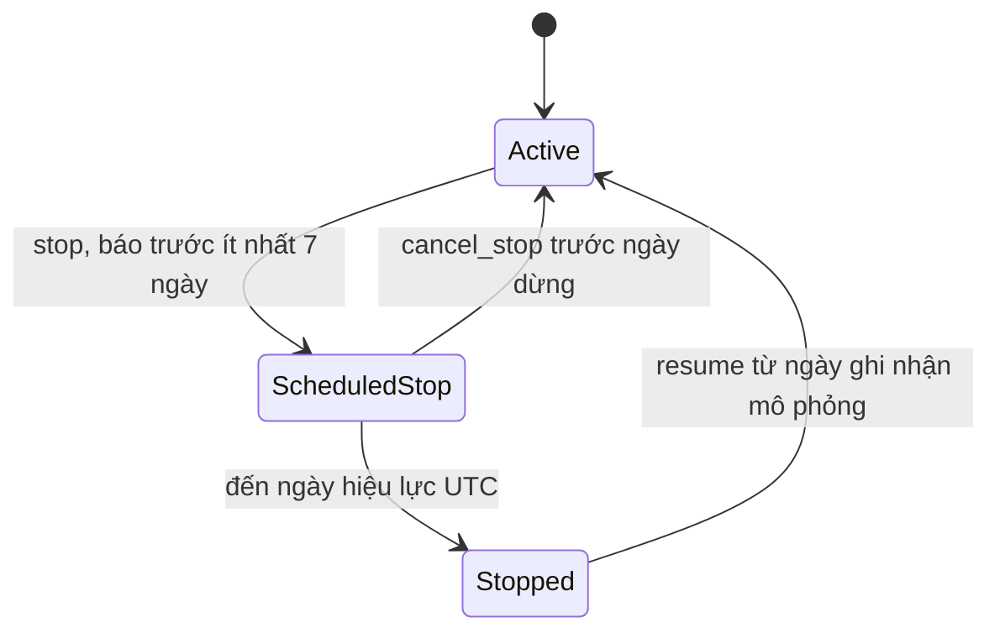

# M3 — CHG-084: ngừng nhập sản phẩm và bán tồn

<a id="status"></a>
## 1. Trạng thái đặc tả

<a id="step6-implemented"></a>
**Cập nhật bước6, 02/11/2026:** ProductSupplyForm/SellThrough và các view FE đã tích hợp API bước3/5; không thay BE/worker/schema. ProductDetail chọn ngày UTC từ origin đang xem, stop gợi ý ngày+7, hủy/mở lại hiệu lực cùng ngày ghi nhận; reason bắt buộc, expected_version/target gửi đúng lịch sử. Thiếu ngày, đang tải, prefix cũ hơn latest version hoặc conflict thì không ghi; 409 giữ lý do, yêu cầu tải lại chủ động. Chặn gửi lặp và callback sau unmount; sau lưu/reload nhắc tạo kế hoạch mới, không tính lại run đang xem. Lịch sử có phân trang, form thể hiện item–kho/loại và tồn/pending của kế hoạch nếu có.

Danh sách dùng ngày/status và bộ lọc server trước phân trang; schema chưa nâng vẫn xem catalog không ngày và form báo chưa bật tính năng. Ngày/chọn kho/loại giữ theo context/URL, xóa ngày không tự điền lại trong cùng kế hoạch. Trang vận hành dùng metadata frozen; stopped hiện bán tồn/chờ lô/hết hàng, giữ cảnh báo toán học và bỏ CTA nhập thêm. SellThrough đọc projection đã lưu, bảng/biểu đồ/CSV cùng origin/kho/item/loại/supplier; tổng tuyến dùng aggregate=route_day, biểu đồ khi chọn kho/item. Trong inventory run, Dự báo ưu tiên bán theo tồn; nhu cầu và đánh giá M05 vẫn xem trong chi tiết. Legacy409 yêu cầu kế hoạch mới, không giả đường0. Các status bước1–5 bên dưới giữ lịch sử; [kiểm trực tiếp](../../docs/development.md#handoff-chg084-step6). DBapp chưa nâng, bước7 chưa thực hiện, R07/T14 giữ mở.

<a id="step5-implemented"></a>
**Cập nhật bước5, 02/11/2026:** GET `/api/v1/runs/{key}/sell-through` và `/api/v1/runs/{key}/exports/sell_through` đã có. Cùng dataset/filter, không tính lại projection hoặc truy vấn lifecycle live. Chỉ inventory run complete; legacy không profile hoặc profile mới thiếu projection bán tồn trả409 feature_not_in_run để tạo kế hoạch mới. Chỉ kiểm DBtest; FE/cutover chưa triển khai. [Bàn giao](../../docs/development.md#handoff-chg084-step5).

Origin mặc định run.as_of_date, chọn bằng as_of_date; date_from/date_to lọc ngày mục tiêu. Bộ lọc kho/item/loại/supplier dùng catalog/policy frozen trước đếm/phân trang. aggregate=route_day cộng demand/sales/unserved/closing/receipts, item_count/stopped_items của toàn phạm vi lọc, không ép bằng raw route demand; không trả trạng thái chung gây hiểu nhầm nếu nhiều item. Split/block/state/alert_type/granularity/cadence không áp dụng cho dataset này và bị422, khoảng ngày đảo cũng422. Không có dữ liệu đúng origin/filter trả mảng rỗng. JSON context thêm projection_as_of_date; CSV có as_of_date của từng dòng cùng run/source/config/selection hash và giữ bảo vệ công thức, xuất hết phạm vi thay vì trang hiện tại.

Inventory/alerts/replenishments trả supply_status/replenishment_allowed/replenishment_block_reason/stock_below_rop/sell_through_state. Hai trường stock/sell state chỉ có giá trị khi dữ liệu tương ứng đã lưu/đủ để tính; legacy status null và allowed=true để giữ nghĩa nhập cũ, không nối cấu hình live. Replenishments có as_of_date chỉ hiện lô đã đặt trước/đúng ngày xem, metadata theo cutoff tương ứng; purchasing incoming/history vẫn dùng known_orders_through, không suy receipt thực ngoài kỳ đã lưu.

Workspace và purchasing lấy đủ inventory/lots trước phân trang; operational view chọn window_origin mới nhất cho mỗi item tại ranh giới replay và lô cùng window, không gộp hai thí nghiệm thành một tồn. Stopped không vào healthy hoặc danh sách đề xuất nhập; raw low stock/warnings vẫn là thông tin. Thêm supply_stopped_items trong summary/workspace warehouse totals, không xóa diagnostic hoặc đổi metric/mẫu số. Read model không sửa needs/Q/JSON/hash đã lưu. Các phần bước1–4 bên dưới là lịch sử.

<a id="step4-implemented"></a>
**Cập nhật bước4, 02/11/2026:** worker đã bỏ guard stage_not_implemented; simulation chỉ đọc supply_lifecycle_snapshot đã freeze, không truy vấn lifecycle live. Profile notice7_sellthrough_v1 mở khóa xử lý cung cấp; profile lạ hoặc thiếu timeline bị từ chối. Legacy không có profile giữ nghĩa/đầu ra cũ, không suy lifecycle từ danh mục live. Chỉ kiểm DBtest; read model/CSV/FE/cutover chưa triển khai. [Bàn giao](../../docs/development.md#handoff-chg084-step4).

recommend nhận keyword replenishment_allowed (mặc định true cho caller cũ); khi false Q=0/needs_replenishment=false, các ngưỡng/IP giữ nguyên. Nhánh tạo lô policy kiểm allowed riêng. Cảnh báo raw belowROP và threshold/depletion giữ để không thay mẫu số, có supply_status/replenishment_allowed/replenishment_block_reason/stock_below_rop/sell_through_state trong explanation. Trạng thái diagnostic cũ không được coi là lời thúc nhập; bước5/6 sẽ tích hợp read model/CTA, chưa mở trên app ở bước4.

Mỗi projection H14 của profile mới lưu forecast_demand_qty/projected_sales_qty/unserved_demand_qty bên cạnh date/receipts_qty/closing_forecast, thêm supply_status/replenishment_allowed theo ngày mục tiêu và thông tin đã biết tại origin. Chỉ cộng receipts đã biết trước Q mới; không dự đoán phần demand thiếu sang SKU khác hoặc sửa actual. Tồn0 có pending là waiting_receipts, có thể bán tiếp khi lô cũ về; ngày cạn đầu tiên khác trạng thái sold_out không còn pending. simulation_summary artifact hiện có bổ sung profile và số quyết định bị khóa; chi tiết projection nằm trong alerts.explanation, không có bảng/API/CSV mới ở bước4.

Verifier runs/supply_verification kiểm profile/timeline/version/action/ngày/provenance/cutoff, tự giải trạng thái và tính đường bán tồn; verification kiểm Q/needs/lô, origin/receipts/policy/path/metadata của explanation, counter và coverage/metric. Không gọi lại supply_state/recommend/project để tự xác nhận producer. Hàm pure_window thêm supply_changes=None: None là legacy, danh sách (kể cả rỗng) bật metadata profile mới. Các mục bước1–3 bên dưới là lịch sử.

<a id="step3-implemented"></a>
**Cập nhật bước3, 02/11/2026:** GET/POST `/api/v1/products/{key}/supply-changes`, product list/detail theo as_of_date, supply_status/filter và freeze profile/timeline đã triển khai trên DBtest. Chưa nâng DBapp, chưa có sell-through API/CSV/FE hoặc simulation cung cấp. Worker trả stage_not_implemented nếu snapshot chứa sự kiện cung cấp cho tới bước4, tránh xác nhận kết quả tính theo policy cũ.

POST nhận action/known_on/effective_on/reason/expected_version/target_change_id; reason trim, int version/target strict, không nhận extra. Ngày cực đại không đủ7ngày vẫn trả422, không overflow. Service khóa Item, kiểm latest version rồi validate timeline trước append; version cũ409, item thiếu404, chuyển trạng thái sai409. Trả201 gồm sự kiện mới, supply_version và state tại known_on. GET lịch sử trả items/total/page/page_size/supply_version/as_of_date/state; state null nếu thiếu ngày, version luôn mới nhất, lịch sử giảm theo version.

Product row thêm supply_status/stop_on/supply_version/supply_schema_ready. Không có ngày thì trạng thái null; supply_status filter thiếu ngày422. Filter SQL thực hiện trước count/offset/limit, lịch sử chỉ đọc theo batch item trong trang. DB chưa có bảng: đọc sản phẩm cũ không ngày vẫn được, các trường supply null và supply_schema_ready=false; yêu cầu mới theo ngày/POST/history/enqueue inventory trả503 supply_schema_required, không tự migrate hoặc giả định active.

Snapshot JSON-safe lấy sự kiện có known_on≤origin quyết định cuối và tồn tại lúc freeze; retry cùng Idempotency-Key trả snapshot đã lưu, không lấy lại live. Stock dùng origin, policy dùng period_end, alert dùng origin cuối có đủ14ngày. Source/forecast parent, snapshot/hash cũ giữ nguyên. [Bàn giao thực](../../docs/development.md#handoff-chg084-step3). Các phần bước1/2 và thiết kế bước4–7 bên dưới giữ mốc lịch sử/dự kiến.

**Cập nhật bước2, 02/11/2026:** migration0007_supply_lifecycle, ItemSupplyChange, supply_state và validate_supply_change đã có trong mã nguồn. Chỉ migrate DBtest; chưa nâng DBứng dụng hoặc triển khai API/ghi version/freeze/worker/FE bước3–7. Các đoạn dự kiến bên dưới giữ thiết kế đầy đủ và mốc bước1. [Bàn giao bước2](../../docs/development.md#handoff-chg084-step2).

Giao diện hàm thuần: supply_state(changes, item_id, decision_origin, target_date=None) nhận timeline dict với date hoặc ISOdate, chỉ lấy item và known_on≤origin, trả supply_status/replenishment_allowed/stop_change_id/stop_on/version của prefix đã biết. target_date mặc định origin và không được trước origin. validate_supply_change kiểm action/ngày/target/chuyển trạng thái của append, chưa ghi DB hoặc kiểm expected_version. Service khóa item/version và HTTP DTO thuộc bước3.

02/11/2026: **đặc tả được người dùng duyệt; lượt này chỉ thực hiện Markdown bước 1**. Chưa có migration `0007_supply_lifecycle`, bảng/API/profile/FE hoặc verifier mới được triển khai. Schema mã nguồn hiện tại là `0006_fixed_days`; bước này không kết nối/nâng DB. [Lộ trình và điểm dừng](../../docs/planning/PRODUCT_SUPPLY_LIFECYCLE_PLAN.md#steps), [yêu cầu](../../docs/requirements.md#supply-lifecycle-chg084), [bàn giao](../../docs/development.md#handoff-chg084).

Thông báo là khai báo mô phỏng của người dùng; không có nhãn NCC/EOL thực trong CSV, không tự suy ngừng cung cấp từ doanh số 0. Giữ M05/R05, raw, target/split, H14/L7/R1 và trạng thái R07/T14 chưa nghiệm thu.

<a id="states-and-time"></a>
## 2. Trạng thái, thời gian và thao tác

Khóa nghiệp vụ là `item_id` (warehouse/tuyến × SKU × product_type). Trạng thái cung cấp tách khỏi policy ROP/SS/lượng nhập và tách khỏi tồn mô phỏng.



| Trạng thái API dự kiến | Nhãn FE | Quy tắc |
|---|---|---|
| `active` | Đang cung cấp | Không có lịch dừng đang áp dụng. Policy quyết định Q bình thường. |
| `scheduled_stop` | Đã lên lịch ngừng | Đã biết lịch dừng nhưng ngày đang xét chưa đến hiệu lực; vẫn cho đề xuất nhập. |
| `stopped` | Đã ngừng nhập | Từ đầu ngày hiệu lực, chặn đề xuất/lô mới; không chặn receipts của lô đã đặt. |

`known_on` là ngày nhận/ghi nhận thông báo trong mô phỏng; không phải bằng chứng thông báo doanh nghiệp. `effective_on` là ngày bắt đầu hành vi. Hai trường dùng `date` UTC; `created_at` dùng `timestamptz` thực. Ví dụ 01/10/2025 thông báo, 08/10 dừng đặt, lô đặt 07/10 nhận 14/10 hợp lệ.

Mặc định triển khai: `known_on` không giảm qua các version của cùng item; cùng ngày phân thứ tự bằng version. Không chèn sửa lịch sử mô phỏng trước sự kiện đã ghi. Hủy hoặc mở lại thêm sự kiện mới, không xóa/cập nhật sự kiện cũ. Thay lịch dừng bằng hủy rồi tạo mới; lịch mới vẫn phải đủ 7 ngày kể từ ngày biết mới.

`cancel_stop` chỉ hợp lệ khi `known_on < effective_on` của stop đích. `resume` chỉ hợp lệ khi đã ngừng tại ngày ghi nhận, chưa mở lại; có hiệu lực ngay ngày mô phỏng đó. V1 không có lịch resume tương lai, dừng ngay trong ngày thông báo, sửa hàng loạt nhiều kho hoặc đổi ngày nhận các lô cũ.

Khi `stopped`, read model tính thêm `sell_through_state`: `selling_remaining` nếu tồn > 0; `waiting_receipts` nếu tồn = 0 và còn lô đã biết chưa về; `sold_out` nếu cả hai bằng 0. Trạng thái này thuộc run/ngày và có thể đổi khi nhận lô; không lưu trên item hoặc tự tắt dự báo nhu cầu.

<a id="database"></a>
## 3. DB dự kiến cho bước 2

Migration `0007_supply_lifecycle`, parent `0006_fixed_days`, thêm **một bảng** `item_supply_changes`; từ 13 lên 14 bảng nghiệp vụ khi thực thi. Không có bảng kết quả mới, không sửa 13 bảng/cột/hàng hiện có hoặc JSON frozen.

| Trường | Kiểu / ràng buộc dự kiến |
|---|---|
| `id` | bigint identity, PK |
| `item_id` | bigint NOT NULL, FK items RESTRICT |
| `version` | integer NOT NULL ≥ 1; UNIQUE(item_id, version) |
| `action` | text NOT NULL, một trong stop/cancel_stop/resume |
| `known_on`, `effective_on` | date NOT NULL |
| `target_change_id` | bigint nullable, FK lịch sử RESTRICT; đích phải là stop cùng item |
| `reason` | text NOT NULL, trim không trắng, API tối đa 1.000 ký tự |
| `is_assumed` | boolean NOT NULL, mặc định true; v1 chỉ khai báo mô phỏng |
| `assumption_source` | text NOT NULL, giá trị v1 `user_declared_supply_simulation_v1` |
| `created_at` | timestamptz NOT NULL, server time |

DB check: stop có target null và `effective_on >= known_on + 7`; cancel_stop/resume có target và `effective_on = known_on`. FK ghép bảo đảm target cùng item; service kiểm đích là stop và chuyển trạng thái hợp lệ. Index theo `(item_id, known_on, version)` phục vụ đọc timeline. Không tạo bản ghi active cho 920 item: không có sự kiện nghĩa là active/version 0.

Service khóa hàng Item hiện hữu, kiểm `expected_version` của lịch sử cung cấp (độc lập version policy), xác thực chuyển trạng thái, rồi append version tiếp theo trong một transaction. Một lịch dừng chưa được hủy/mở lại cho mỗi item; hai request đồng thời chỉ một request thành công. Không thêm trigger tự đổi trạng thái theo đồng hồ hoặc cron quét ngày dừng; resolver tính theo ngày được hỏi.

Downgrade chỉ được drop bảng khi rỗng; có sự kiện thì từ chối trong transaction. Trước cutover DB ứng dụng ở bước 7 phải backup và restore thử; không quay code/DB về bản bỏ qua lịch dừng đã khai báo. Các thao tác này chưa thực hiện ở bước 1.

<a id="api"></a>
## 4. API dự kiến cho bước 3 và bước 5

Giữ DTO extra-forbid, validation strict và HTTP/service dùng chung với CLI/worker hiện có. Không thêm dependency hoặc dịch vụ riêng.

| Endpoint | Hợp đồng mới dự kiến |
|---|---|
| `GET /api/v1/products/{id}/supply-changes` | Lịch sử version giảm dần, page/page_size theo chuẩn hiện có; `as_of_date` tùy chọn cho trạng thái tại ngày mô phỏng. |
| `POST /api/v1/products/{id}/supply-changes` | `action`, `known_on`, `effective_on`, `reason`, `expected_version` ≥ 0; `target_change_id` null cho stop, bắt buộc cho hai action còn lại. Trả 201 với sự kiện mới và trạng thái theo ngày ghi nhận. |
| `GET /api/v1/products` và detail | Thêm `as_of_date`, `supply_status` active/scheduled_stop/stopped; trả trạng thái, ngày dừng và `supply_version`. Lọc trước đếm/phân trang. |
| `GET /api/v1/runs/{id}/sell-through` | Chỉ inventory run complete có profile mới; dùng Filters hiện có cho as_of_date/kho/item/loại/ngày và phân trang. |
| `GET /api/v1/runs/{id}/exports/sell_through` | Cùng dataset/filter với endpoint bán tồn, xuất toàn phạm vi thay vì chỉ trang đầu; metadata source/config/run và bảo vệ CSV như hiện có. |

API sản phẩm thiếu `as_of_date` vẫn giữ tương thích đọc quản lý, trả lịch/version mới nhất nhưng trạng thái theo ngày là null; lọc `supply_status` mà thiếu ngày bị 422. Không tự lấy ngày hiện tại hoặc ngày cuối nguồn để giả làm ngày mô phỏng. `supply_version` luôn là latest version để kiểm ghi; ngày xem quá khứ không làm giảm expected_version.

Lỗi: item không tồn tại → 404; ngày/payload/lý do sai → 422; version cũ, ngày ghi nhận lùi, trùng lịch hoặc chuyển trạng thái không hợp lệ → 409. Request ghi trùng không thêm version thứ hai: expected_version cũ bị 409, FE chặn gửi lặp khi đang lưu. Reason được coi là văn bản, không thực thi HTML.

Read model inventory/purchasing/workspace/alerts thêm `supply_status`, `replenishment_allowed`, `replenishment_block_reason` (`supply_stopped` khi chặn), `stock_below_rop` và sell_through_state khi có đủ dữ liệu. `needs_replenishment=false` và Q=0 khi chặn; `stock_below_rop` vẫn mô tả phép so sánh thực. Không đếm item đang ngừng thành healthy chỉ vì needs_replenishment=false. Các trường mới đọc từ snapshot của run, không JOIN lịch cung cấp live để sửa kết quả cũ.

<a id="snapshots-and-causality"></a>
## 5. Snapshot và tính nhân quả

Run mới thuộc stock_projection/policy_replay/alert_replay lưu `supply_lifecycle_profile=notice7_sellthrough_v1` và `supply_lifecycle_snapshot` chứa lịch sử/version của item thuộc catalog cần dùng. Chỉ lấy sự kiện đã tồn tại lúc enqueue; worker không tải bổ sung sự kiện live sau đó. Có thể đóng băng sự kiện đến decision origin lớn nhất của replay, nhưng mỗi lần tính bắt buộc lọc `known_on <= decision_origin` trước khi giải timeline.

- Stock projection: knowledge cutoff là run.as_of_date cho toàn đường H14.
- Policy replay: knowledge cutoff cuốn theo từng ngày ra quyết định.
- Alert replay: knowledge cutoff giữ origin của từng cửa sổ 14 ngày.
- Sự kiện đã biết có hiệu lực tương lai được xét theo ngày mục tiêu; cancel/resume biết sau cutoff không sửa projection trước đó, kể cả sau này mới chạy worker.
- Run cũ không có profile giữ hành vi cũ; không backfill config/hash hoặc nối lifecycle live. Endpoint bán tồn mới trả 409 `feature_not_in_run` và hướng dẫn tạo kế hoạch mới cho run thiếu profile, không báo dữ liệu bằng 0.

Lịch sử cung cấp là cấu hình mô phỏng mới tại cấp item, không được đọc ngược vào nguồn import/forecast parent. Vẫn dùng forecast parent cũ tương thích làm đầu vào nhu cầu; không yêu cầu refit chỉ vì đổi lịch cung cấp. Snapshot mới và manifest/verifier phải thể hiện profile, lịch sử và version đã khóa.

<a id="forecast-and-worker"></a>
## 6. Model, worker và dự báo bán tồn dự kiến cho bước 4

Giữ model dự báo quantity bán theo tuyến, phân bổ 90 ngày weekday/30–90 ngày item, giá trị `item_forecasts.forecast_qty` và metric M05 hiện có. Đây vẫn là ước tính từ lượng bán quan sát, không tự nhận đã đo được nhu cầu thị trường mất do hết hàng. Không xóa lịch sử, gán actual tương lai bằng 0, renormalize share hoặc chuyển nhu cầu sang SKU khác.

Với từng ngày trong H14, chỉ dùng lô đã biết trước quyết định, không thêm Q vừa khuyến nghị:

```text
available_qty         = opening_forecast + known_receipts_qty
projected_sales_qty   = min(forecast_demand_qty, available_qty)
closing_forecast      = available_qty - projected_sales_qty
unserved_demand_qty   = forecast_demand_qty - projected_sales_qty
```

Dự báo giữ số thực không âm, không làm tròn thành sale thực. Tồn 10, nhu cầu 4 mỗi ngày → bán 4/4/2/0, tồn 6/2/0/0; nhu cầu chưa đáp ứng ngày ba bằng 2. Hết hàng chưa có lô về thì dự kiến bán 0; lô cũ về sau đó cho phép bán tiếp. Không dự đoán ngoài H14 để lấp ngày bán hết; nếu chưa cạn trong H14 thì hiển thị chưa xác định trong phạm vi. Ngày cạn đầu tiên khác trạng thái hết hàng không còn pending.

Tại quyết định đã stopped: giữ ROP/SS/target/IP theo công thức hiện tại để đối soát, nhưng chặn needs_replenishment/Q và chặn riêng nhánh tạo Replenishment trong worker. Nhận lô cũ và fulfill sale thực vẫn giữ balance/ETA7/receipt một lần; không cắt actual/shortage vì nhãn ngừng nhập. Trước ngày dừng và sau resume dùng lại policy hiệu lực bình thường; sửa policy không tác động timeline cung cấp.

Giữ cảnh báo toán học xuống ngưỡng/cạn làm thông tin; bổ sung lý do ngừng nhập và tính có thể hành động để FE không thúc nhập. Danh sách công việc nhập và CTA loại item bị chặn, không âm thầm xóa dữ liệu chẩn đoán. Giữ nguyên quy tắc tính metric/mẫu số, báo riêng số item ngừng và phạm vi mô phỏng; không nhận cải thiện R07 hoặc đạt mục tiêu chỉ vì thay lifecycle.

Lưu các trường projection mới trong explanation JSON của depletion alert và artifact hiện có, không tạo bảng forecast bán tồn riêng. Endpoint/CSV đọc phần đã lưu với `item_id`, `as_of_date`, `target_date`, `horizon_day`, forecast_demand_qty/projected_sales_qty/receipts_qty/closing_forecast/unserved_demand_qty cùng ngữ cảnh cung cấp. Tổng theo tuyến là tổng đầy đủ item cùng run/origin/ngày; không gán nó bằng raw route forecast.

Verifier độc lập dùng snapshot và công thức riêng để kiểm lịch cung cấp, Q/lô, projection, receipts và cân bằng; không chỉ gọi lại resolver/recommend của producer để tự xác nhận. Run không có sự kiện phải giữ kết quả nghiệp vụ/metric cơ sở, ngoài metadata/profile/trường bổ sung được giao.

<a id="frontend"></a>
## 7. FE dự kiến cho bước 6

Tận dụng trang Products/ProductDetail, hook HTTP, form và nhãn hiện có; thêm khu vực **Tình trạng cung cấp** độc lập form ROP/SS/lượng nhập. Không thêm màn hình quản trị hoặc framework trạng thái mới.

- Ngày xem/ghi nhận mô phỏng mặc định từ kế hoạch đang mở; chưa có ngày thì hiển thị chọn ngày, không cho lưu. Danh sách sản phẩm vẫn đọc được khi chưa chọn run/ngày.
- Form dừng: kho/SKU/loại/carrier rõ ràng, ngày thông báo, ngày ngừng sớm nhất +7, lý do bắt buộc. Có phần xem tác động trước nút lưu, nêu lô đang về vẫn nhận và run đang xem chưa đổi.
- Nút hủy lịch hoặc mở nhập lại theo trạng thái tại ngày đã chọn; giữ lịch sử/version và xử lý 409 bằng tải lại, không tự gửi lại mutation. Sau lưu đọc lại cấu hình, thông báo tạo kế hoạch mới để tính tác động.
- Nhãn/lọc trạng thái trên danh sách; đổi bộ lọc về trang 1, server lọc trước phân trang. Back/reload giữ ngữ cảnh kho/item/ngày theo pattern URL hiện có.
- Tồn/nhập/tổng quan/cảnh báo dùng trạng thái frozen. Khi danh mục mới hơn kế hoạch, ghi rõ hai ngữ cảnh; không lấy trạng thái live để tắt đề xuất của run cũ.
- Dự báo trong inventory run có profile mới hiển thị **Dự kiến bán theo tồn**, raw nhu cầu trong phần chi tiết; standalone forecast giữ góc nhìn nhu cầu. Run cũ thiếu profile có thông báo tạo mới, không vẽ đường 0 giả.
- Giữ focus, nhãn trường, loading/error/empty, chặn gửi lặp và khả năng dùng ở desktop/390px. Item đã ngừng không có CTA nhập thêm; vẫn xem tồn, pending, CSV và lịch sử.

<a id="test-matrix"></a>
## 8. Ma trận kiểm dự kiến cho bước 2–7

| Ca | Kết quả cần đạt |
|---|---|
| Dừng cùng ngày, sau 6 ngày, sau đúng 7 ngày | 422, 422, thành công; timezone trình duyệt không đổi ngày UTC. |
| Hủy trước/ngay ngày hiệu lực | Trước ngày hợp lệ; đúng ngày phải dùng resume, không hủy quá khứ. |
| Resume khi active/scheduled/stopped | Chỉ stopped hợp lệ; hiệu lực bằng ngày ghi nhận và giữ stop cũ. |
| Hai lịch chờ, target khác item, ngày ghi nhận lùi, lý do trắng | Bị từ chối; không có hàng lịch sử dở dang. |
| Hai request cùng expected_version hoặc retry body cũ | Một success, một 409; không nhân đôi sự kiện. |
| Sửa ROP/SS/fixed quantity khi stopped | Không mở nhập lại; version policy và supply độc lập. |
| Cùng SKU ở hai kho | Chỉ item được thao tác thay đổi. |
| Ngày trước/đúng ngày dừng, rồi resume | Trước dùng policy; đúng ngày Q=0/không lô mới; sau resume dùng policy lại. |
| Lô đặt trước dừng, ETA sau dừng | Nhận đủ một lần đúng ETA, balance giữ; không tự cancel. |
| Stock 10/demand 4, không pending | Dự kiến bán 4/4/2/0, unserved vẫn đủ; stock không âm. |
| Stock 0 có pending hoặc không pending | waiting_receipts hoặc sold_out; lô về có thể bán tiếp. |
| H14 chưa cạn, missing forecast/actual | Không bịa ngày cạn hoặc zero; giữ validation thiếu dữ liệu hiện có. |
| Thông báo/cancel sau origin; stop đã biết nhưng hiệu lực trong H14 | Không dùng thông tin tương lai; áp dụng lịch đã biết đúng ngày mục tiêu. |
| Policy replay và alert replay | Knowledge cutoff cuốn ngày/giữ origin đúng hợp đồng; verifier tự kiểm. |
| Không có sự kiện và run cũ | Parity nghiệp vụ/metric; JSON/hash/artifact cũ giữ; sell-through legacy trả 409 rõ nghĩa. |
| API/CSV/filter/pagination/aggregate | Cùng run/ngày/snapshot; export đầy đủ, không tính tổng từ một trang. |
| Form lưu–reload, 409, Back, focus, desktop/390px | Trạng thái/URL đúng, lỗi rõ, không tràn trang hoặc gửi trùng. |
| Migration upgrade/downgrade | 13 bảng cũ/hàng/hash nguyên; metadata0diff; có lịch sử thì chặn downgrade. |

Kiểm MD bước 1 chỉ kiểm đặc tả/link/anchor/sơ đồ và bảo toàn phạm vi tệp, không phải bằng chứng các ca trên đã chạy. Bước 7 mới kiểm suite BE/M2 phù hợp, React/build/pip check, API/CSV/browser, backup/restore và app cutover theo lộ trình; không dùng số test lịch sử thay kết quả trực tiếp.
