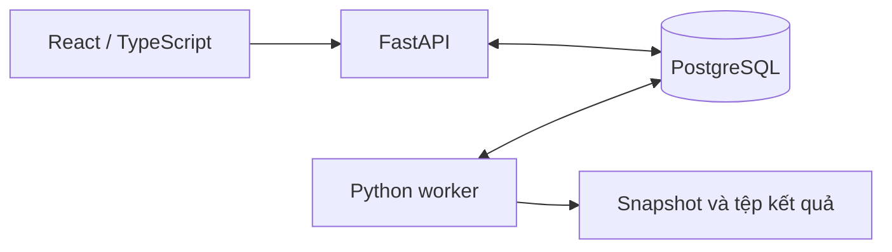

# SIGMA — Dự báo nhu cầu và lập kế hoạch tồn kho SIM/eSIM

SIGMA hỗ trợ theo dõi nhu cầu bán, lập kế hoạch tồn kho, đề xuất nhập hàng và cảnh báo nguy cơ cạn hàng. Hệ thống kết hợp **dự báo nhu cầu** với **tồn hiện có, lô đang về và cấu hình sản phẩm** để giải thích khi nào cần bổ sung, bổ sung bao nhiêu và hàng có về kịp hay không.

Đây là sản phẩm thực tập phục vụ nghiên cứu và demo. Tồn kho và lô nhập trong demo được mô phỏng; hệ thống chưa gửi đơn mua hàng thật đến nhà cung cấp.

## Bài toán hệ thống giải quyết

- Sản phẩm nào cần nhập thêm và lượng nhập mỗi lần là bao nhiêu?
- Lô đang về đã đủ lượng và có về trước lúc dự kiến cạn không?
- Trong 14 ngày tới, sản phẩm có nguy cơ xuống ngưỡng nhập hoặc cạn hàng không?
- Kế hoạch thay đổi thế nào khi chủ động ngừng nhập hoặc nhà mạng ngừng dịch vụ?

SIGMA theo dõi từng sản phẩm theo SKU, loại SIM/eSIM, nhà cung cấp và kho. Cạn hàng được xét cho từng sản phẩm tại kho tương ứng.

## Các chức năng chính

| Chức năng | Nội dung |
| --- | --- |
| Quản lý sản phẩm | Cấu hình ngưỡng nhập tối thiểu, số ngày tồn an toàn, lượng nhập mỗi lần và kho nhận mặc định. |
| Dự báo nhu cầu | Xem nhu cầu dự báo, phân bổ xuống sản phẩm/ngày và so sánh với số bán nguồn khi có dữ liệu đối chiếu. |
| Kịch bản | Lưu phiên bản thiết lập, chọn công việc, chạy và xem tiến độ/kết quả tại một trang. |
| Tồn kho và nhập hàng | Theo dõi tồn, lượng đang về, lô nhập mô phỏng, ngày đặt và ETA. |
| Lịch cung cấp | Quản lý ngừng nhập nội bộ và thông báo nhà mạng ngừng nhập/bán sản phẩm. |
| Cảnh báo và báo cáo | Xem nguy cơ xuống ngưỡng/cạn hàng, lý do quyết định và xuất CSV theo lượt chạy. |

## Ba loại công việc trong kịch bản

| Công việc | Cách hoạt động |
| --- | --- |
| **Kế hoạch tồn kho** | Tính ngưỡng, khuyến nghị nhập và chiếu tồn 14 ngày tại một mốc từ tồn cùng các lô đã biết; chưa coi khuyến nghị là lô đã đặt. |
| **Kế hoạch nhập hàng** | Mô phỏng bán, đặt lô và nhận hàng theo ETA; cập nhật quyết định và cảnh báo từng ngày. |
| **Kiểm tra cảnh báo** | Đối chiếu cảnh báo với sự kiện cạn trong hồi cứu để đo khả năng báo sớm; không tự tạo lô mới trong cửa sổ đánh giá. |

Lưu thiết lập không tự chạy công việc. Mỗi lượt chạy chốt đầu vào và cấu hình riêng, nên sửa thiết lập hiện tại không viết lại kết quả đã lưu.

## Luồng xử lý tổng quát

1. Chuẩn bị nguồn bán và dự báo nhu cầu từ nền mô hình M2.
2. Phân bổ dự báo theo sản phẩm và ngày để có nhu cầu cho 14 ngày tiếp theo.
3. Kết hợp nhu cầu với tồn, lô đang về, chính sách nhập và lịch cung cấp đã chốt.
4. Worker tính kế hoạch, kiểm chứng kết quả rồi lưu tồn, lô nhập và cảnh báo.
5. Giao diện đọc kết quả qua API để hiển thị bảng, biểu đồ, chi tiết và CSV.

Mô hình dự báo **nhu cầu bán**. Ngày dự kiến cạn được suy ra từ nhu cầu đó cùng tồn và lịch nhận hàng.

Các khái niệm chính:

- **SS:** lượng dự phòng, tính từ số ngày tồn an toàn và mức nhu cầu dự báo.
- **ROP:** ngưỡng xét bổ sung, lấy giá trị lớn hơn giữa nhu cầu dự báo 7 ngày cộng SS (làm tròn lên) và ngưỡng nhập tối thiểu.
- **IP:** tồn hiện có cộng lượng đang về, dùng để tránh đặt thêm khi đã đủ hàng theo chính sách.
- **Q:** lượng một lô nhập cố định đã cấu hình, sau khi áp các ràng buộc cung cấp.
- **ETA:** ngày dự kiến nhận lô; cấu hình hiện tại là 7 ngày sau ngày đặt. Quyết định được xét hằng ngày.

Cảnh báo cạn nhìn trước 14 ngày. Nếu dự kiến cạn sau ít nhất 7 ngày thì xếp loại **sớm**; dưới 7 ngày thì xếp loại **khẩn**. Cảnh báo dưới ROP được phân biệt với cảnh báo tồn về 0.

## Xử lý ngừng cung cấp

| Trường hợp | Hành vi |
| --- | --- |
| **Ngừng nhập nội bộ** | Chặn đặt lô mới từ ngày hiệu lực tại kho; vẫn bán tồn được phép bán và nhận các lô đã đặt. |
| **Nhà mạng ngừng dịch vụ** | Thông báo mới áp dụng cho cùng SKU và loại sản phẩm của nhà mạng tại mọi thị trường/kho hiện có. Xét ETA và khả năng bán trước hạn; từ ngày hiệu lực chặn cả nhập và bán mới. |

Lô đã đặt không tự bị hủy hoặc từ chối nhận. Nếu về sau hạn ngừng dịch vụ, lượng hàng đó có thể trở thành tồn bị chặn bán. Ngày biết thông báo và ngày hiệu lực được lưu riêng để tránh sử dụng thông tin tương lai cho quyết định quá khứ.

## Kiến trúc hệ thống

API kiểm tra yêu cầu và lưu công việc trong bảng `runs` của PostgreSQL. Worker nhận công việc ở nền, tính toán và kiểm chứng trước khi chuyển sang hoàn tất. Hàng đợi hiện dùng **PostgreSQL**, chưa dùng Redis. FE theo dõi trạng thái và đọc kết quả qua API.

| Thành phần | Vị trí |
| --- | --- |
| Mô hình và đánh giá dự báo nền | `M2/` |
| Giao diện React | `web/frontend/` |
| API, worker và nghiệp vụ | `web/backend/` |
| Tài liệu đặc tả M3 | `M3/docs/` |
| Điểm khởi động demo đã chuẩn bị | `src/start_demo.py` |

## Tài liệu chi tiết

- [Nghiệp vụ và công thức](M3/docs/01-functional-spec.md)
- [Mô hình dữ liệu và ERD](M3/docs/02-data-model.md)
- [Backend, API và worker](M3/docs/03-backend-api.md)
- [Giao diện và luồng thao tác](M3/docs/04-frontend-spec.md)
- [Vòng đời cung cấp sản phẩm](M3/docs/07-product-supply-lifecycle.md)
- [Chuẩn bị và vận hành demo](web/backend/configs/DEMO_RUNTIME.md)
- [Kiểm tra và bàn giao từng thay đổi](docs/development.md)

Demo trên máy cá nhân cần bộ dữ liệu/cấu hình riêng và các tiến trình hoạt động. Mã nguồn không kèm dữ liệu bán riêng tư, database, credential hoặc runtime demo.
