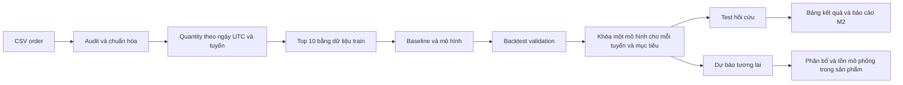

# Hiểu M2 SIGMA từ dữ liệu đến kết quả

**CHG-045/E73 — 14/10/2026:** nhánh `cleanup/m2-final` chỉ giữ code M2 final. Xem [bản đồ code hiện hành](../M2/README.md) và [khôi phục code cũ](review-log.md#removed-docs-chg070). Các lệnh/đường code M1, M3, V13 và thử nghiệm bên dưới là lịch sử, cần nhánh backup để chạy; dữ liệu, kết quả, bằng chứng và tiêu chí nghiệm thu không đổi.

Tài liệu ôn báo cáo cho Chủ nhật 11/10/2026. Đối chiếu ngày 09/10/2026, Asia/Saigon, tại checkout `C:/Users/Admin/OneDrive/Desktop/WorksSpace/Sigma`.

Nguồn chính: [34 trang thuyết trình](Bài%20Báo%20Cáo%20M2.pdf), [bộ báo cáo tổng hợp đã khóa](../M2/reports/published_m2_20261007/README.md), mã trong `src/`, `M2/models/`, `sigma/forecasting/` và lịch sử thử nghiệm trong [review-log](review-log.md). Không sửa slide, thuật toán, cấu hình hoặc lựa chọn mô hình trong lượt này.

**Điều cần nhớ:** nhóm dự báo số đơn vị sản phẩm bán theo tuyến và ngày đặt UTC. Ba họ mô hình được thử với hai mục tiêu: từng ngày và trực tiếp tổng 7 ngày. Phương án chọn theo validation từng tuyến đạt **9/10 tuyến tổng 7 ngày, MAPE trung bình test 15,89%**; **LG U+ 20,69% chưa đạt**. Dự báo ngày vẫn **0/10, MAPE 46,74%**. Test là đánh giá hồi cứu; kết quả tuần chưa thay nghiệm thu ngày R05.

## 1. M2 đang giải quyết bài toán gì?

Một **tuyến** là cặp `(destination_country, carrier)`, ví dụ Japan / NTT Docomo. Với mỗi tuyến, sau khi chốt ngày D, nhóm muốn dự báo quantity sẽ bán trong D+1 đến D+14. `quantity` là số đơn vị sản phẩm trên giao dịch: hai giao dịch quantity 2 và 3 tạo số bán 5, không phải 2.

M2 tập trung kiểm tra dữ liệu, xây dựng mô hình, so sánh phương pháp và đánh giá sai số. Tồn kho, lịch nhập, ngưỡng nhập và cảnh báo là phần downstream/M3. Cùng source có cả hai phần, nhưng bảng kết quả M2 top 10 không phải kết quả nghiệm thu tồn kho.



Ba tầng cần phân biệt: **đã có mã triển khai**, **có kết quả thực nghiệm**, **đạt tiêu chí nghiệm thu**. Có nhiều mô hình hoặc tests không tự chứng minh đã đạt MAPE 20%.

## 2. Dữ liệu ban đầu: có gì, dùng gì?

Theo slide và báo cáo đã khóa, nguồn có **100.000 dòng, 20 cột**, ngày đặt từ 01/01/2024 đến 31/12/2025 UTC, **731 ngày và 46 tuyến**. Có **93.104 dòng success**, tổng **118.296 quantity**. Các số này được đối chiếu giữa tài liệu; CSV gốc không có trong checkout hiện tại để audit lại toàn bộ.

Người dùng đã mô tả snapshot order là giả định. Chưa xác minh độc lập cơ chế sinh dữ liệu. Khi báo cáo nên gọi đúng là “snapshot order được cung cấp, người dùng mô tả là giả định”, không nhận là dữ liệu vận hành doanh nghiệp đã kiểm chứng.

| Nhóm cột | Cột | Vai trò trong hệ thống |
|---|---|---|
| Khóa và thời gian | `order_id`, `order_datetime`, `activation_datetime` | Dedup, xác định ngày đặt UTC, audit activation riêng |
| Tuyến | `destination_country`, `carrier`, `region` | Hai cột đầu xác định tuyến; region không chứng minh kho thật |
| Sản phẩm | `sku`, `product_type`, `plan_type`, `data_gb`, `validity_days` | Chi tiết sản phẩm/M3; một số thử nghiệm cũ dùng thống kê lịch sử sản phẩm |
| Số lượng và tiền | `quantity`, `unit_price_vnd`, `unit_cost_vnd`, `gross_revenue_vnd` | Quantity tạo target; tiền được đối soát riêng |
| Kênh và thanh toán | `sales_channel`, `payment_method` | Thuộc tính giao dịch; không mặc định biết trước giao dịch tương lai |
| Khách và trạng thái | `customer_id`, `customer_type`, `order_status` | Trạng thái chọn sales; ID không làm feature trực tiếp |

**Thiếu activation:** slide ghi 5.691 dòng trên toàn nguồn. Theo E03 lịch sử, chúng thuộc failed/timeout/pending; không nên nói “có 5.691 sale success thiếu activation”. Quy tắc xử lý vẫn giữ sale success hợp lệ nếu gặp activation thiếu. Ca đó đã được kiểm bằng dữ liệu giả trong lượt đọc này.

**Những gì nguồn không cung cấp:** tồn đầu, lịch hàng về, lead time nhà cung cấp, mapping đối tác thật. Source tạo/đọc giả định mô phỏng cho các phần này. Không suy chúng từ `validity_days`, không xin thêm dữ liệu doanh nghiệp đã xác định không cung cấp.

## 3. Target: nhóm thực sự dự báo đại lượng nào?

```text
y_r(t) = tổng quantity của giao dịch hợp lệ có order_status == success
         thuộc tuyến r và UTC_date(order_datetime) == t
```

Mã thực hiện: [audit_orders](../src/data.py), rồi `daily_sales` trong cùng module. Cấu hình hiện hành có `sales_statuses = ["success"]`, target version `sales-success-utc-v1`.

Đây là **A08 đề xuất đang dùng cho thực nghiệm**, được người dùng cho phép thử; không gọi là bộ lọc mentor xác nhận hoặc quy tắc kế toán. M01/M02 vẫn là xác nhận mentor do người dùng thuật lại.

`refunded`, `failed`, `timeout`, `pending` không vào sales cơ sở. Không tạo lượng hoàn trả âm hoặc ngày hoàn nhập vì thiếu lịch sử chuyển trạng thái. Activation không tạo target, không chuyển sale sang ngày kích hoạt và không làm điều kiện loại một sale hợp lệ.

**Giới hạn snapshot:** trạng thái cuối trong CSV chưa chứng minh trạng thái đó đã biết tại từng origin trong quá khứ. Việc feature không nhìn tương lai giải quyết rò rỉ trong phép tính, chưa tái dựng đầy đủ dữ liệu vận hành có sẵn lúc đó.

## 4. Xử lý dữ liệu: từ giao dịch sang chuỗi thời gian

Luồng trong [src/data.py](../src/data.py):

1. **Bảo toàn nguồn:** tính SHA-256 trước và sau audit; xử lý trên bản dẫn xuất.
2. **Kiểm schema:** đủ đúng 20 cột, không có cột trùng hoặc dòng lệch số trường.
3. **Trim khoảng trắng:** có đếm/log; nếu làm va chạm khóa mặt hàng thì chặn. Code không tự đoán hoặc đổi trạng thái lạ thành success.
4. **Parse thời gian:** bắt buộc timestamp có timezone; chuyển UTC rồi lấy ngày. Không dùng timezone của máy để gán ngày bán.
5. **Kiểm quantity và khóa:** quantity nguyên dương; thiếu khóa, timestamp lỗi, trạng thái lạ gây lỗi chặn.
6. **Dedup:** cùng order ID và nội dung giống nhau giữ một bản, log dòng/quantity loại; cùng ID nhưng nội dung mâu thuẫn thì chặn. Nội dung giống nhưng ID khác không tự xóa.
7. **Audit tiền và activation riêng:** lỗi tiền không tự làm mất quantity hợp lệ; activation không lọc sales.
8. **Chọn success và aggregate:** cộng quantity theo ngày × tuyến, đếm order khác nhau, tổng hợp doanh thu với cờ hợp lệ.
9. **Tạo lịch liên tục:** ghép ngày với tuyến; giữ kiểm tra tổng quantity trước/sau.

Theo quy mô báo cáo, toàn lưới có 731 × 46 = **33.626 dòng ngày × tuyến**. Đây là dữ liệu aggregate, khác 100.000 dòng giao dịch.

| Trường hợp | Cách biểu diễn |
|---|---|
| Ngày không giao dịch trong phạm vi được giả định quan sát đầy đủ | Sales = 0 |
| Ngày được khai báo thiếu nguồn | Sales = missing, `actual_available = False` |
| Ngày tương lai chưa có actual | Actual trống, không chấm metric |

Code hỗ trợ danh sách `missing_days`; nó không tự phát hiện mọi ngày mất nguồn từ sự vắng mặt giao dịch. Việc điền 0 mặc định dựa trên giả định phạm vi quan sát đầy đủ. Không xóa spike hoặc ngày bán thấp để làm đẹp MAPE. Hàm phát hiện bất thường dùng lịch sử trước ngày đang xét để **gắn cờ sau quan sát**, không dự báo trước cú sốc và không xóa giao dịch.

## 5. Chia thời gian, chọn top 10, backtest

| Tập | Thời gian | Ngày | Dòng ngày × top 10 | Quantity top 10 |
|---|---|---:|---:|---:|
| Train | 01/01/2024–30/06/2025 | 547 | 5.470 | 40.549 |
| Validation | 01/07/2025–30/09/2025 | 92 | 920 | 8.637 |
| Test hồi cứu | 01/10/2025–31/12/2025 | 92 | 920 | 7.765 |

Top 10 được xếp theo tổng quantity **train**, hòa theo tên tuyến; không dùng test, doanh thu hoặc số activation. Hàm: `route_top` trong [data.py](../src/data.py). Các dòng/quantity trên là phần top 10, không phải toàn 46 tuyến.

**Origin D** là ngày cuối đã quan sát. **Horizon h** là số ngày từ D tới ngày cần dự báo. Tại D = 30/09/2025, h1 là 01/10, h7 là 07/10 và h14 là 14/10.

Backtest tiến từng ngày; mô hình **refit mỗi 7 ngày**. Tại các origin sau, có thể dùng actual của những ngày đã qua; không dùng actual của ngày còn nằm sau origin. Vì vậy “test” trong backtest không có nghĩa mọi mô hình luôn chỉ học đến 30/06. Quy tắc/hyperparameter được khóa; tham số được refit bằng nhãn đã hoàn tất theo protocol.

| Thành phần | Giữa hai lần refit |
|---|---|
| LightGBM | Giữ cây đã fit, cập nhật feature lịch sử tới origin hiện tại |
| SARIMA | Giữ tham số, cập nhật state với quan sát mới đã biết |
| Prophet | Giữ hệ số đã fit; dự báo tại ngày mục tiêu mới |

**Chống rò rỉ:** feature quantity chỉ tới origin; lịch ngày tương lai được biết trước; nhãn huấn luyện phải có `label_end <= fit_cutoff`. Ví dụ tổng D+1…D+7 chưa được dùng làm nhãn train ở D+3. Chuẩn hóa và head hiệu chỉnh cũng chỉ học từ dữ liệu đã biết. Các tests có sửa dữ liệu sau origin rồi kiểm forecast tại origin không đổi.

## 6. Hai phương pháp dự báo trong slide 15–16

### Cách 1: dự báo từng ngày rồi cộng

```text
Đầu ra ngày: y_hat(D+1), ..., y_hat(D+14)
Tổng khối 1 = sum(y_hat(D+h), h=1..7)
Tổng khối 2 = sum(y_hat(D+h), h=8..14)
```

Mô hình học nhãn ngày. Kết quả tổng chỉ được tạo sau khi cộng đủ bảy dự báo. Ưu điểm là có lịch nhu cầu từng ngày. Mô hình được chọn tốt theo MAPE ngày chưa chắc tối ưu tổng tuần.

### Cách 2: dự báo trực tiếp tổng 7 ngày

```text
Y1(D) = sum(y(D+h), h=1..7)
Y2(D) = sum(y(D+h), h=8..14)
```

LightGBM học trực tiếp hai nhãn này, dùng `block` phân biệt khối. SARIMA/Prophet học chuỗi tổng trượt **gắn với ngày kết thúc**:

```text
S(t) = y(t-6) + ... + y(t)
S(D+7)  = y(D+1) + ... + y(D+7)
S(D+14) = y(D+8) + ... + y(D+14)
```

Vì vậy runner lấy forecast ở bước **7 và 14**, không lấy S(D+1). S(D+1) chứa sáu ngày đã quan sát và chỉ một ngày tương lai. Mã: [target_history/prediction_rows](../M2/models/common.py), `ts_job` trong [families.py](../M2/models/families.py).

Đây là **hai tổng liên tiếp 7 ngày tính từ origin**, không mặc định là tuần lịch thứ Hai–Chủ nhật. Với origin tiến mỗi ngày, các cửa sổ sẽ chồng lấn.

Ví dụ minh họa slide 16: actual `[3,8,2,9,4,6,3]`, dự báo ngày `[5,5,4,6,6,3,4]`. Actual tổng 35, dự báo tổng 33; MAPE ngày khoảng 53,0%, sai số tổng 5,7%. Một dự báo trực tiếp 36 có sai số 2,9%. **Các số này là ví dụ, không phải kết quả run.** Sai số ngày có thể bù trừ khi cộng, nên tuần tốt không suy ra ngày tốt.

## 7. Baseline: vì sao cần và vì sao hai baseline có cùng tổng?

Ba baseline trong [src/models.py](review-log.md#removed-docs-chg070):

| Baseline | Cách dự báo | MAPE ngày trong slide | MAPE tổng 7 trong slide |
|---|---|---:|---:|
| Naive | Lặp quantity ngày cuối cho mọi h | 72,40% | 40,37% |
| MA7 | Mỗi ngày bằng mean 7 ngày vừa qua | 57,00% | 19,18% |
| Seasonal naive 7 | Lặp nguyên tuần vừa qua | 69,02% | 19,18% |

MA7 và seasonal naive 7 đều có tổng bảy dự báo bằng tổng bảy ngày lịch sử, nên cùng kết quả tổng; hình dạng từng ngày khác nhau. Cả hai đạt 7/10 tuyến về tổng tuần theo slide.

Baseline cho biết mô hình phức tạp có tạo thêm giá trị hay không. Phương án M2 chọn từng tuyến đạt 9/10 và 15,89%, so với MA7 7/10 và 19,18% trong báo cáo. Số baseline được đối chiếu slide và báo cáo/lịch sử; chưa tính lại từ forecast gốc vì artifact thiếu.

## 8. Feature: mỗi mô hình nhìn thấy gì?

### LightGBM từng ngày

Mã: `prepare_daily`, `daily_inputs`, `daily_lgbm_fit` trong [LightGBM/model.py](../M2/models/LightGBM/model.py).

| Feature | Ý nghĩa |
|---|---|
| `route_index`, `horizon_day` | Tuyến nào, cần dự báo cách origin bao nhiêu ngày |
| `lag0`, `lag1`, `lag6`, `lag13` | Quantity tại D, D−1, D−6, D−13 |
| `mean7`, `mean28`, `std28` | Mức bán gần đây và biến động |
| `target_weekday`, `target_month`, `target_dayofyear` | Lịch của ngày cần dự báo |
| Sin/cos năm khi bật annual | Biểu diễn chu kỳ năm liền mạch |
| Scale 90 ngày cho ratio | `max(mean90 đến D, 1)` |

Một mô hình pooled dùng chung cho 10 tuyến và 14 horizon, có mã tuyến/horizon trong bảng feature. Mỗi dòng training là một trường hợp tuyến × origin × horizon; vì vậy số training pair lớn hơn số dòng aggregate. **100.000 giao dịch không phải 100.000 ngày độc lập.**

### LightGBM trực tiếp tổng 7

Mã dùng chung: `prepare`, `inputs`, `fit` trong [weekly.py](review-log.md#removed-docs-chg070).

| Nhóm | Feature |
|---|---|
| Tuyến, khối và lịch | Route, block, thứ tại origin, tháng bắt đầu khối, sin/cos năm, elapsed days |
| Quantity quá khứ | Sum 7/14/28/90, previous7, std28 |
| Tần suất/giỏ hàng | Tỷ lệ ngày dương 28 ngày, số đơn 28 ngày, quantity trung bình/đơn |
| Cùng kỳ, khi bật annual | Tổng 7 ngày năm trước, mức bán 28/90 ngày quanh cùng kỳ đã quan sát |
| Scale cho ratio | `max(sum90 × 7/90, 1)` = `max(mean90 × 7, 1)` |

`previous7` là bảy ngày ngay trước bảy ngày gần nhất. `basket28` dùng quantity và order count đã biết. “Annual” trong biến thể tuần bật thêm tín hiệu lượng bán cùng kỳ; sin/cos năm đã nằm trong feature cơ sở. Trong biến thể ngày, annual bật thêm sin/cos năm. Các cửa sổ quanh cùng kỳ năm trước được kiểm tra đã kết thúc trước origin.

### SARIMA và Prophet

Hai họ này chủ yếu nhận **chuỗi một tuyến**: quantity ngày hoặc S(t). Chúng không nhận toàn bộ bảng lag/rolling của LightGBM. SARIMAX annual có sin/cos năm làm biến ngoại sinh; Prophet tạo thành phần mùa vụ từ lịch. Bộ M2 hiện tại không bật riêng regressor ngày lễ trong Prophet.

ID không là đầu vào trực tiếp của mô hình M2. Các thử nghiệm cohort cũ dùng ID nội bộ để tính thống kê first-seen trong snapshot, rồi chỉ đưa thống kê tổng hợp vào feature. First-seen không chứng minh khách mới thật hoặc có lịch gia hạn.

## 9. Ba họ mô hình: hiểu và giải thích đúng mã đang chạy

### SARIMA / ARIMA / SARIMAX

Mô hình dùng quan hệ với các giá trị trễ, sai phân và thành phần mùa vụ. Với `(p,d,q)(P,D,Q,s)`: p/P là bậc tự hồi quy, d/D là sai phân, q/Q là thành phần sai số trễ; s=7 biểu diễn chu kỳ tuần. Không phải mọi biến thể đều sai phân: `(1,0,0)` có d=0.

[SARIMA/model.py](review-log.md#removed-docs-chg070) dùng `statsmodels.SARIMAX`. Các biến thể có/không seasonal, log1p hoặc annual exog. Log1p dùng `log(1+y)` rồi `expm1` khi dự báo; không có hiệu chỉnh bias log chưa kiểm chứng. Nếu không hội tụ thì log lỗi và candidate bị loại khỏi lựa chọn, không âm thầm bỏ riêng những ngày sai số lớn.

Tám biến thể: `sarima_100_100_7`, `sarima_111_011_7`, `sarima_log_100_100_7`, `sarimax_annual_100_100_7`, `arima_101`, `arima_111`, `sarima_100_100_7_window180`, `sarimax_annual_100_100_7_window540`.

### Prophet

Hiểu theo phép phân rã: số bán có phần xu hướng, mùa vụ và phần sai số chưa giải thích. Additive cộng mùa vụ vào mức bán; multiplicative cho biên độ mùa vụ phụ thuộc mức bán. `changepoint_prior_scale` điều chỉnh độ linh hoạt của xu hướng; 0,01 hạn chế thay đổi hơn 0,05.

[Prophet/model.py](../M2/models/Prophet/model.py) tắt intraday seasonality (`daily_seasonality=False`), dùng 10 changepoints, không sinh uncertainty samples. “Daily seasonality” ở đây là chu kỳ trong một ngày; tắt nó không có nghĩa mô hình không dự báo từng ngày.

Tám biến thể: `prophet_additive`, `prophet_multiplicative`, `prophet_smooth`, `prophet_no_weekly`, `prophet_no_annual_weekly_w365`, `prophet_no_annual_no_weekly_w365`, `prophet_annual3_weekly_w540`, `prophet_annual3_no_weekly_w540`.

`annual3` là Fourier order 3 của mùa vụ năm, không phải ba năm dữ liệu. `w540` là tối đa 540 điểm lịch sử đã có. Nguồn khoảng hai năm và cửa sổ 365/540 ngày chưa đủ để khẳng định mùa vụ năm ổn định lâu dài.

### LightGBM

Mô hình học từ bảng feature bằng **các cây được thêm nối tiếp để sửa sai theo loss**. Cụm “cùng bỏ phiếu” trên slide 19 chỉ là cách nói gợi hình; giải thích kỹ thuật nên dùng “boosting, mỗi cây bổ sung giúp giảm phần lỗi còn lại”.

Poisson là lựa chọn loss cho quantity không âm; **không có nghĩa output bắt buộc là số nguyên**. Weighted L1 dùng trọng số `1/y` với nhãn dương để hướng việc học tới relative error. Nhãn 0 có weight 0 ở loss này nhưng vẫn giữ trong đánh giá MAE/WAPE/bias. Forecast không được làm tròn trước khi chấm.

Cấu hình M2 mặc định: 150 cây, learning rate 0,03, 7/15 lá tùy biến thể, min-child 100, lambda 10, window 365 ngày, seed 42. Có biến thể 300 cây, min-child 50 hoặc window 180. Đây là cấu hình **M2**; code pipeline ngày cũ có bộ tham số khác.

Tám biến thể cho cả hai mục tiêu: `lgbm_poisson`, `lgbm_weighted_l1`, `lgbm_annual_l1`, `lgbm_annual_l1_15`, `lgbm_annual_ratio7`, `lgbm_annual_ratio7_n300`, `lgbm_annual_l1_15_min50`, `lgbm_annual_l1_15_window180`.

Hai biến thể chỉ tổng 7: `lgbm_cal_ratio7_56_p4`, `lgbm_cal_ratio7_n300_56_p4`.

## 10. Ratio và calibration: hai bước khác nhau

**Ratio** xử lý chênh lệch quy mô tuyến. Feature lượng và nhãn chia cho scale tại origin; sau dự báo phải nhân scale trả lại quantity trước chấm metric.

Ví dụ scale tuần = 70, target tuần = 84 → nhãn ratio = 1,2. Mô hình dự báo 1,1 → forecast quantity = 77. Không tính MAPE giữa ratio 1,1 và quantity 84. Scale chỉ lấy lịch sử đã quan sát.

**Calibration** điều chỉnh forecast bằng lỗi của những dự báo lịch sử đã có kết quả thật. Hai biến thể dùng lịch sử 56 ngày, các origin cách nhau 7 ngày, prior 4 và factor giới hạn 0,5–1,5, học riêng từng tuyến × block, refit mỗi 7 ngày.

Mã trong [calibration.py](review-log.md#removed-docs-chg070) dùng weighted median của tỷ số `actual/predicted`, trọng số `predicted/actual`; prior thêm tỷ số 1 với sức nặng tương đương 4 tuần trung bình. Không phải lấy trung bình tỷ số hoặc cộng thêm 4 tuần dữ liệu thật.

Forecast sửa = forecast parent × factor. Teacher tại origin quá khứ chỉ fit nhãn đã có ở origin đó; head tại cutoff hiện tại chỉ dùng cửa sổ đã kết thúc. Head không học từ actual tương lai. Việc LG U+ validation tốt nhưng test kém cho thấy hiệu chỉnh lịch sử không bảo đảm sửa được mọi thay đổi về sau.

## 11. Đã thử bao nhiêu cấu hình?

| Họ | Biến thể | Cấu hình ngày | Cấu hình tổng 7 |
|---|---:|---:|---:|
| LightGBM | 10 | 8 | 10 |
| SARIMA | 8 | 8 | 8 |
| Prophet | 8 | 8 | 8 |
| Tổng | **26** | **24** | **26** |

Cộng hai mục tiêu có **50 cấu hình**, trên 10 tuyến là **500 tổ hợp tuyến × cấu hình validation**. Không phải 500 họ thuật toán hoặc 500 mô hình cùng được dùng khi vận hành. “8 ngày/10 tuần” trên slide 22 nên đọc là 8 biến thể cho target ngày và 10 biến thể cho target tổng tuần.

Pool cải tiến gồm 12 biến thể đối chứng cũ và 14 mới. Sau đánh giá, mỗi tuyến/mục tiêu chỉ dùng lựa chọn đã khóa. Mã đăng ký tại [registry.py](../M2/models/registry.py), cấu hình tại [model_families.json](review-log.md#removed-docs-chg070) và `variants.json` của từng họ.

## 12. Chọn mô hình bằng validation, không bằng test

Runner [families.py](../M2/models/families.py) thực hiện:

1. Backtest tất cả candidate trên validation cho từng họ và mục tiêu.
2. Loại candidate lỗi hoặc thiếu forecast; yêu cầu độ phủ đầy đủ.
3. Chấm phần chính block 1: ngày h1–7 hoặc tổng D+1…D+7, origin mỗi ngày.
4. Chọn theo MAPE dương thấp nhất; hòa thì MAE rồi mã biến thể. Lựa chọn xuyên họ còn có thứ tự tên họ/mã khi hòa.
5. Lưu lựa chọn và hash khóa **trước fit/chấm test**.
6. Chỉ chạy candidate đã chọn trong từng họ trên test/future, rồi ghép đúng lựa chọn xuyên họ.

Phương án “phối hợp” trong slide là **chọn một mô hình cho mỗi tuyến**. Với tổng 7: 9 tuyến LightGBM, au (KDDI) dùng Prophet. Không trộn ba forecast, không chia tỷ lệ 9/10–1/10. Dự báo ngày chọn LightGBM cho cả 10 tuyến.

Lựa chọn có thể là candidate tốt nhất hiện có dù validation vẫn >20%, ví dụ China Mobile 20,33%. Không gọi “được chọn” là “đã đạt ngưỡng”.

Mã chọn mô hình của pipeline ngày cũ trong `src/evaluation.py` có quy tắc riêng: khi có candidate đạt ngưỡng thì ưu tiên MAE trong nhóm đó; ngoài top 10 dùng baseline. Không đem quy tắc lịch sử đó thay cho quy tắc MAPE → MAE của bộ M2 mới.

## 13. Metric: phải đọc đúng mẫu số

Với `error = forecast - actual`:

```text
MAPE = 100 × mean(abs(error) / actual), chỉ actual > 0
MAE  = mean(abs(error)), mọi cặp có actual và forecast hợp lệ
WAPE = 100 × sum(abs(error)) / sum(actual), mọi cặp hợp lệ
Bias = mean(error), mọi cặp hợp lệ
Coverage = số cặp chấm được / số cặp đủ điều kiện cần chấm
```

**Bias âm** nghĩa là trung bình dự báo thiếu. Trong CSV M2, bias có đơn vị quantity/ngày hoặc quantity/7 ngày; phần sản phẩm tuần khác có trường bias theo %. Không đổi đơn vị giữa các run.

MAPE nhạy với actual nhỏ: sai 2 khi actual 2 là 100%, sai 2 khi actual 20 là 10%. Ngày 0 không tính MAPE vì mẫu số 0, nhưng vẫn tính MAE/WAPE/bias. Toàn actual 0 thì MAPE/WAPE không xác định, không trả 0%.

**15,89%** là trung bình số học MAPE của 10 tuyến, không phải WAPE gộp và không phải “độ chính xác 84,11%”. Ngưỡng 20% xét **từng tuyến**, nên một mean dưới 20% chưa chứng minh cả 10 tuyến đạt.

**Coverage 100%** nghĩa là có đủ forecast/actual cho các cặp đủ điều kiện, không phải đúng 100%. Với 92 ngày test, mỗi tuyến có:

| Phần đánh giá | Origin mỗi ngày | Cadence 7 ngày |
|---|---:|---:|
| Ngày h1–7 | 623 cặp, 92 ngày mục tiêu | 92 cặp |
| Ngày h8–14 | 574 cặp, 85 ngày mục tiêu | 85 cặp |
| Tổng block 1 | 86 cửa sổ đủ 7 ngày | 13 cửa sổ |
| Tổng block 2 | 79 cửa sổ đủ 7 ngày | 12 cửa sổ |

623 = 92+91+90+89+88+87+86. Một ngày có thể được dự báo từ nhiều origin, nên 623 cặp không phải 623 ngày độc lập. 86 tổng trượt cũng chồng lấn; báo thêm cadence 7 ngày để thể hiện kết quả khi origin thưa hơn. Actual ngoài split/tương lai giữ trống.

## 14. Kết quả ba họ, hai phương pháp

Tính từ [summary.csv](../M2/reports/published_m2_20261007/summary.csv), block 1, origin mỗi ngày, test hồi cứu; mỗi hàng là các biến thể chọn theo validation trong họ:

| Họ | MAPE ngày h1–7 | Ngày đạt | Cộng dự báo ngày: MAPE tổng 7 | Tổng cộng đạt | Trực tiếp tổng 7: MAPE | Tổng trực tiếp đạt |
|---|---:|---:|---:|---:|---:|---:|
| LightGBM | 46,74% | 0/10 | 32,28% | 1/10 | 16,11% | 8/10 |
| SARIMA | 54,63% | 0/10 | 20,67% | 5/10 | 17,12% | 7/10 |
| Prophet | 55,47% | 0/10 | 16,88% | 9/10 | 16,51% | 8/10 |

So sánh **32,28 với 16,11**, **20,67 với 17,12**, **16,88 với 16,51** là cùng target tổng 7, nên giải thích được khác biệt hai cách. So trực tiếp 46,74% ngày với 15,89% tổng 7 có mẫu số/target khác nhau; không dùng để nhận ngày đã cải thiện đến mức đó.

Trực tiếp tổng 7 có mean MAPE thấp hơn ở cả ba họ với cấu hình đã thử. Nhưng Prophet cộng ngày đạt 9 tuyến, trực tiếp đạt 8: **mean thấp hơn không nhất thiết nhiều tuyến đạt hơn**. Không nói trực tiếp tốt hơn mọi tuyến hoặc mọi metric.

Một giới hạn so sánh nữa: mô hình ngày được chọn theo metric ngày, mô hình tổng được chọn theo metric tổng. Bảng là kết quả hai quy trình đã dùng, chưa chứng minh mọi quy trình cộng dự báo ngày đều kém. Muốn so riêng chiến lược tối ưu tổng, cần đăng ký cách chọn cả hai trên validation tổng và đánh giá ở dữ liệu chưa dùng cho phát triển.

Đối chứng trước/sau cải tiến trong cùng bộ ba họ:

| Họ | MAPE ngày cũ → mới | MAPE trực tiếp tổng 7 cũ → mới | Tuyến tổng đạt cũ → mới |
|---|---|---|---|
| LightGBM | 47,77% → 46,74% | 16,83% → 16,11% | 8 → 8 |
| SARIMA | 54,63% → 54,63% | 16,92% → 17,12% | 8 → 7 |
| Prophet | 57,28% → 55,47% | 26,43% → 16,51% | 3 → 8 |

SARIMA test xấu hơn sau cải tiến dù lựa chọn validation tốt hơn; giữ lựa chọn đã khóa. Không dùng test để quay về biến thể cũ chỉ vì số đẹp hơn.

## 15. Mô hình tổng 7 của từng tuyến và kết quả cuối

Nguồn: [selected_weekly_routes.csv](../M2/reports/published_m2_20261007/selected_weekly_routes.csv). MAPE trong bảng là %, MAE/bias là quantity/7 ngày. Tất cả coverage 100%, mỗi tuyến 86 cửa sổ dương đủ nhãn.

| Tuyến | Họ / biến thể | Val MAPE | Test MAPE | MAE | WAPE | Bias |
|---|---|---:|---:|---:|---:|---:|
| China / China Mobile | LightGBM / annual_l1_15 | 20,33 | 19,73 | 6,02 | 19,50 | −3,47 |
| Japan / NTT Docomo | LightGBM / annual_ratio7 | 18,89 | 17,00 | 10,55 | 17,41 | −7,57 |
| Japan / SoftBank | LightGBM / weighted_l1 | 20,17 | 15,36 | 10,10 | 16,18 | −8,46 |
| Japan / au (KDDI) | Prophet / annual3_weekly_w540 | 15,31 | 17,87 | 10,85 | 16,44 | −0,53 |
| South Korea / KT | LightGBM / weighted_l1 | 12,62 | 13,69 | 7,74 | 14,07 | −6,30 |
| South Korea / LG U+ | LightGBM / cal_ratio7_56_p4 | 11,63 | **20,69** | 11,44 | 20,93 | −5,65 |
| South Korea / SKT | LightGBM / poisson | 16,21 | 13,88 | 8,57 | 15,18 | −6,15 |
| Thailand / AIS | LightGBM / annual_ratio7 | 13,82 | 12,67 | 9,35 | 13,90 | −5,71 |
| Thailand / TrueMove H | LightGBM / annual_l1_15_min50 | 17,84 | 16,46 | 10,98 | 16,89 | −4,31 |
| Thailand / dtac | LightGBM / annual_ratio7 | 10,23 | 11,53 | 9,12 | 13,43 | −5,68 |

Chín tuyến đạt test ≤20%; LG U+ vượt khoảng **0,69 điểm phần trăm**, vẫn chưa đạt. Validation LG U+ 11,63% không bảo đảm test tốt; chưa đủ dữ liệu gốc trong checkout này để kết luận chính xác nguyên nhân tăng lỗi.

Bias trung bình trên từng tuyến đều âm ở bảng tổng 7: có xu hướng dự báo thiếu. Đây là điểm cần cân nhắc cho planning tồn, nhưng không có nghĩa mọi cửa sổ đều dự báo thiếu hoặc tự động cộng một hệ số lấy từ test.

Từ [overall_test_metrics.csv](../M2/reports/published_m2_20261007/overall_test_metrics.csv), lựa chọn tổng 7 xuyên họ còn có:

| Phần | Mean MAPE | Tuyến đạt |
|---|---:|---:|
| Block 1, origin mỗi ngày | **15,89%** | **9/10** |
| Block 1, cadence 7 ngày | 15,38% | 9/10 |
| Block 2, origin mỗi ngày | 16,47% | 9/10 |
| Block 2, cadence 7 ngày | 16,20% | 8/10 |

Không bỏ block 2 hoặc cadence ít thuận lợi. H1–7/block 1 vẫn là phần chính.

## 16. Dự báo ngày đã chọn cụ thể thế nào?

Nguồn: [selected_daily_routes.csv](../M2/reports/published_m2_20261007/selected_daily_routes.csv). Tất cả dùng LightGBM; đây là lựa chọn khác bảng tổng 7.

| Tuyến | Biến thể ngày | Test MAPE |
|---|---|---:|
| China / China Mobile | annual_ratio7 | 58,82% |
| Japan / NTT Docomo | annual_ratio7_n300 | 43,03% |
| Japan / SoftBank | weighted_l1 | 47,18% |
| Japan / au (KDDI) | poisson | 46,74% |
| South Korea / KT | annual_ratio7 | 54,24% |
| South Korea / LG U+ | annual_ratio7 | 52,96% |
| South Korea / SKT | annual_ratio7 | 38,95% |
| Thailand / AIS | annual_l1_15_min50 | 40,97% |
| Thailand / TrueMove H | annual_ratio7_n300 | 41,27% |
| Thailand / dtac | annual_ratio7_n300 | 43,27% |

Mean 46,74%; 0/10 đạt. China Mobile có 603 cặp dương/623 cặp hợp lệ; KT/LG U+ 616; các tuyến khác 623. Không đánh đồng “cặp dương” với toàn bộ mẫu hoặc “ngày”.

## 17. Vì sao ngày khó và tổng tuần tốt hơn?

Quan sát hỗ trợ trong [model-diagnostics](model-diagnostics.md): trên validation, CV ngày top 10 khoảng 0,454–0,598, CV tổng 7 khoảng 0,201–0,348. Cộng nhiều ngày giảm một phần dao động tương đối và lỗi ngày có thể bù trừ. Đây là giải thích phù hợp với kết quả, chưa chứng minh nguồn có cơ chế ngẫu nhiên nào cụ thể.

MAPE ngày chịu ảnh hưởng mạnh khi actual nhỏ. Calendar, lag và rolling chưa giải thích hết biến động. Fit lịch rất thuận lợi bằng chính dữ liệu đang xét vẫn còn lỗi, nhưng đó là diagnostic in-sample, **không phải cận dưới mọi mô hình** và không chứng minh mục tiêu 20% bất khả thi.

Độ ổn định lựa chọn M2 trên validation, tính từ [validation_monthly_mix.csv](../M2/reports/published_m2_20261007/validation_monthly_mix.csv):

| Mục tiêu | Tháng 7 | Tháng 8 | Tháng 9 |
|---|---:|---:|---:|
| MAPE ngày | 39,11% | 37,43% | 53,80% |
| MAPE tổng 7 | 14,96% | 14,16% | 18,70% |
| Tuyến tổng 7 đạt | 9/10 | 9/10 | 7/10 |

Tháng 9 yếu hơn; chưa thể nói phương án ổn định mọi thời kỳ. Bảng tháng giữ nguyên lựa chọn toàn validation, không chọn lại mô hình theo tháng. Mỗi tổng phải có trọn cửa sổ trong tháng để được chấm.

## 18. Toàn source còn chứa những thử nghiệm nào trước bộ ba họ?

Phần này giúp trả lời “nhóm đã thử những hướng gì?”. Số liệu lịch sử dưới đây lấy từ review-log/diagnostics; artifact của chúng thiếu trong checkout nên chưa tái tính lại ở lượt này. Chúng không cùng pool với 26 biến thể của slide hiện tại.

### Pipeline ngày, đến v11

Catalog v11 có **61 mã candidate**, phát triển dần qua các vòng:

| Hướng | Số mã trong catalog | Ý tưởng và source |
|---|---:|---|
| Baseline | 3 | Naive, MA7, seasonal naive 7; `src/models.py` |
| SARIMA gốc | 6 | Grid 2 order × 3 seasonal order; “60 ứng viên” lịch sử là 6 × 10 tuyến |
| LightGBM Poisson/L1 | 8 | 4 Poisson và 4 weighted L1, lag/rolling/lịch |
| Robust | 8 | Weighted median, window 28/90/180/toàn lịch sử, có/không weekday shrinkage |
| Calendar regression | 12 | Lịch Fourier/weekday, weighted LAD hoặc Poisson; `src/calendar_models.py` |
| Context | 4 | Lịch sử tuyến/quốc gia/toàn hệ thống; `src/context_models.py` |
| Seasonal distribution | 6 | Lân cận lịch trong năm, bandwidth 14/28/56, có/không hiệu chỉnh recent; `src/seasonal_models.py` |
| Count | 4 | Dự báo số đơn rồi chuyển sang quantity bằng phân phối basket quá khứ; `src/count_models.py` |
| Cohort/composition | 4 | Thống kê đơn, first-seen, giá, eSIM, basket, validity proxy; `src/cohort_models.py` |
| Count monthly | 2 | Count với lịch tháng/weekday/trend |
| Hierarchical count | 2 | Tổng arrivals rồi chia theo share tuyến quá khứ; `src/hierarchical_models.py` |
| Monthly LAD/scaled LAD | 2 | Quantity regression với lịch tháng, có/không StandardScaler causal; `src/monthly_lad.py` |

Count không đổi target nghiệm thu thành số đơn. Nó dùng Poisson arrivals và phân phối quantity/đơn lịch sử để chọn quantity theo loss relative-error. Validity proxy không phải ngày activation hoặc bằng chứng khách chắc chắn mua lại.

E31 ghi run `sigma_scaled_v11` ngày: **0/10**, mean MAPE **47,59%**, range 41,89–58,13%. Đây khác **46,74%** của bộ M2 cải tiến; không trộn hai run.

### Campaign ngày bị giữ ngoài production

E32: 12 cấu hình calendar/history/annual × raw/ratio × leaves 7/31. Chọn trong inner phase tháng 5–6 nằm trong train, khóa rồi chấm validation tháng 7–9. Validation mean **44,97%, 0/10**, kém đối chứng v11 validation khoảng 2,99 điểm phần trăm. Có paired bootstrap theo block ngày 7 với 2.000 draws/seed 42 để mô tả chênh lệch; không coi cặp chồng lấn là độc lập. Không tích hợp hoặc chấm test cho campaign đó.

E34: thử kết hợp convex, affine LAD và affine regularized trên forecast causal; head học tháng 5, chọn tháng 6 rồi khóa trước validation. Vẫn **0/10**, range khoảng 38,64–52,10%, mean kém v11 validation. Không dùng diagnostic fit cùng mẫu làm kết quả ngoài mẫu.

### Pipeline tuần cho sản phẩm V13

| Vòng | Hướng bổ sung |
|---|---|
| V1 | Baseline tổng 7, LightGBM raw/ratio, L1/Poisson |
| V2–V5 | Cùng kỳ năm, phối hợp cố định, country/global macro, calibration |
| V6–V8 | Median regression theo tuyến, phối hợp thích ứng, mô hình local |
| V9–V10 | Phối hợp sau calibration, annual/macro với trọng số học từ tuần đã kết thúc |
| V13 | Bổ sung ngân sách boosting 300 cây; pool 58 candidate cho sản phẩm |

Modules tương ứng trong `sigma/forecasting/`: `weekly`, `macro`, `linear`, `local`, `calibration`, `mix`, `combine`, `boosting`. Phối hợp trong các vòng này có thể là convex blend thực sự, khác chọn một mô hình/tuyến ở slide M2.

Sản phẩm V13 ghi **9/10, 16,17%, LG U+ 21,19%**. Bộ nghiên cứu M2 mới ghi **9/10, 15,89%, LG U+ 20,69%**. M2 nghiên cứu top 10 không tự thay run của sản phẩm 46 tuyến/tồn/cảnh báo.

E57: sáu cấu hình seasonal weekly mới, raw/ratio, bandwidth 28/56 và decay. Validation best từng tuyến chỉ 4/10 đạt, **0/10 tốt hơn V13 ở top 10**, nên không tích hợp và không chấm test. Thử nghiệm bị loại vẫn là kết quả nghiên cứu có ích; không cần kể nó như một phương án đã thành công.

## 19. Liên hệ với tồn kho/M3 nếu được hỏi

Forecast theo tuyến có thể được phân bổ xuống ngày bằng profile weekday 90 ngày đã quan sát, rồi xuống `sku × product_type` bằng tỷ trọng quá khứ. Tổng phần chi tiết phải khớp tổng tuyến. **Phân bổ không phải bảy mô hình ngày**, nên tổng tuần tốt chưa chứng minh MAPE ngày đạt.

Tồn, lead time và mapping đối tác vẫn giả định/mô phỏng. Trigger là `closing_on_hand < ROP`; bằng ROP không kích hoạt. Inventory position dùng tính lượng đặt, không thay closing_on_hand trong trigger. Giao khách D+7 ngày lịch UTC khác lead time nhà cung cấp.

Theo bằng chứng V13 lịch sử, chính sách cơ sở đáp ứng khoảng 85,02%; cảnh báo sớm ≥7 ngày 33,73% trên 2.867 sự kiện mô phỏng. Đây thuộc bộ sản phẩm/M3, không phải kiểm chứng mới từ bộ M2 hoặc hiệu quả doanh nghiệp đã quan sát.

## 20. Những câu hỏi dễ gặp khi bảo vệ

**Tại sao không dùng activation?** Target hiện hành là số bán theo ngày đặt UTC. Activation đo sự kiện khác và có thể xảy ra sau ngày đặt; không dùng để loại sale hợp lệ.

**Tại sao không chia random train/test?** Dự báo tương lai yêu cầu dữ liệu học ở trước dữ liệu đánh giá; random split làm mất trật tự này và dễ rò rỉ feature/nhãn.

**547 ngày train, sao chỉ học 365/540?** Train là phạm vi được phép dùng; window là độ dài lịch sử của từng biến thể tại mỗi refit. Top 10 vẫn tính toàn train.

**Refit trên những ngày thuộc test có phải leakage?** Khi backtest đã tiến qua ngày đó, actual của nó là lịch sử được phép dùng. Candidate/hyperparameter đã khóa; không dùng nhãn sau cutoff hoặc test metric chọn lại candidate.

**Vì sao có 500 ứng viên nhưng chỉ dùng 10 lựa chọn?** 500 là số tổ hợp thử tuyến × cấu hình cho hai mục tiêu; mỗi tuyến/mục tiêu dùng một lựa chọn theo validation.

**Phối hợp 9 LightGBM + 1 Prophet thế nào?** Dispatch theo tuyến: au (KDDI) gọi Prophet, chín tuyến còn lại gọi biến thể LightGBM tương ứng. Không average ba họ.

**Vì sao MA7 và seasonal naive cùng tổng?** Bảy lần mean7 và một lần lặp đủ tuần cũ đều bằng tổng tuần cũ.

**Tổng 7 tốt có nghĩa đạt mục tiêu 20% không?** Đạt chỉ tiêu thực nghiệm tổng 7 ở 9 tuyến. R05 theo ngày vẫn 0/10; chưa có xác nhận mentor đổi nghiệm thu.

**LG U+ chỉ hơn 0,69, sao không làm tròn nhận đạt?** Ngưỡng là ≤20% trên số metric chưa làm tròn. 20,688% vẫn vượt. Không đổi ngưỡng hoặc bỏ tuyến.

**Vì sao LG U+ validation tốt mà test kém?** Các giai đoạn có hành vi sai số khác nhau; không có bảo đảm validation chuyển nguyên sang tương lai. Tháng 9 cũng cho thấy giảm ổn định. Nguyên nhân chi tiết chưa được xác nhận từ raw trong lượt này.

**Coverage 100% có nghĩa đúng hết?** Có đủ cặp hợp lệ để chấm; độ chính xác được đo bằng MAPE/MAE/WAPE/bias.

**Có thể nói chính xác 84,11% không?** Không. 15,89% là mean MAPE; 100−MAPE không phải xác suất đúng hay accuracy chuẩn cho bài regression.

**Test có độc lập không?** Đã từng được xem trong các vòng phát triển. Mỗi run vẫn khóa selection trước chấm, nhưng toàn quá trình có phản hồi từ test; kết quả phải gọi hồi cứu.

**Vì sao không chọn Prophet cộng ngày 9/10 thay phương án hiện tại?** Số đó là quan sát bổ sung trên test. Không dùng test chọn lại giữa quy trình; muốn đổi phải có protocol lựa chọn trên validation và đánh giá phù hợp.

**Nhóm đã hoàn thành toàn bài chưa?** Đã có implementation và kết quả có kiểm tra. Còn R05 ngày, một tuyến tổng tuần và chất lượng cảnh báo/nghiệm thu cuối chưa đóng.

## 21. Cách trình bày theo file PDF hiện tại

| Trang | Điều cần nói |
|---|---|
| 5–7 | Quy mô nguồn, quantity success UTC, audit có log, 0 khác missing |
| 8–10 | Chuỗi chung; LightGBM có bảng feature, SARIMA/Prophet dùng chuỗi |
| 11–13 | Split thời gian, top 10 train, validation chọn/khóa, metric và baseline |
| 15–16 | Hai target/quy trình; ví dụ là minh họa, lỗi ngày có thể bù khi cộng |
| 17–20 | Cách ba họ học; tổng trượt phải lấy S(D+7)/S(D+14) |
| 21–22 | Ratio trả lại quantity, head chỉ dùng tuần đã có actual; 26/50/500 |
| 24–29 | Phương án chọn theo tuyến, 9/10; LG U+ giữ chưa đạt; ngày 0/10 |
| 31–32 | So cùng target tổng 7; tháng 9 kém ổn định |
| 33–34 | Giữ kết luận thực nghiệm và giới hạn nghiệm thu; việc tiếp theo |

Ba câu có thể dùng để mở bài: “Nhóm dùng snapshot order để tạo tổng quantity bán theo ngày đặt UTC và tuyến quốc gia–nhà mạng. Nhóm thử ba họ mô hình với hai cách dự báo: từng ngày rồi cộng và trực tiếp tổng 7 ngày. Phương án chọn theo validation từng tuyến đạt 9/10 tuyến về tổng tuần; tiêu chí ngày vẫn chưa đạt.”

Những chỗ nên nói rõ hoặc chỉnh khi nhóm sửa slide:

- Trang 5 viết dữ liệu tồn “cần bổ sung”: nên đổi thành “không được cung cấp; phần tồn dùng giả định/mô phỏng”, đúng phạm vi nguồn hiện hành.
- Phần target nên nói thêm success là A08 thực nghiệm, không gán xác nhận bộ lọc cho mentor.
- Trang 14 còn `[ngày]`; nhiều footer ghi 07/10/2026. Với lịch Chủ nhật 11/10, phân biệt ngày trình bày và ngày khóa kết quả 06/10; không đổi ngày kết quả thành ngày train mới.
- Trang 19 “cùng bỏ phiếu”: khi giải thích dùng “boosting, cây thêm nối tiếp giảm lỗi”.
- Trang 25 “phối hợp”: nói rõ chọn một mô hình cho mỗi tuyến.
- Trang 31: nói mean tổng trực tiếp thấp hơn trong các cấu hình đã thử; Prophet cộng ngày vẫn có số tuyến đạt lớn hơn trực tiếp.
- Trang kết luận: nói rõ tổng 7 chưa thay R05 ngày, test hồi cứu và chưa nghiệm thu toàn bài.

## 22. Mở source nào khi mentor hỏi?

| Nội dung | Tệp / hàm quan trọng |
|---|---|
| Target/split/seed | [config.json](../data/configs/config.json) |
| Audit và aggregate | [data.py](../src/data.py): `audit_orders`, `daily_sales`, `route_top` |
| Metric | [evaluation.py](../src/evaluation.py): `score` |
| Nhãn S(t) và cửa sổ | [common.py](../M2/models/common.py): `target_history`, `prediction_rows` |
| Backtest/selection/lock | [families.py](../M2/models/families.py): `ts_job`, `select`, `run` |
| LightGBM ngày | [model.py](../M2/models/LightGBM/model.py): `prepare_daily`, `daily_lgbm_fit` |
| LightGBM tuần | [weekly.py](review-log.md#removed-docs-chg070): `prepare`, `fit`, `predict_batch` |
| SARIMA | [model.py](review-log.md#removed-docs-chg070) và [variants](review-log.md#removed-docs-chg070) |
| Prophet | [model.py](../M2/models/Prophet/model.py) và [variants](../M2/models/Prophet/variants.json) |
| Ratio/head | [LightGBM variants](../M2/models/LightGBM/variants.json), [calibration.py](review-log.md#removed-docs-chg070) |
| Đối soát run M2 | [verify.py](../M2/models/verify.py), [tests cải tiến](review-log.md#removed-docs-chg070) |
| Tạo báo cáo/UI | [presentation.py](review-log.md#removed-docs-chg070), [report_app.py](review-log.md#removed-docs-chg070), [build_report.py](review-log.md#removed-docs-chg070) |
| Kết quả exact | [metric test](../M2/reports/published_m2_20261007/overall_test_metrics.csv), [selection](../M2/reports/published_m2_20261007/overall_selected_models.csv) |
| Lịch sử và trạng thái | [review-log](review-log.md), [TASK](planning/TASK.md), [code-map](code-map.md) |

`src/` chứa pipeline ngày và các mô hình lịch sử; `sigma/` tổ chức forecasting, inventory, delivery, verification, UI, experiments; `M2/` chứa nghiên cứu ba họ và báo cáo hiện tại. `legacy/` giữ entry point tương thích, không phải những thuật toán độc lập cần đếm thêm.

## 23. Đã kiểm trực tiếp gì trong lượt giải thích này?

**Kiểm trực tiếp ngày 09/10/2026:**

- Đọc PDF 34 trang, render và xem tất cả trang; trang 15–22 chủ yếu là ảnh nên đọc trực tiếp hình, không chỉ text extraction.
- Lập chỉ mục 89 module Python ngoài tests trong `src/` (17), `sigma/` (56), `M2/` (16); đọc implementation chính về dữ liệu, feature, ba họ, calibration, backtest/selection và các hướng thử nghiệm. Đây là khảo sát để giải thích, không phải audit mọi nhánh source hoặc chạy mọi tính năng.
- Hash **12/12 tệp báo cáo** khớp `evidence.json`.
- Tính lại tổng hợp từ 80 dòng `overall_test_metrics.csv`: ngày block 1 **46,743066%, 0/10**; direct block 1 **15,887577%, 9/10**, coverage 1. Kiểm bảng tháng và số lượng 26 biến thể/50 cấu hình.
- Chạy ca synthetic với kỳ vọng tính tay: UTC offset, success quantity, duplicate giống nhau, sale thiếu activation, loại failed/refunded, zero/missing, top train, hash nguồn fixture, MAPE/MAE/WAPE/bias, S(D+7)/S(D+14), future actual trống. Đều đạt.

**Giới hạn hiện tại:** không có `data/sigma_sim_data_orders.csv`, `M2/artifacts/`, `outputs/` hoặc `.venv` trong checkout này. Python bundled có numpy/pandas/PDF tools nhưng không có LightGBM/statsmodels/Prophet/pytest. Không fit lại mô hình, không chạy full verifier hoặc full suite. Các con số **401.600 forecast/9.160 nhóm metric, 262 tests** là bằng chứng lưu trong bộ báo cáo/lịch sử, chưa được chạy lại trong lượt này. Hash khớp chứng minh bộ báo cáo không đổi, chưa thay được kiểm raw → forecast đầy đủ.

Run nghiên cứu nguồn ghi trong bằng chứng: `m2_improved_models_20261006_fixed`. Manifest SHA-256 lịch sử: `6407c68e9f520da51924fb021a275a947ada9cca15fbde06f35287218f3561dc`. Selection SHA-256 đã kiểm trực tiếp trên CSV hiện có: `98eb1ea7fa468f082424e429702dd8f6e85126b665540d17759ae5b19d32b48f`.

Theo báo cáo đã khóa, hậu tố `fixed` do verifier phát hiện biến `end` bị ghi đè cutoff chấm actual ở hai calibration trong lượt đầu. Lượt lỗi giữ marker `invalid_actual_metadata`, không dùng bàn giao. Lượt sửa chỉ tái sử dụng forecast validation sau kiểm tương đương source/config/audit, dựng lại actual và metric/selection rồi khóa trước fit test mới. Không gọi sử dụng cache đã xác thực là huấn luyện lại tất cả candidate, và không dùng test/lựa chọn của lượt lỗi.

Không thay tiến độ T01–T14, tiêu chí hoặc lựa chọn bằng việc viết tài liệu này. Khi ôn, đọc phần 1–16 để hiểu phương pháp và kết quả, phần 18 nếu được hỏi toàn lịch sử thử nghiệm, rồi luyện câu hỏi ở phần 20. Trước báo cáo, dùng [HTML offline đã có](../M2/reports/published_m2_20261007/index.html); launcher Streamlit đòi bộ run local hiện đang thiếu trong checkout này.
