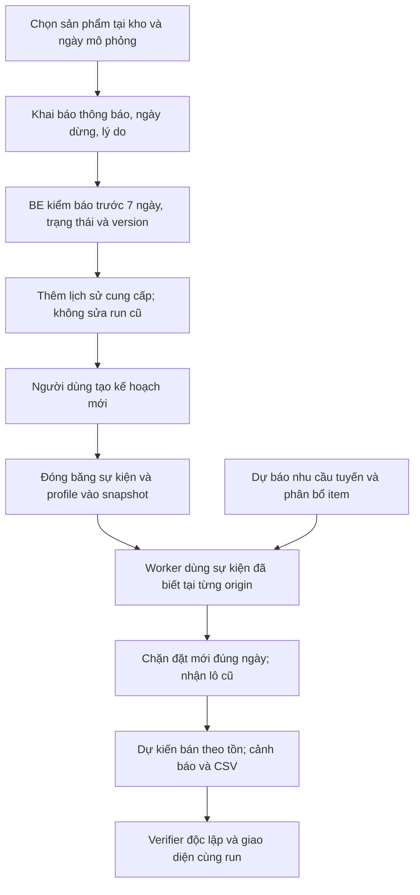

# CHG-084 — Kế hoạch ngừng nhập sản phẩm và bán tồn

## 1. Trạng thái và phạm vi được giao

**Cập nhật bước2, 02/11/2026:** người dùng đã giao triển khai riêng DB/model/nghiệp vụ và push GitHub. Đã thêm migration0007, ItemSupplyChange, resolver/validator thuần; chỉ migrate DBtest, chưa API/freeze/worker/FE hoặc nâng DBứng dụng. Kiểm/publish tại [bàn giao bước2](../development.md#handoff-chg084-step2). Dừng sau bước2; phạm vi bước1 dưới đây là lịch sử.

Ngày 02/11/2026 (Asia/Saigon), người dùng duyệt kế hoạch và giao **riêng bước 1: tài liệu Markdown**. Sau kiểm tra, commit/push thường phần MD CHG-084 lên `final-report`, đối chiếu SHA remote và CI, rồi dừng chờ người dùng duyệt bước 2. Chưa sửa code, tạo migration, nâng DB hoặc chạy model/replay. Bước 2–7 bên dưới là thiết kế, chưa triển khai.

Thay đổi thuộc T01/T10/T11/T12 hiện hữu; bổ sung R06/R08/R09, giữ M05/R05 và trạng thái R07/T14 chưa nghiệm thu. Đây là yêu cầu trực tiếp của người dùng, không phải xác nhận mentor. Nguồn order chưa có nhãn ngừng cung cấp thực tế; mọi thông báo mới là khai báo có nhãn **mô phỏng**, không suy ra EOL từ việc không có sale. Lịch sử ngoài phạm vi EOL trong E05/RV12 vẫn đúng với dữ liệu nguồn và tự động phát hiện.

Nguồn đặc tả kỹ thuật duy nhất: [DB, API, FE, worker và kiểm thử](../../M3/docs/07-product-supply-lifecycle.md). [Yêu cầu](../requirements.md#supply-lifecycle-chg084), [hợp đồng dữ liệu](../data-contract.md#supply-lifecycle-chg084), [PLAN](PLAN.md#chg-084), [TASK](TASK.md#supply-lifecycle-chg084), [bàn giao](../development.md#handoff-chg084).

## 2. Quyết định nghiệp vụ

| Quyết định đã được người dùng chọn | Hành vi dự kiến |
|---|---|
| Phạm vi một sản phẩm tại một kho | Theo `item_id` = kho/tuyến × SKU × loại; không tác động cùng SKU ở kho khác. |
| Báo trước ít nhất 7 ngày | Theo L7 hiện có; không thêm tham số số ngày riêng ở v1. Ngày dừng ≥ ngày thông báo + 7. |
| Ngày dừng là ngày ngừng đặt mới | Trước ngày đó vẫn áp dụng policy; từ đầu ngày UTC hiệu lực, đề xuất và lô mới đều bị chặn. |
| Nhận tiếp lô đã đặt | Giữ lượng/ETA, nhận đúng một lần, kể cả ETA sau ngày dừng. Không tự hủy lô. |
| Bán lượng tồn còn lại | Dự báo nhu cầu tiếp tục làm đầu vào; dự kiến bán bị giới hạn bởi tồn và lô đã biết đang về. |
| Hủy lịch và mở nhập lại | Hủy chỉ trước ngày dừng; đã dừng thì dùng thao tác mở lại, có lịch sử riêng. |
| Ngày trong kế hoạch mô phỏng | Ghi nhận ngày biết thông báo theo UTC mô phỏng, lưu thời điểm tạo thực riêng. Không dùng đồng hồ hiện tại thay origin lịch sử. |
| Bảo toàn kết quả đã lưu | Thay đổi chỉ được đóng băng vào run mới, không cập nhật số liệu/hash/artifact của run cũ. |

Ví dụ khai báo giả: nhận thông báo 01/10/2025 → sớm nhất dừng đặt mới 08/10/2025. Lô đặt 07/10 có ETA 14/10 vẫn được nhận; đề xuất mới ngày 08/10 bằng 0. Mốc 7 ngày không phải ngày cuối được nhận hàng.

Trạng thái cung cấp: **Đang cung cấp → Đã lên lịch ngừng → Đã ngừng nhập**. Khi đang ngừng, tình trạng **Đang bán tồn / Chờ lô đang về / Đã hết hàng** tính riêng trong kế hoạch, không ghi cứng vào item. Hết hàng hôm nay vẫn có thể bán tiếp nếu một lô đã đặt về sau đó.

## 3. Luồng hệ thống dự kiến

Luồng kỹ thuật giữ model nhu cầu và phân bổ hiện có, không refit/xóa lịch sử hoặc chuyển nhu cầu sang SKU khác. Tổng dự kiến bán theo tồn có thể thấp hơn tổng nhu cầu tuyến; không ép hai tổng bằng nhau. Không thêm đặt hàng thật, phê duyệt doanh nghiệp, tích hợp thông báo từ NCC hoặc tự động phát hiện EOL.

## 4. Các bước và cổng hoàn thành

| Bước | Task | Sản phẩm dự kiến | Kiểm/cổng | Trạng thái tại lượt tài liệu |
|---|---|---|---|---|
| 1 — Markdown | T01/T10/T11/T12 | Tài liệu này, đặc tả 07 và đồng bộ MD hiện có | Link/anchor, bảng, Mermaid, quy tắc/ngày/trạng thái; chỉ diff MD; commit/push/SHA/CI rồi dừng | Hoàn tất kiểm local MD; bằng chứng kiểm/publish tại bàn giao |
| 2 — DB và nghiệp vụ | T10/T12 | Migration `0007_supply_lifecycle`, bảng lịch sử, resolver trạng thái | Biên 6/7 ngày, lịch sử, constraint, migration DB test và downgrade không mất dữ liệu | Đã triển khai DB/model/hàm thuần; kiểm và publish tại bàn giao bước2 |
| 3 — API và snapshot | T10/T12 | API thao tác/lịch sử, lọc sản phẩm, expected_version, freeze | 404/409/422, ghi đồng thời, snapshot, không leakage/run cũ | Chưa triển khai |
| 4 — Worker và bán tồn | T10/T12 | Chặn đề xuất/lô mới; giữ receipts; projection và verifier | Tính tay, biên ngày dừng, lô về muộn, causality; parity khi không có sự kiện | Chưa triển khai |
| 5 — Read model/CSV | T10/T11/T12 | Tồn/nhập/tổng quan, endpoint và CSV bán tồn | Cùng snapshot, lọc trước phân trang, tổng đầy đủ; không coi ngừng nhập là đủ hàng | Chưa triển khai |
| 6 — FE | T11/T12 | Form/lịch sử/trạng thái/bộ lọc/biểu đồ | Lưu–reload, 409/lỗi, Back/focus/CSV, desktop và 390px | Chưa triển khai |
| 7 — Tích hợp/bàn giao | T10/T11/T12 | Kiểm toàn luồng; sau backup/restore thử mới nâng DB ứng dụng | BE/M2 liên quan, React/build/pip check, API/CSV/browser, verifier và hash | Chưa triển khai |

Không tự nối bước 2 sau khi hoàn tất bước 1. Các bước 2–6 kiểm trên fixture/DB test; chưa đưa thao tác cung cấp vào DB ứng dụng khi worker/read model chưa hỗ trợ đầy đủ. Cổng triển khai DB app thuộc bước 7. Quyền commit/push của lượt này chỉ áp dụng MD bước 1; quyền của các bước sau theo yêu cầu tiếp theo của người dùng.

## 5. Kịch bản nghiệm thu dự kiến

- Báo trước 0 hoặc 6 ngày bị từ chối; đúng 7 ngày được nhận; ranh giới tính theo ngày UTC, không theo timezone trình duyệt.
- Trước ngày hiệu lực vẫn có thể đề xuất nhập; từ ngày hiệu lực Q=0 và không sinh lô mới; lô cũ vẫn về đúng ETA một lần.
- Tồn 10, nhu cầu 4/ngày, không receipts → dự kiến bán `4, 4, 2, 0…`; phần không đáp ứng vẫn được đối soát.
- Tồn 0 còn pending → chờ lô đang về; nhận lô xong có thể bán tiếp. Không có pending mới hiển thị hết hàng trong phạm vi kế hoạch.
- Hủy lịch/mở nhập lại giữ lịch sử; sửa ROP/SS/lượng nhập không mở lại trạng thái cung cấp; cùng SKU ở kho khác không đổi.
- Sự kiện sau origin không ảnh hưởng quyết định trước; lịch đã biết nhưng hiệu lực tương lai áp dụng đúng ngày; run cũ bất biến.
- Không có sự kiện phải giữ phép tính/metric cơ sở; không lọc bớt episode để làm đẹp R07. Chi tiết ca và mã kiểm tại [đặc tả 07](../../M3/docs/07-product-supply-lifecycle.md#test-matrix).

## 6. Bàn giao bước 1

Tài liệu đã mô tả nghiệp vụ, DB/API, luồng FE/worker/model, các bước và ma trận kiểm; chưa có tính năng chạy được. [Biên bản kiểm/publish](../development.md#handoff-chg084) phân biệt kiểm MD thực chạy với kiểm ứng dụng dự kiến. Không dùng số test/run của CHG-083 làm bằng chứng mới cho CHG-084. Dừng chờ người dùng duyệt bước 2.
