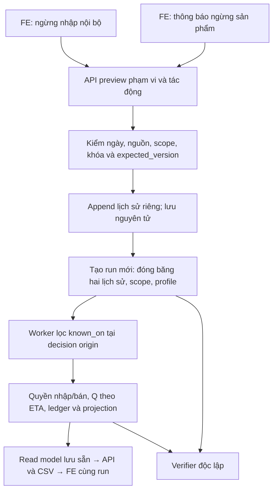

# SIGMA — Vòng đời mua bán SIM/eSIM: CHG-085

## 1. Phạm vi hiện tại và bằng chứng đối chiếu

**Cập nhật giai đoạn3 — 02/11/2026:** đã có API/DTO/preview fingerprint/scope/version, product filters/quyền2nguồn và snapshottrade_v2 trên DBtest;419Python BE/M2/pipcheck đạt. Markertrade_v2 là opt-in kỹ thuật ở staging3; bỏ marker khi có hạn chế mới đã biết bị409, worker/verifier/result guard tới4–5. Người dùng giao xong3thì commit/push thường final-report, gồm code2cònlocal là phụ thuộc; kiểm SHAremote/CI rồi dừng trước4. [Đặc tả thực](../../M3/docs/07-product-supply-lifecycle.md#phase3-implemented), [bàn giao](../development.md#handoff-chg085-phase3). DBapp/bản sao/bước8 cũ giữ nguyên; các điểm dừng2bên dưới là lịch sử.

**Cập nhật giai đoạn2 — 02/11/2026:** người dùng đã giao riêng DB/nghiệp vụ sau commit92243b8. Có migration0008/3bảng provider/2cột ledger nullable và domain/service khóa-version; chỉ kiểm sigma_m3_test, app0007 và các bản sao không nâng/ghi. API/DTO cũ giữnotice7; min0 cùng ngày và quyền hai nguồn hiện chỉ domain, chưa snapshot/worker/FE mới. [Phạm vi thực](../../M3/docs/07-product-supply-lifecycle.md#phase2-implemented), [bàn giao](../development.md#handoff-chg085-phase2). Chưa giao3–8 hoặc commit/push code giai đoạn2. Đoạn giai đoạn1 bên dưới giữ lịch sử.

**02/11/2026, giai đoạn 1 chỉ Markdown, chờ người dùng duyệt thiết kế.** CHG-085 thay thiết kế CHG-084 ở các điểm được nêu dưới đây; chưa thay hành vi ứng dụng. Không sửa code/migration/DB, chạy worker/model hoặc tạo run. Người dùng bổ sung giao hoàn tất kiểm bước1 rồi commit/push thường lên final-report, đối chiếu SHA remote/CI và dừng. Giai đoạn 2–8 chỉ làm khi người dùng giao. Quyền publish lượt này chỉ gồm Markdown bước1 theo yêu cầu bổ sung; không gồm code/DB hoặc giai đoạn2. Rxx/Txx hiện hữu được giữ; R07/T14 chưa nghiệm thu.

**Đã đọc trực tiếp mã nguồn:** migration `0007_supply_lifecycle`, catalog models/schemas/router/supply/supply_service, runs service/supply_verification, inventory service/simulation, reporting supply và FE ProductSupplyForm/Products/SellThrough. CHG-084 hiện có lịch sử theo item, khóa Item + expected_version, stop tối thiểu known_on+7, cancel/resume, profile `notice7_sellthrough_v1`, chặn nhập mới và tiếp tục bán tồn. Chưa có hạn chế bán từ nhà mạng, phạm vi một thông báo nhiều kho hoặc tách tồn bị chặn. Tên “cung cấp” hiện tại không làm các sự kiện cũ trở thành thông báo ngừng bán.

**DB thực tế chưa xác minh được ở phiên tài liệu này:** đã thử kết nối chỉ đọc DBapp và hai DB bản sao từ cấu hình local; cả ba trả OperationalError. Không khởi động dịch vụ để kiểm tiếp. Mã và báo cáo lưu sẵn không chứng minh số hàng DB hiện tại. Bản ghi `outputs/chg084_validation/before.json` ghi app 14 bảng nghiệp vụ/3 run/lịch sử nội bộ rỗng tại lúc chụp; bản sao đã có run và sự kiện mới theo các báo cáo sau đó. Trước giai đoạn 2/7 phải kiểm kê thực tế, không mặc định bảng rỗng.

## 2. Bước 8 CHG-084 đang tạm dừng

Đã đọc các tệp local có sẵn trong `outputs/chg084_validation/`; không chạy lại verifier/API/worker, không sửa bằng chứng:

- `old-runs.json` cùng `history-results.json`: 6 run cũ duy nhất, đủ source/forecast/stock_projection/policy_replay/alert_replay; báo cáo lưu kết quả verifier passed cả 6. Hai bản sao chứa tổng 8 hàng run cũ do chung parent.
- `old-api-results.json`: kết quả đọc/API/CSV theo loại; 4 run tồn thiếu profile có sell-through409 đúng reader cũ. Đây là báo cáo đã lưu, chưa phải kiểm lại trực tiếp ở phiên này.
- `locked-scenario.json`, `new-run.json`, `new-verification.json`: policy_replay mới `b2fb2e42-74e0-40d6-a86e-99bbf6cf9bb0`, origin03/11/2025, kỳ04–24/11, item1/eSIM D10G-10D/kho Sydney; biết01/11, ngừng nhập08/11, lô giả định10 đơn vị ETA10/11. Profile cũ notice7; verifier lưu verified.
- `report.json`, ledger/CSV/JSON và `sell-through.png`: báo cáo lưu 0 lô mới sau dừng, 17 quyết định bị chặn, 22 hàng ledger, CSV14 hàng; actual/fulfilled7, shortage0, tồn cuối4 của item chọn. Đây là ngừng nhập và bán tồn, **không phải bằng chứng nhà mạng ngừng bán**.
- Chưa thấy `preserved.json`, chưa có biên bản browser desktop/390px và kết luận cuối toàn phạm vi. `servers.json` chỉ là PID/port lịch sử, không chứng minh dịch vụ đang chạy. Bước8 chưa hoàn tất; còn đối soát hash/hàng/file cuối, UI, tổng hợp giới hạn và bàn giao. Mọi phần này tạm dừng; không xóa, sửa hoặc chạy lại bằng chứng theo thiết kế mới.

## 3. Quyết định nghiệp vụ thay thế

Phạm vi chỉ mua/nhập, tồn, bán và dự báo/đề xuất/cảnh báo phục vụ chúng. Không hạn kích hoạt, cài eSIM, thuê bao, dung lượng, gia hạn/nạp thêm/tính cước hoặc hậu mãi. “Nhà mạng ngừng gói” chỉ chặn mua/bán mới của sản phẩm trong phạm vi thông báo; không ngắt dịch vụ khách đã mua. Nguồn không có nhãn ngừng thực: khai báo mang nhãn giả định/mô phỏng, lý do và nguồn bắt buộc, URL tùy chọn; doanh số0 không tạo thông báo.

| Nghiệp vụ | Phạm vi và lịch sử | Quy tắc mới đề xuất |
|---|---|---|
| Ngừng nhập nội bộ | Một item = kho × SKU × loại, tận dụng item_supply_changes | stop có effective_on≥known_on, gồm cùng ngày; bỏ bắt buộc báo trước7ngày. L7 vẫn là lead time. Chặn đề xuất/lô mới, vẫn nhận lô cũ và bán tồn được phép bán. |
| Nhà mạng ngừng sản phẩm | Một thông báo với danh sách item/kho rõ ràng, lịch sử riêng | known_on và effective_on có thể trước/bằng/sau nhau. Khi đã biết và hiệu lực thì chặn nhập và bán mới. Một khai báo áp dụng đồng nhất mọi item trong phạm vi đã chọn. |
| Hủy và phục hồi | Thao tác riêng từng nghiệp vụ | Hủy trước hiệu lực; sau hiệu lực phải mở lại nội bộ hoặc ghi nhận nhà mạng cung cấp trở lại tương ứng. Không xóa lịch sử, không sửa policy để vượt hạn chế. |

Quyền nhập = nội bộ cho phép AND không thông báo nhà mạng nào đang chặn. Quyền bán = không thông báo nhà mạng nào đang chặn; ngừng nhập nội bộ không chặn bán. Trạng thái tổng hợp phải kèm từng hạn chế/ID/lý do, không ghi đè thành một trường “đang/ngừng cung cấp”.

| Nội bộ | Nhà mạng | Nhập mới | Bán mới |
|---|---|---|---|
| Ngừng | Vẫn cung cấp | 0 | Được bán tồn |
| Đang mở | Đã ngừng | 0 | 0 dù còn tồn |
| Vừa mở nhập lại | Vẫn ngừng | 0 | 0 |
| Vẫn ngừng nhập | Vừa cung cấp trở lại | 0 | Được bán tồn |

Các quyền là điều kiện cần; Q còn phụ thuộc policy/tồn/ETA, bán còn phụ thuộc tồn. Nếu nhiều thông báo cùng chặn, gỡ một thông báo không gỡ thông báo khác. Không mặc định chặn cả carrier, không chuyển nhu cầu/tồn sang sản phẩm thay thế.

## 4. Tồn, lô cũ và giới hạn nhập trước hạn

Tồn tổng giữ ledger nhập–xuất–tồn. Theo item/ngày: tổng tồn = tồn được phép bán + tồn bị chặn; hạn chế nhà mạng hiện chặn toàn bộ lượng của item, không chặn theo lô. Ngừng bán không làm mất tồn hoặc phát sinh bút toán tổn thất. Lô đã đặt không tự hủy/hoàn tiền; nhận đúng một lần theo ETA, kể cả sau hạn, nhưng vào tồn bị chặn nếu còn hạn chế. Hiện “Cần xử lý với nhà cung cấp”; chưa thiết kế quy trình trả hàng/hoàn tiền. Cung cấp trở lại có thể giải phóng tồn bị chặn khi không còn thông báo khác; không tạo receipt mới.

Trước hạn nhà mạng đã biết tại origin, giữ nguyên trigger closing<ROP, SS theo ngày, ROP cố định, S/IP và lượng mỗi lần hiện có. Thêm cổng sau policy:
1. Tìm ngày chặn bán đầu tiên T trong lịch đã biết, không dựa thông báo tương lai chưa biết. ETA≥T thì Q=0.
2. Nếu ETA<T, tính đường bán nền với tồn hiện có và lô đang về đã biết, không gồm Q mới. Trong đoạn ETA…T−1, cộng lượng dự báo chưa đáp ứng do thiếu hàng, lấy floor thành ngân sách B nguyên không âm.
3. **Đề xuất chọn lô cố định nguyên:** Q=Q_policy chỉ khi Q_policy≤B; nếu 0<B<Q_policy thì Q=0, ghi “Lượng mỗi lần vượt khả năng bán trước hạn”. Không tự chia lô, làm tròn lên hoặc sửa fixed_order_qty. Phần dư ngân sách không đặt thêm; chấp nhận nguy cơ thiếu nhỏ và công bố lý do.
4. Nếu T−1 vượt coverage dự báo đã đóng băng (hiện H14), chưa đủ dữ liệu để duyệt lô trước hạn: Q=0, lý do “Chưa đủ dự báo để kiểm lượng trước ngày ngừng”. Không ngoại suy hoặc dùng actual tương lai. Đây là phương án bảo thủ cần người dùng duyệt, không đổi model.

Ví dụ Q_policy10/ETA10/11/T12/11: B12→Q10, B6→Q0; ETA12/11→Q0. B tính sau khi trừ tác động tồn/lô cũ qua đường nền, tránh cộng nhu cầu rồi trừ tồn hai lần. Không có hạn nhà mạng đã biết thì giữ policy hiện tại; lịch ngừng nhập nội bộ đơn thuần không kích hoạt giới hạn bán. Bán không hết vẫn giữ tồn, không tự ghi tài chính. Chi tiết thời gian, dự báo và metric ở [đặc tả kỹ thuật](../../M3/docs/07-product-supply-lifecycle.md#forecast-and-worker).

## 5. Luồng dự kiến

Model đầu vào vẫn dự báo quantity bán từ lịch sử quan sát; dự kiến bán sau ràng buộc là kết quả khác. Không gọi nó là nhu cầu thị trường đã được đo đầy đủ, không refit toàn bộ model chỉ vì thêm thông báo. Snapshot cũ/profile cũ không đọc cấu hình live hoặc tự bổ sung quyền bán/tồn bị chặn mới.

## 6. Lộ trình CHG-085 và điểm dừng

Đây là lộ trình mới, không reset trạng thái CHG-084. Giai đoạn1đã push;2–3hoàn tất local và được giao publish tích hợp;4–8chưa được giao.

| Giai đoạn | Phạm vi/sản phẩm bàn giao | Kiểm bắt buộc khi được giao | Điểm dừng |
|---|---|---|---|
| 1. Tài liệu và chốt thiết kế | Hai đặc tả chính và bộ MD đồng bộ, kiểm kê mã/bằng chứng/giới hạn DB | Link/anchor, bảng/fence/sơ đồ, thuật ngữ/causal/profile, diff MD | Kiểm MD → commit/push thường → SHA remote/CI → dừng chờ duyệt triển khai |
| 2. DB và nghiệp vụ | Đã có0008/domain hai nguồn/scope/service khóa-version, chỉ DBtest; API cũ chưa mở min0 | Kiểm kê3DB chỉ đọc; constraint/overlap/phạm vi/concurrency, upgrade/rollback có ledger và lịch sử cũ; kết quả tại bàn giao | Không nâng DBapp, chưa commit/push; dừng chờ giao3 |
| 3. API, snapshot, tương thích | Đã có API/preview/version/filter, snapshottrade_v2/rules/scope identity; guard worker/result | Baseline65/targeted83/full419Python, pipcheck;18ca mới về lỗi/stale/race/cutoff/legacy/idempotence | Publish code2–3/SHAremote/CI; worker guard; dừng trước4 |
| 4. Worker, projection, verifier | Quyền nhập/bán, lô cũ/tồn bị chặn, cap Q, replay actual và metric riêng | Tính tay/balance/biên ngày/known late, fixed lot/coverage; verifier không dùng producer | Chỉ DBtest; chờ giao5 |
| 5. Read model và CSV | Cùng kết quả frozen, bộ lọc/tổng/pagination, reason/counter và schema export | API=CSV=stored; tổng toàn scope; legacy không giả0 hoặc nối live | Chờ giao6 |
| 6. FE | Modal nội bộ, trang thông báo riêng, summary/operational UI | Save–reload/409/Back/focus/loading/error, desktop/390px, CTA và profile cũ | Chỉ môi trường kiểm; chờ giao7 |
| 7. Tích hợp và cutover | Suite phù hợp, backup/restore, kế hoạch bật đồng bộ DB/BE/FE/worker và rollback | Hash cũ/metadata, API/CSV/browser, rehearsal dữ liệu không rỗng, profile dispatch | Chỉ cutover khi người dùng giao; không tự chạy8 |
| 8. Run cũ và kịch bản mới trên bản sao | Danh sách run theo profile; kịch bản nội bộ và nhà mạng độc lập, overlap/multiwarehouse/late notice | Hash trước–sau, worker/verifier, frozen API/CSV/UI, actual/metric riêng; không refit/tuning | Bàn giao từng ca/giới hạn rồi dừng; không nâng R07/T14 |

Quyền publish MD bước1 là lịch sử; yêu cầu mới ở3cho phép publish code2–3tích hợp, không gồm4–8. Các giai đoạn sau không tự nối. Tại8 kiểm lại hiện trạng read-only trước; giữ các bản sao/báo cáo CHG-084 nguyên, tạo DB/output riêng cho kịch bản mới khi được giao, không chuyển run cũ sang profile mới.

## 6a. Phương án cutover dự kiến, chỉ khi được giao giai đoạn7

Kiểm kê read-only revision/events/catalog/run/profile và hash trên cùng cột cũ trước; backup đầy đủ rồi restore sang DBtest riêng, nâng0008 và thử dữ liệu lịch sử không rỗng/cùng ngày/multiwarehouse/late notice. Đối chiếu reader/verifier mọi profile, source/forecast/artifact cũ và API/CSV/FE. Không dùng bản sao thử cũ đang tạm dừng làm DB rehearsal ghi tiếp.

Khi được giao cutover: kiểm không còn job đang ghi, tạm ngăn enqueue/thao tác lifecycle trong cửa sổ chuyển đổi; backup lại; nâng DB rồi đưa BE/worker/reader/FE cùng phiên bản hỗ trợ profile mới trước khi mở ghi/enqueue. Client cũ còn form+7 phải reload; server giữ tương thích URI nội bộ nhưng không có đường vượt provider restriction. Không mở riêng API v2 cho worker cũ. Smoke đọc/ghi chỉ synthetic trong rehearsal; không tự tạo thông báo hoặc run nguồn thật trong app để thử. Bằng chứng phải nêu thời điểm bật, version và phạm vi; đây chưa phải tuyên bố đã dừng/bật live.

Rollback trước mở ghi có thể dùng backup đã restore thử; sau có notice/stop cùng ngày/run v2 thì không downgrade làm mất lịch sử. Ưu tiên giữ DB và reader tương thích, tạm ngăn thao tác mới, sửa lỗi rồi chạy tiếp khi được giao; nếu cần phục hồi phải có kế hoạch giữ/reconcile dữ liệu phát sinh. Không xóa sự kiện hoặc run để qua cổng rollback. [Ràng buộc migration](../../M3/docs/07-product-supply-lifecycle.md#database).

## 7. Cổng duyệt và ca bắt buộc

[Ma trận kỹ thuật](../../M3/docs/07-product-supply-lifecycle.md#test-matrix) bao phủ: ngừng nhập cùng ngày/lịch/hủy/mở lại; ngừng bán còn tồn/lô cũ về; ETA chạm hạn; phạm vi nhiều kho; hai hạn chế và overlap; hiệu lực ngay/biết muộn; nhân quả từng origin; run cũ/hash; API/CSV/FE frozen; actual nguồn nguyên; blocked stock không mất khỏi ledger; R07/T14 giữ mở.

Cần duyệt các lựa chọn thiết kế: nguyên lô cố định và Q0 khi thiếu coverage đến hạn; thông báo có phạm vi item tường minh, không tự thêm item tương lai; cung cấp trở lại có hiệu lực từ known_on hoặc tương lai, không hồi tố quyền bán; ledger replay tách lượng bị chặn khỏi thiếu hàng và công bố mẫu số riêng. Các quy tắc bắt buộc của người dùng đã được đưa vào thiết kế; đây là các chi tiết triển khai được đề xuất, chưa phải đã được duyệt.

## 8. Bàn giao và tra cứu lịch sử

[Bàn giao CHG-085](../development.md#handoff-chg085), [đặc tả DB/API/worker/FE](../../M3/docs/07-product-supply-lifecycle.md), [FE chi tiết](../../M3/docs/04-frontend-spec.md#lifecycle-chg085). Lịch sử CHG-084/bằng chứng từng bước giữ tại [development](../development.md#handoff-chg084) và [PLAN](PLAN.md#chg-084). Quy tắc notice7 cũ chỉ phục vụ reader/profile lịch sử và mô tả triển khai hiện tại; không còn là yêu cầu mục tiêu cho thao tác ngừng nhập mới.
