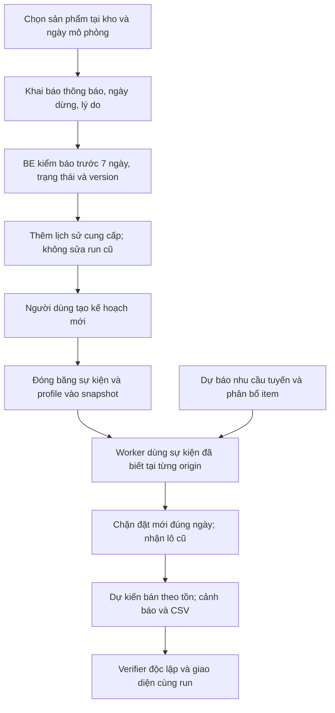

# CHG-084 — Kế hoạch ngừng nhập sản phẩm và bán tồn

## 1. Trạng thái và phạm vi được giao

**Cập nhật bước7, 02/11/2026:** kiểm tích hợp và cutover đã hoàn tất local:368Python BE/M2,74React/build/pipcheck, API/CSV920 và browser1440/390px. Backup đã restore thử; app nâng0007,13bảng cũ/3run/1.052file nguyên hash, bảng cung cấp mới rỗng. [Bàn giao](../development.md#handoff-chg084-step7). Hiện7/8bước hoàn tất; commit/push/SHA/CI rồi dừng trước bước8. Chưa chạy kịch bản nguồn thật hoặc thao tác stop live; các trạng thái chưa nâng DB ở checkpoint trước là lịch sử.

**Bổ sung bước8, 02/11/2026 — chỉ kế hoạch:** theo yêu cầu người dùng, sau bước7 sẽ kiểm các run cũ và chạy thử một run mới có một item ngừng nhập giữa kỳ. [Protocol bước8](#step8-run-validation). Bước1–6 đã hoàn tất; bước7 và bước8 chưa thực hiện. Lượt này chỉ sửa Markdown, chưa chạy run hoặc nâng DB; các lộ trình7bước phía dưới là mốc trước bổ sung.

**Cập nhật bước6, 02/11/2026:** FE cung cấp/bán tồn đã triển khai và kiểm trên DBtest:73React/build, browser desktop1440 và390px, lưu/reload/Back/focus/CSV. [Bàn giao bước6](../development.md#handoff-chg084-step6). Không nâng DBapp, không tự làm bước7; tiếp tục cổng commit/push/SHA/CI rồi dừng. Các điểm dừng trước bên dưới là lịch sử.

**Cập nhật bước5, 02/11/2026:** read model/CSV bán tồn và metadata cung cấp đã triển khai, chỉ kiểm DBtest; không nâng DBapp hoặc làm FE. [Bàn giao bước5](../development.md#handoff-chg084-step5). Dừng sau bước5; các điểm dừng trước là lịch sử.

**Cập nhật bước4, 02/11/2026:** đã nối timeline frozen vào worker/simulation, Q/lô, projection bán tồn và verifier độc lập. Chỉ DBtest, chưa nâng DBapp; read model/CSV/FE thuộc bước5–7. [Bàn giao bước4](../development.md#handoff-chg084-step4). Dừng sau bước4, các đoạn điểm dừng trước là lịch sử.

**Cập nhật bước3, 02/11/2026:** người dùng giao API/lịch sử/version/filter/snapshot rồi push GitHub. Phần này đã triển khai, chỉ kiểm trên DBtest; chưa nâng DBapp. Guard worker chặn run có sự kiện cho tới bước4. [Bàn giao bước3](../development.md#handoff-chg084-step3); dừng sau bước3, các điểm dừng trước bên dưới là lịch sử.

**Cập nhật bước2, 02/11/2026:** người dùng đã giao triển khai riêng DB/model/nghiệp vụ và push GitHub. Đã thêm migration0007, ItemSupplyChange, resolver/validator thuần; chỉ migrate DBtest, chưa API/freeze/worker/FE hoặc nâng DBứng dụng. Kiểm/publish tại [bàn giao bước2](../development.md#handoff-chg084-step2). Dừng sau bước2; phạm vi bước1 dưới đây là lịch sử.

Ngày 02/11/2026 (Asia/Saigon), người dùng duyệt kế hoạch và giao **riêng bước 1: tài liệu Markdown**. Sau kiểm tra, commit/push thường phần MD CHG-084 lên `final-report`, đối chiếu SHA remote và CI, rồi dừng chờ người dùng duyệt bước 2. Chưa sửa code, tạo migration, nâng DB hoặc chạy model/replay. Bước 2–7 bên dưới là thiết kế, chưa triển khai.

Thay đổi thuộc T01/T10/T11/T12 hiện hữu; bổ sung R06/R08/R09, giữ M05/R05 và trạng thái R07/T14 chưa nghiệm thu. Đây là yêu cầu trực tiếp của người dùng, không phải xác nhận mentor. Nguồn order chưa có nhãn ngừng cung cấp thực tế; mọi thông báo mới là khai báo có nhãn **mô phỏng**, không suy ra EOL từ việc không có sale. Lịch sử ngoài phạm vi EOL trong E05/RV12 vẫn đúng với dữ liệu nguồn và tự động phát hiện.

Nguồn đặc tả kỹ thuật duy nhất: [DB, API, FE, worker và kiểm thử](../../M3/docs/07-product-supply-lifecycle.md). [Yêu cầu](../requirements.md#supply-lifecycle-chg084), [hợp đồng dữ liệu](../data-contract.md#supply-lifecycle-chg084), [PLAN](PLAN.md#chg-084), [TASK](TASK.md#supply-lifecycle-chg084), [bàn giao](../development.md#handoff-chg084).

## 2. Quyết định nghiệp vụ

| Quyết định đã được người dùng chọn | Hành vi dự kiến |
|---|---|
| Phạm vi một sản phẩm tại một kho | Theo `item_id` = kho/tuyến × SKU × loại; không tác động cùng SKU ở kho khác. |
| Báo trước ít nhất 7 ngày | Theo L7 hiện có; không thêm tham số số ngày riêng ở v1. Ngày dừng ≥ ngày thông báo + 7. |
| Ngày dừng là ngày ngừng đặt mới | Trước ngày đó vẫn áp dụng policy; từ đầu ngày UTC hiệu lực, đề xuất và lô mới đều bị chặn. |
| Nhận tiếp lô đã đặt | Giữ lượng/ETA, nhận đúng một lần, kể cả ETA sau ngày dừng. Không tự hủy lô. |
| Bán lượng tồn còn lại | Dự báo nhu cầu tiếp tục làm đầu vào; dự kiến bán bị giới hạn bởi tồn và lô đã biết đang về. |
| Hủy lịch và mở nhập lại | Hủy chỉ trước ngày dừng; đã dừng thì dùng thao tác mở lại, có lịch sử riêng. |
| Ngày trong kế hoạch mô phỏng | Ghi nhận ngày biết thông báo theo UTC mô phỏng, lưu thời điểm tạo thực riêng. Không dùng đồng hồ hiện tại thay origin lịch sử. |
| Bảo toàn kết quả đã lưu | Thay đổi chỉ được đóng băng vào run mới, không cập nhật số liệu/hash/artifact của run cũ. |

Ví dụ khai báo giả: nhận thông báo 01/10/2025 → sớm nhất dừng đặt mới 08/10/2025. Lô đặt 07/10 có ETA 14/10 vẫn được nhận; đề xuất mới ngày 08/10 bằng 0. Mốc 7 ngày không phải ngày cuối được nhận hàng.

Trạng thái cung cấp: **Đang cung cấp → Đã lên lịch ngừng → Đã ngừng nhập**. Khi đang ngừng, tình trạng **Đang bán tồn / Chờ lô đang về / Đã hết hàng** tính riêng trong kế hoạch, không ghi cứng vào item. Hết hàng hôm nay vẫn có thể bán tiếp nếu một lô đã đặt về sau đó.

## 3. Luồng hệ thống dự kiến

Luồng kỹ thuật giữ model nhu cầu và phân bổ hiện có, không refit/xóa lịch sử hoặc chuyển nhu cầu sang SKU khác. Tổng dự kiến bán theo tồn có thể thấp hơn tổng nhu cầu tuyến; không ép hai tổng bằng nhau. Không thêm đặt hàng thật, phê duyệt doanh nghiệp, tích hợp thông báo từ NCC hoặc tự động phát hiện EOL.

## 4. Các bước và cổng hoàn thành

| Bước | Task | Sản phẩm dự kiến | Kiểm/cổng | Trạng thái tại lượt tài liệu |
|---|---|---|---|---|
| 1 — Markdown | T01/T10/T11/T12 | Tài liệu này, đặc tả 07 và đồng bộ MD hiện có | Link/anchor, bảng, Mermaid, quy tắc/ngày/trạng thái; chỉ diff MD; commit/push/SHA/CI rồi dừng | Hoàn tất kiểm local MD; bằng chứng kiểm/publish tại bàn giao |
| 2 — DB và nghiệp vụ | T10/T12 | Migration `0007_supply_lifecycle`, bảng lịch sử, resolver trạng thái | Biên 6/7 ngày, lịch sử, constraint, migration DB test và downgrade không mất dữ liệu | Đã triển khai DB/model/hàm thuần; kiểm và publish tại bàn giao bước2 |
| 3 — API và snapshot | T10/T12 | API thao tác/lịch sử, lọc sản phẩm, expected_version, freeze | 404/409/422, ghi đồng thời, snapshot, không leakage/run cũ | Đã triển khai; kiểm/publish tại bàn giao bước3 |
| 4 — Worker và bán tồn | T10/T12 | Chặn đề xuất/lô mới; giữ receipts; projection và verifier | Tính tay, biên ngày dừng, lô về muộn, causality; parity khi không có sự kiện | Đã triển khai; kiểm/publish tại bàn giao bước4 |
| 5 — Read model/CSV | T10/T11/T12 | Tồn/nhập/tổng quan, endpoint và CSV bán tồn | Cùng snapshot, lọc trước phân trang, tổng đầy đủ; không coi ngừng nhập là đủ hàng | Đã triển khai; kiểm/publish tại bàn giao bước5 |
| 6 — FE | T11/T12 | Form/lịch sử/trạng thái/bộ lọc/biểu đồ | Lưu–reload, 409/lỗi, Back/focus/CSV, desktop và 390px | Đã triển khai; kiểm/publish tại bàn giao bước6, chỉ DBtest |
| 7 — Tích hợp/bàn giao | T10/T11/T12 | Kiểm toàn luồng; sau backup/restore thử mới nâng DB ứng dụng | BE/M2 liên quan, React/build/pip check, API/CSV/browser, verifier và hash | Hoàn tất local; DBapp0007, kiểm/publish tại bàn giao bước7 |
| 8 — Run cũ và kịch bản một item ngừng nhập | T10/T11/T12 | Báo cáo kiểm run cũ; một policy_replay mới có lịch dừng giữa kỳ, kết quả/CSV và bằng chứng local | Bảo toàn run cũ, biên ngày dừng, lô cũ/ETA, bán tồn, nhân quả, verifier độc lập; protocol bên dưới | Mới bổ sung kế hoạch, chưa thực hiện |

Không tự nối bước 2 sau khi hoàn tất bước 1. Các bước 2–6 kiểm trên fixture/DB test; chưa đưa thao tác cung cấp vào DB ứng dụng khi worker/read model chưa hỗ trợ đầy đủ. Cổng triển khai DB app thuộc bước 7. Quyền commit/push của lượt này chỉ áp dụng MD bước 1; quyền của các bước sau theo yêu cầu tiếp theo của người dùng.

## 4a. Bước 8 — Kiểm run cũ và một run mới có giả định ngừng nhập

**Phụ thuộc:** bước7 hoàn tất cổng kiểm/cutover và người dùng giao thực hiện bước8. Lượt bổ sung này chỉ mô tả kế hoạch; không tự chạy bước7/8. Còn hai bước7–8 trong phạm vi CHG-084 mở rộng, không đổi R07/T14.

1. **Chốt phạm vi và bảo toàn.** Liệt kê run ứng dụng đang giữ và run đã lưu trữ còn truy cập được, gồm nguồn/forecast parent và các run tồn/nhập/cảnh báo. Ghi ID/kind/profile/schema/version/origin/phạm vi ngày, snapshot/config hash và artifact SHA256 trước kiểm. Run thiếu file hoặc không còn truy cập phải ghi rõ, không nhận đã kiểm tất cả lịch sử. Thao tác trên nguồn thật giữ local; tạo bản sao DB riêng từ backup đã restore thử và giữ artifact cũ chỉ đọc. Không khai báo giả định vào cấu hình live của DB ứng dụng trong bài thử này.
2. **Kiểm các run cũ theo hợp đồng đã đóng băng.** Dùng reader/verifier tương ứng profile lịch sử, đối soát tồn/nhập/cảnh báo và API/CSV/UI trong phạm vi từng loại. Không enqueue lại vào cùng ID, cập nhật snapshot/hash/JSON hoặc sửa artifact để khớp mã mới. Legacy thiếu profile bán tồn phải trả409 và UI yêu cầu tạo kế hoạch mới; không diễn giải lại từ lifecycle live. Nếu muốn tái chạy phải tạo runID khác và ghi là phép thử mới. Cuối kiểm so lại hàng/hash/artifact cũ, phân biệt metadata trình bày mới với kết quả đã lưu.
3. **Khóa một kịch bản mới trước khi chạy.** Chọn một item có tồn hoặc lô về, xác định rõ kho/SKU/loại, dùng source/forecast parent hiện có tương thích và không refit. Ưu tiên policy_replay có nhiều ngày quyết định để quan sát trước/sau dừng và việc tạo lô. Khóa cấu hình/seed/tồn đầu/pending/cửa sổ và lý do có nhãn giả định; ngày thông báo biết trước ngày dừng ít nhất7ngày, ngày dừng nằm trong kỳ. Chỉ thêm stop cho đúng một item trong DB bản sao qua API cung cấp, freeze notice7_sellthrough_v1 vào run mới. Không xóa sản phẩm, hủy lô cũ hoặc gán actual tương lai bằng0.
4. **Chạy worker và kiểm độc lập.** Trước hiệu lực vẫn theo policy (không bắt buộc Q>0 nếu chưa đủ điều kiện); từ ngày hiệu lực Q=0 và không phát sinh lô mới cho item. Lô đặt trước dừng vẫn nhận đủ một lần đúng ETA; projection bán=min(nhu cầu, tồn+lô đã biết), tồn không âm, unserved giữ đủ. Lô về sau khi cạn cho phép bán tiếp. Không có ngày cạn trong H14 thì ghi chưa xác định trong phạm vi, không ngoại suy. Chọn item khác/cùng SKU ở kho khác nếu có để đối chứng phạm vi; nhu cầu/share không bị chuyển sang mặt hàng khác. Kiểm cutoff cuốn theo ngày của policy, lịch frozen và verifier độc lập.
5. **Đối soát và bàn giao.** So API/CSV/UI cùng run/origin/kho/item, lập bảng trước dừng/ngày dừng/lô về/ngày cạn hoặc hết horizon. Có biểu đồ nhu cầu–dự kiến bán–tồn, lịch lô cũ và kết quả verifier. Chỉ dùng run cũ làm đối chứng định lượng khi source/forecast/config/profile/kỳ đánh giá tương thích; khác cấu hình thì công bố khác biệt, không quy mọi chênh lệch cho ngừng nhập. Bàn giao một run mới được ghi rõ giả định, không tự thêm lượt tuning/đối chứng mới hoặc sửa run cũ. Báo cáo còn có kết quả kiểm từng run cũ, hash trước–sau và giới hạn; raw/DB/run/artifact thật không push GitHub.

**Ví dụ thời gian dự kiến, chưa phải run đã chạy:** kỳ03–21/10/2025, thông báo01/10, ngừng nhập08/10. Có thể khai báo trước khi chạy một lô pending giả định đặt03/10, ETA10/10, đã biết tại origin03/10; lô đó vẫn nhận sau ngày dừng. Nếu policy còn cho đặt lô07/10 thì lô đó vẫn nhận14/10. Khi thực hiện sẽ chọn kỳ có dữ liệu/forecast hợp lệ, lượng/tồn và provenance rõ; pending đầu kỳ phải có ngày đặt không sau origin, không đưa đơn đặt tương lai vào tập đã biết. Không chỉnh policy sau khi thấy kết quả để ép có đơn đặt hoặc làm đẹp metric. Nguồn chưa có nhãn ngừng cung cấp thật; “hủy mặt hàng” trong bài thử được hiểu là **ngừng nhập và tiếp tục bán tồn**, không xóa SKU.

**Điều kiện xong bước8:** các run trong danh sách kiểm đều có kết quả đạt/chưa đạt/không thể kiểm có lý do; run mới complete và independently verified; các biên nghiệp vụ, API/CSV/UI và bảo toàn cũ có bằng chứng. Một kịch bản không thay nghiệm thu toàn bài, không dùng để nâng R07/T14 hoặc suy ra hiệu quả vận hành thật. [Chi tiết kiểm kỹ thuật](../../M3/docs/07-product-supply-lifecycle.md#step8-run-validation).

## 5. Kịch bản nghiệm thu dự kiến

- Báo trước 0 hoặc 6 ngày bị từ chối; đúng 7 ngày được nhận; ranh giới tính theo ngày UTC, không theo timezone trình duyệt.
- Trước ngày hiệu lực vẫn có thể đề xuất nhập; từ ngày hiệu lực Q=0 và không sinh lô mới; lô cũ vẫn về đúng ETA một lần.
- Tồn 10, nhu cầu 4/ngày, không receipts → dự kiến bán `4, 4, 2, 0…`; phần không đáp ứng vẫn được đối soát.
- Tồn 0 còn pending → chờ lô đang về; nhận lô xong có thể bán tiếp. Không có pending mới hiển thị hết hàng trong phạm vi kế hoạch.
- Hủy lịch/mở nhập lại giữ lịch sử; sửa ROP/SS/lượng nhập không mở lại trạng thái cung cấp; cùng SKU ở kho khác không đổi.
- Sự kiện sau origin không ảnh hưởng quyết định trước; lịch đã biết nhưng hiệu lực tương lai áp dụng đúng ngày; run cũ bất biến.
- Không có sự kiện phải giữ phép tính/metric cơ sở; không lọc bớt episode để làm đẹp R07. Chi tiết ca và mã kiểm tại [đặc tả 07](../../M3/docs/07-product-supply-lifecycle.md#test-matrix).

## 6. Bàn giao bước 1

Tài liệu đã mô tả nghiệp vụ, DB/API, luồng FE/worker/model, các bước và ma trận kiểm; chưa có tính năng chạy được. [Biên bản kiểm/publish](../development.md#handoff-chg084) phân biệt kiểm MD thực chạy với kiểm ứng dụng dự kiến. Không dùng số test/run của CHG-083 làm bằng chứng mới cho CHG-084. Dừng chờ người dùng duyệt bước 2.
